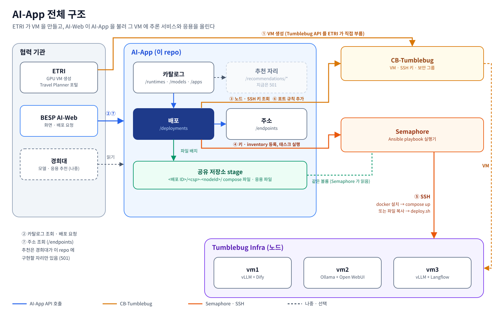

<p align="left"><a href="README.md">English</a> | <b>한국어</b></p>

# AI-App

**CB-Tumblebug 이 이미 띄운 멀티클라우드 VM 에 AI 모델과 AI 응용을 배포하고, 어디서 서비스되는지 알려 주는 서비스입니다.**

AI-App 은 AI-MCMP 과제(Cloud-Barista)의 Go 서비스입니다. AI 모델과 AI 응용의 카탈로그를 두고, Semaphore 를 통해 SSH 로
CB-Tumblebug 노드에 설치하고, 서빙 포트를 열고, 그 주소를 알려 줍니다. 그 위의 자동화 엔진은 배포·복구·제어·상태 확인
워크플로를 같은 API 로 정해진 순서대로 돌립니다. LLM 을 쓰지 않습니다.

> 상태: **프로토타입.** API 는 협력 기관과 공유하고 있고 AWS·Azure·GCP 의 실제 GPU VM 에서 돌려 봤지만,
> 운영 수준으로 다듬어지지는 않았습니다 ([제약](#제약) 참고).

- [하는 일](#하는-일)
- [구조](#구조)
- [빠른 시작](#빠른-시작)
- [CB-Tumblebug 과 함께 쓰기](#cb-tumblebug-과-함께-쓰기)
- [협력 기관은 어떻게 쓰나](#협력-기관은-어떻게-쓰나)
- [API](#api)
- [문서](#문서)
- [지금 되는 것](#지금-되는-것)
- [제약](#제약)
- [앞으로 할 것](#앞으로-할-것)
- [설정](#설정)
- [개발](#개발)
- [라이선스](#라이선스)

## 하는 일

| 하려는 것 | AI-App 이 주는 것 |
|---|---|
| 무엇을 배포할 수 있는지 알기 | **모델 카탈로그**(모델, 출처·형식별 아티팩트, 호환 런타임). Hugging Face, Ollama 에서 매일 수집하고(Docker Model Runner, NGC, Kaggle 은 켜면 수집), 직접 등록도 됨 |
| 모델 서빙 | `POST /aiapp/deployments` 에 `type: inference`. 노드 하나에 런타임(`vllm` 또는 `ollama`)이 모델 아티팩트 하나를 띄우고 OpenAI 호환 API 를 엶 |
| AI 응용 실행 | 파일과 `deploy.sh` 를 한 번 올리고(`POST /aiapp/apps`, 버전 관리) `type: app` 으로 배포. Open WebUI, Langflow, Dify 예시가 들어 있음 |
| 어디서 서비스되는지 알기 | `GET /aiapp/endpoints` 가 지금 떠 있는 추론 서비스·응용의 주소를 돌려줌 |
| 배포 진행 보기 | `GET /aiapp/deployments/{id}/progress`(`done` 이 될 때까지 폴링), 노드별 로그, Semaphore 태스크 화면 링크 |
| 내리기 | `DELETE /aiapp/deployments/{id}` 가 노드에서 `docker compose down` 을 함 (named volume 의 모델 가중치는 남김) |
| VM 제어 | 배포의 노드를 CB-Tumblebug 으로 정지·재개·재부팅·종료 |
| 자동화 | 자동화 엔진이 `deploy`, `heal`(실패하면 한 번 다시 배포), `control`, `status` 워크플로를 REST 나 MCP 도구로 돌림 |
| 감사 | 배포·내리기·노드 제어·엔진 실행이 전부 JSON Lines 기록으로 남음 |

AI-App 이 **하지 않는** 것:

- **VM 을 만들지 않습니다.** Infra 는 CB-Tumblebug 으로(직접 또는 인프라 추천을 거쳐) 만들고, AI-App 에는 `nsId` / `infraId` / `nodeId` 를 넘깁니다.
- 모델·인프라 추천을 하지 않습니다. 추천 경로는 협력 기관 구현을 끼울 자리만 있고 지금은 `501` 을 돌려줍니다.
- 모델 호출을 중계하지 않습니다. 클라이언트는 노드를 직접 부르고(`http://<노드>:8000/v1`), AI-App 은 그 주소와 vLLM 의 API 키만 알려 줍니다.

## 구조



| 프로세스 | 포트 | 맡는 것 |
|---|---|---|
| `ai-app-server` (`cmd/ai-app-server`) | `8090` | API, 도구 13개의 MCP 서버(`/aiapp/mcp`), 운영자 콘솔(`/aiapp/ui`), Swagger(`/aiapp/api/index.html`) |
| `ai-automation-engine` (`cmd/ai-automation-engine`) | `8091` | AI-App 도구를 MCP 로 부르는 정해진 워크플로. 자기 MCP 서버(`/aiapp/engine/mcp`)로 도구 5개를 엶. AI-App 이 `/aiapp/engine/*` 을 넘겨 주므로 클라이언트는 `8090` 만 알면 됨 |
| Semaphore UI `v2.12.17` (외부, 선택) | `3001` | [`deploy/ansible`](deploy/ansible) 의 Ansible playbook 을 노드에 돌림. 실제 배포에만 필요 |
| `mock-partner-recommender`, `mock-partner-nl-agent` (`mock/partner/`) | `8092`, `8093` | 협력 기관 담당 영역(인프라 추천, 자연어 에이전트)의 **모의 구현**. 연동 계약을 시험하려고 둔 것이고 AI-App 에 들지 않음 |

**기본이 안전한 쪽입니다.** `AIAPP_TUMBLEBUG_DRY_RUN=true` 가 기본값입니다. 이때 배포는 노드를 읽고 파일을 배치하는 데서 멈추고
Semaphore 에 아무것도 보내지 않으며, 노드 제어는 막힙니다. 이 게이트는 요청 파라미터가 아니라 서비스 설정이라
엔진·MCP 클라이언트·LLM 에이전트 어느 쪽도 건너뛸 수 없습니다.

## 빠른 시작

### 1. 설정 없이 로컬에서 띄우기 (클라우드 불필요)

Go 1.26 이상이 필요합니다.

```sh
git clone https://github.com/cloud-barista/ai-app.git
cd ai-app
make run-app        # AI-App, :8090
make run-engine     # 자동화 엔진, :8091 (다른 터미널, 선택)
```

모든 설정에 기본값이 있어 env 파일이 필요 없습니다. 클라우드에 닿지 않는 기능은 전부 동작합니다.

```sh
curl localhost:8090/aiapp/readyz                    # {"message":"Service is ready"}
curl localhost:8090/aiapp/runtimes                  # ollama, vllm
curl localhost:8090/aiapp/models                    # 기본 모델 3개 + 수집한 모델
curl localhost:8090/aiapp/models/qwen3-vl-8b/artifacts/ollama-gguf/compose   # 노드에 갈 compose 파일
curl -F name=open-webui -F script=@examples/apps/open-webui/deploy.sh \
     -F files=@examples/apps/open-webui/docker-compose.yml -F ports=3000 \
     localhost:8090/aiapp/apps                      # 응용 업로드 (다시 올리면 version 2)
curl localhost:8090/aiapp/engine/card               # 엔진 (:8090 을 거쳐 넘어감)
```

- 운영자 콘솔: <http://localhost:8090/aiapp/ui>
- Swagger UI: <http://localhost:8090/aiapp/api/index.html>

CB-Tumblebug 에 닿지 않으면 배포 요청은 `502`(`CB-Tumblebug could not be read`)를 돌려줍니다. 정상입니다.

### 2. Docker 로 띄우기

```sh
make docker-up      # docker compose up -d --build: AI-App, 엔진, 모의 둘
make docker-logs
make docker-down
```

카탈로그, 업로드한 응용, 배포 기록, 아카이브는 named volume 에 있어 컨테이너를 다시 만들어도 남습니다.
compose 에 CB-Tumblebug 은 **들어 있지 않습니다.** 컨테이너는 `http://host.docker.internal:1323/tumblebug` 에서 찾습니다.

### 3. 실제 노드에 배포하기

1. CB-Tumblebug 을 띄우고, [노드 요건](#노드-요건)을 갖춘 노드로 Infra 를 만들어 둡니다.
2. AI-App 을 Semaphore 와 같이 띄웁니다.

   ```sh
   cp .env.example .env
   # .env 에 적어도 아래를 넣는다
   #   AIAPP_TUMBLEBUG_BASE_URL=http://<tumblebug 호스트>:1323/tumblebug
   #   AIAPP_TUMBLEBUG_USERNAME=... / AIAPP_TUMBLEBUG_PASSWORD=...
   #   AIAPP_SEMAPHORE_PASSWORD=<같이 뜨는 Semaphore 관리자 비밀번호, 아무 값>
   #   AIAPP_TUMBLEBUG_DRY_RUN=false        # 이러면 배포가 실제 노드를 바꿈
   #   AIAPP_AUTH_TOKEN=<토큰>              # 다른 사람이 포트에 닿을 수 있으면 권장
   docker compose --profile deploy up -d
   curl localhost:8090/aiapp/status         # Semaphore, CB-Tumblebug, stage 폴더, dry-run
   ```

3. [`docs/api/examples`](docs/api/examples) 의 예제 스크립트로 배포합니다 (`curl`, `jq` 필요).

   ```sh
   export AIAPP_URL=http://localhost:8090/aiapp AIAPP_AUTH_TOKEN=<토큰>
   cd docs/api/examples
   ./03-deploy-inference.sh <nsId> <infraId> <nodeId> qwen3-vl-8b ollama-gguf     # Ollama + Qwen3-VL-8B, 끝날 때까지 기다림
   ./02-upload-app.sh ../../../examples/apps/open-webui                          # Open WebUI 업로드
   ./04-deploy-app.sh <nsId> <infraId> <nodeId> open-webui OLLAMA_BASE_URL=http://<노드 IP>:11434
   ./05-endpoints.sh                                                             # 지금 떠 있는 주소
   ./07-remove.sh <deploymentId>                                                 # 내리기
   ```

   API 를 직접 불러도 됩니다.

   ```sh
   curl -X POST localhost:8090/aiapp/deployments -H "Authorization: Bearer $AIAPP_AUTH_TOKEN" \
        -H 'Content-Type: application/json' -d '{
          "type": "inference",
          "targets": [{"kind": "node", "nsId": "<nsId>", "infraId": "<infraId>", "nodeId": "<nodeId>"}],
          "inference": {"modelId": "qwen3-vl-8b", "artifactId": "ollama-gguf"}
        }'
   # 202 + {"id": "...", "status": "pending", ...}. 그 뒤 GET /aiapp/deployments/{id}/progress 를 폴링
   ```

Docker 없이도 띄울 수 있습니다(`cp conf/template-setup.env conf/setup.env` 후 `make run-app`). 이때는 Semaphore 가
`deploy/ansible` 과 AI-App 과 같은 stage 폴더(`AIAPP_STAGE_ROOT`)를 같은 절대경로로 봐야 합니다. compose 의 `deploy` 프로필이 이것을 맞춰 줍니다.

## CB-Tumblebug 과 함께 쓰기

AI-App 은 CB-Tumblebug 을 부르는 쪽입니다. **CB-Tumblebug 0.13.8**(cb-spider 0.13.20)으로 시험했습니다.

```
 사용자 / 인프라 추천 ──▶ CB-Tumblebug: Infra 생성 (GPU VM)             ← AI-App 이 하지 않음
                                    │ nsId / infraId / nodeId
                                    ▼
 사용자 / AI-Web / 엔진 ─▶ AI-App: POST /aiapp/deployments
                                    1. CB-Tumblebug 에서 노드, SSH 키, 스펙을 읽음
                                    2. compose 파일이나 응용 파일을 stage 에 둠
                                    3. Semaphore 가 SSH 로 (GPU 노드면 install-gpu-driver,) install-docker, 이어서 compose-up 또는 copy-and-run
                                    4. CB-Tumblebug 에서 노드 보안 그룹에 서빙 포트를 엶
                                    ▼
 클라이언트 ────────────▶ http://<노드 IP>:<포트>   (GET /aiapp/endpoints 에서 받음)
```

AI-App 이 CB-Tumblebug 에서 부르는 것:

| 목적 | 언제 |
|---|---|
| 노드(IP, `securityGroupIds`, `specId`, 이미지 OS, SSH 사용자)와 개인키 조회 | 배포·내리기마다 |
| `system` 네임스페이스(`AIAPP_TUMBLEBUG_SPEC_NAMESPACE`)의 노드 스펙에서 `acceleratorType` 조회 | GPU 여부 판단. 요청에 `inference.gpu` 가 있으면 안 봄 |
| 노드 보안 그룹에 TCP 인바운드 규칙(`0.0.0.0/0`) 추가 | 배포가 성공한 뒤, 아직 안 열린 포트만 |
| 노드 제어 (정지, 재개, 재부팅, 종료) | `POST /aiapp/deployments/{id}/control` |

설정은 `AIAPP_TUMBLEBUG_BASE_URL`, `AIAPP_TUMBLEBUG_USERNAME` / `_PASSWORD`, 필요하면 `AIAPP_TUMBLEBUG_CREDENTIAL_HOLDER` 입니다.
기동 로그가 base URL 과 그 값이 환경변수에서 왔는지 기본값인지를 찍습니다.

### 노드 요건

| 요건 | 내용 |
|---|---|
| CB-Tumblebug 이 만든 노드 | AI-App 은 노드를 `nsId` / `infraId` / `nodeId` 로 가리키고 CB-Tumblebug 이 가진 SSH 키를 씀 |
| 리눅스 배포판 | Ubuntu, Debian, RHEL, Rocky, AlmaLinux, CentOS Stream, Oracle Linux, Fedora, Amazon Linux 2023. docker 와 compose 플러그인이 없으면 깖 |
| GPU | 모델 실행은 NVIDIA 만. **드라이버가 550 이상**이어야 함(Ollama 0.40.13 요구). Ubuntu 면 드라이버가 응답하지 않을 때 `install-gpu-driver` 가 apt 로 깔고(`ubuntu-drivers install --gpgpu`, 커널에 맞는 Canonical 서명 모듈이 있으면 그것) 노드를 한 번 재부팅함. 다른 배포판은 이미지에 들어 있어야 함. AI-App 이 NVIDIA Container Toolkit 을 깖. GPU 배포인데 런타임이 CPU 로 돌면 실패로 처리 |
| AMD GPU (Ubuntu) | `install-gpu-driver` 가 DKMS 없이 GPU 를 살림(커널 기본 `amdgpu`, AMD 최신 GPU 릴리스의 펌웨어 패키지 `amdgpu-dkms-firmware`, `amd-smi`). 그래서 Secure Boot 가 켜져 있어도 MOK 등록이 필요 없음. 그 위에서 모델을 돌리는 것은 아직 안 됨(제약 참고). |
| 보안 그룹 | 노드 정보에 `securityGroupIds` 가 있어야 포트를 엶 (없어도 배포는 성공) |
| 바깥 인터넷 | 노드가 Docker Hub, ghcr.io, Hugging Face, Ollama 레지스트리, GitHub 에서 이미지와 모델을 직접 받음 |
| SSH 사용자 | 줄 것 없음. 노드가 CB-Tumblebug 의 사용자를 거절하면(aws RHEL 계열 이미지에는 `cb-user` 가 없음) 이미지 기본 사용자(예 `ec2-user`)로 시도. 직접 정하려면 `targets[].sshUser` |

실제로 돌리며 알게 된 CB-Tumblebug 쪽 사항(자세한 것은 [docs/api/etri.md](docs/api/etri.md)): GCP 는 존마다 GPU 재고가 다릅니다. 다른 존으로
다시 요청할 때는 노드 그룹 이름을 바꿉니다. CB-Tumblebug 이 처음 존 네트워크의 보안 그룹을 다시 써서 SSH 가 막히기 때문입니다.

## 협력 기관은 어떻게 쓰나

| 누가 | AI-App 으로 무엇을 하나 | 가이드 |
|---|---|---|
| 인프라 제공 (ETRI) | CB-Tumblebug 으로 GPU VM 을 만들고 `POST /aiapp/deployments` 로 런타임·모델·응용을 배포. Travel Planner 포털이 `GET /aiapp/endpoints` 의 주소를 씀 | [docs/api/etri.md](docs/api/etri.md) |
| AI-Web 포털 (BESP) | 카탈로그를 읽고, 배포를 요청하고, 진행과 주소를 보여 줌 | [docs/api/besp.md](docs/api/besp.md) |
| 모델·응용 추천, 업데이트 판단, AI-Ops 연동 (경희대) | `internal/recommend` 뒤에 추천 구현을 넣음. AI-App 은 판단 재료인 카탈로그 메타데이터를 원래 값 그대로 내줌. 응용 업데이트와 AI-Ops 연동의 분담·협의 항목도 같은 문서에 있음 | [docs/api/khu.md](docs/api/khu.md) |
| 자연어 에이전트 (협력 기관) | 엔진의 MCP 도구(`/aiapp/engine/mcp`)를 부름. 모의 구현이 `mock/partner/nlagent` 에 있음 | [API 가이드](docs/api/README.md) |
| 인프라 추천 (경희대) | `POST /aiapp/partner/rec/recommendations/specs`, `/image` 를 `AIAPP_PARTNER_REC_URL` 의 추천기로 넘김. 경희대 구현은 `cmd/khu-infra-recommender`(8094)로 CB-Tumblebug 스펙·이미지 카탈로그를 읽고, 설정하지 않으면 `mock/partner/recommender` 모의가 답함 | [docs/api/infra-recommendation.md](docs/api/infra-recommendation.md) |
| 승인 배포 (경희대 AI-Ops) | AI-Ops 가 승인한 추론·응용 배포를 승인 전용 MCP(`/aiapp/engine/automation/mcp`)로 보내고 엔진이 Revision 단위로 적용 | [docs/api/approved-deployment.md](docs/api/approved-deployment.md) |
| 추론 최적화 (경희대) | 승인한 Revision 의 vLLM·GPU 지표를 Prometheus 에서 읽어(`get_inference_observation`) `optimization/policy.py` 가 vLLM 설정 변경을 제안 | [docs/api/inference-optimization.md](docs/api/inference-optimization.md) |

API 는 두 층이고 부르는 쪽이 다릅니다.

| 층 | 주소 | 인증 |
|---|---|---|
| 관리 API | `http://<AI-App 호스트>:8090/aiapp/...` | `Authorization: Bearer <AIAPP_AUTH_TOKEN>` (준비 상태, 콘솔, Swagger 는 열려 있음) |
| 추론 서비스 | vLLM `http://<노드>:8000/v1`, Ollama `http://<노드>:11434` (`/v1` 아래 OpenAI 호환) | vLLM: `/v1/*` 에 `Authorization: Bearer <apiKey>` (없으면 401, `/health` 는 열림). 키는 배포마다 `inference.apiKey` 로 주거나 AI-App 이 만들고, 다시 배포해도 유지되며, `GET /aiapp/endpoints` 에서 읽음. Ollama: 없음 (API 키 기능이 없음) |
| 응용 | `http://<노드>:<포트>` (Dify `80`, Open WebUI `3000`, Langflow `7860`) | 응용 자체 로그인 |

## API

모든 경로는 `/aiapp` 아래입니다. 필드 설명은 Swagger(`/aiapp/api/index.html`, 파일은 [`api/docs/swagger.yaml`](api/docs/swagger.yaml))에 있습니다.

| 분류 | 경로 |
|---|---|
| 상태 | `GET /readyz`, `GET /status` |
| 카탈로그 | `GET /runtimes`, `GET /runtimes/{runtimeId}`, `GET/POST /models`, `GET/DELETE /models/{modelId}`, `GET /models/{modelId}/artifacts/{artifactId}/compose`, `GET/POST /catalog/sync` |
| 응용 | `GET/POST /apps`, `GET/DELETE /apps/{name}`, `GET /apps/{name}/versions/{version}` |
| 배포 | `GET/POST /deployments`, `GET/DELETE /deployments/{id}`, `GET /deployments/{id}/progress`, `GET /deployments/{id}/logs`, `POST /deployments/{id}/control` |
| 주소 | `GET /endpoints` (필터 `nsId`, `infraId`, `nodeId`, `type`, `available`). 부를 때마다 CB-Tumblebug 에서 노드를 읽어 지금 IP 로 주소를 만들고, 노드가 `Running` 일 때만 주소를 줌. vLLM 항목에는 `apiKey` |
| 추천 (자리만) | `POST /recommendations/models`, `POST /recommendations/apps` (구현을 등록하기 전까지 `501`) |
| 도구와 감사 | `GET /tools`, `/mcp` (MCP, Streamable HTTP), `GET /archive`, `GET /archive/{runId}` |
| 자동화 엔진 (넘겨 줌) | `POST /engine/workflows/{deploy\|heal\|control\|status}`, `GET /engine/runs`, `GET /engine/runs/{runId}`, `GET /engine/card`, `/engine/mcp` |

목록 경로(`GET /models`, `/apps`, `/deployments`, `/endpoints`, `/archive`, `/engine/runs`)와 MCP 목록 도구는 `limit`(기본 100, 1~1000)과 `offset`(기본 0)을 받고,
필터를 거친 전체 수 `total` 을 함께 돌려줍니다. 범위 밖의 `limit` 이나 음수 `offset` 은 `400` 입니다. 자세한 것은 [API 가이드](docs/api/README.md) 9-0절입니다.

배포 상태는 `pending`, `deploying`, `running`, `failed`, `partial`, `dry-run`, `interrupted`, `removing`, `removed`, `remove-failed` 입니다.
노드는 런타임의 헬스 경로가 응답해야(GPU 노드면 런타임이 실제로 GPU 위에 있어야) `running` 이 되고,
응용은 포트가 HTTP 로 응답하고 컨테이너가 재시작 없이 돌아야 `running` 이 됩니다.

## 문서

| 문서 | 읽는 사람 | 내용 |
|---|---|---|
| [docs/api/README.md](docs/api/README.md) | API 를 부르는 개발자 | 부르는 순서, 인증, 오류, 비동기 배포와 진행 보기, 포트, 전체 API 목록, 요청 모양, 예시 응용과 화면 |
| [docs/api/etri.md](docs/api/etri.md) | 인프라 제공 기관 | VM 요건, CSP 별로 써 본 이미지, 노드 세 대 여행 시나리오 배포 |
| [docs/api/besp.md](docs/api/besp.md) | 포털 개발자 | 카탈로그·배포·진행·주소 화면과 호출 |
| [docs/api/khu.md](docs/api/khu.md) | 추천 구현자, AI-Ops 연동 담당 | `internal/recommend` 인터페이스와 구현 등록 방법, 응용 업데이트·버전 분담, AI-Ops 와의 호출 방향과 계약 차이 |
| [docs/api/khu-collaboration.md](docs/api/khu-collaboration.md) | 경희대, 이노그리드 | 지금 코드와 2차 워크샵 발표의 대조, 같이 정할 것을 그림과 함께 |
| [docs/test/live-test-2026-11-03.md](docs/test/live-test-2026-11-03.md) | 모두 | 실제 GPU VM 에서 돌린 결과 |
| [docs/test/gpu-driver-test-2026-11-09.md](docs/test/gpu-driver-test-2026-11-09.md) | AI-App 개발자 | Azure AMD 노드의 GPU 드라이버 설치 시험, Secure Boot·MOK 관련 확인 |
| [docs/api/examples/](docs/api/examples) | 모두 | 바로 돌려 볼 수 있는 curl 스크립트 `00` ~ `07` |
| [docs/design/model-catalog-and-node-deploy.md](docs/design/model-catalog-and-node-deploy.md) | 유지보수자 | 데이터 모델과 배포 설계, 열린 문제 |
| [examples/apps/](examples/apps) | 응용 작성자 | 업로드용 Open WebUI, Langflow, Dify 묶음 |
| Swagger (`/aiapp/api/index.html`) | 개발자 | 모든 경로와 필드 |

## 지금 되는 것

| 분야 | 상태 |
|---|---|
| 런타임 | `vllm` (`vllm/vllm-openai:v0.32.0`, Hugging Face safetensors), `ollama` (`ollama/ollama:0.40.13`, GGUF) |
| 기본 모델 | `qwen3-embedding-0.6b` (임베딩), `qwen3-vl-8b` (이미지 입력 대화), `ministral-3-8b` (대화). 각각 필요한 런타임 인자가 들어 있음 |
| 카탈로그 수집 | 기본은 Hugging Face, Ollama. Docker Model Runner, NGC, Kaggle 은 맞는 런타임이 아직 없어 기본으로 꺼 둠. 켜면 그 아티팩트는 `deployable: false` 로 목록에만 나오고 배포하면 `422`. 다시 끄면 다음 수집이 끝날 때 그 모델을 지움 |
| 예시 응용 | Open WebUI `v0.12.4`, Langflow `1.13.0`, Dify `1.18.0` |
| 클라우드 | AI-App 은 CB-Tumblebug 과 SSH 로만 일하므로 CB-Tumblebug 이 지원하는 CSP 면 대상이 됨. 실제 VM 으로 돌려 본 곳은 **AWS**(T4, L4), **Azure**(T4), **GCP**(L4)이고 RHEL 9, Amazon Linux 2023, AlmaLinux 9 노드도 포함 |
| 연동 | CB-Tumblebug 0.13.8, Semaphore UI v2.12.17, AI-App 도구 13개와 엔진 도구 5개의 MCP(Streamable HTTP), 엔진 카드를 등록하는 에이전트 레지스트리(`POST {registry}/agents`) |

2026-11-03 에 노드 세 대 여행 시나리오(vLLM 임베딩 + Dify, Ollama Qwen3-VL + Open WebUI, vLLM Ministral + Langflow)를
API 만으로 배포했고 모든 서비스가 바깥에서 응답했습니다. [시험 결과](docs/test/live-test-2026-11-03.md)를 보십시오.

## 제약

| 제약 | 영향 |
|---|---|
| 서빙 포트를 `0.0.0.0/0` 으로 열고 내려도 닫지 않음. 추론 서비스에 인증이 없음 | 시험 환경 기준. 그 밖에서는 네트워크 단에서 막아야 함 |
| 배포 `env` 값(예 `HF_TOKEN`)이 배포 기록, 아카이브, 노드의 `.env` 에 평문으로 남음 | 오래 쓰는 비밀값을 넣지 말 것 |
| API 전체에 bearer 토큰 하나 | 사용자·역할 구분 없음 |
| 헬스는 배포할 때 한 번만 확인 | 나중에 컨테이너가 죽어도 기록은 안 바뀜 |
| 노드 하나에 런타임마다 모델 하나 | 같은 노드에 같은 런타임으로 다른 모델을 배포하면 앞의 것을 바꿈 |
| 큰 모델을 처음 받으면 태스크 상한 30분(`AIAPP_SEMAPHORE_TIMEOUT`)에 걸릴 수 있고, 엔진은 15분(`AIAPP_HEALTH_TIMEOUT`)만 기다림 | 큰 모델이면 상한을 올림 |
| `kind: k8s` 대상 | `422` 로 거절 |
| Windows 와 그 밖의 배포판(Amazon Linux 2, SUSE, Alpine) | `install-docker` 가 지원하지 않음 |
| 모델 실행은 NVIDIA GPU 만 | AMD GPU 노드는 드라이버까지는 깔리지만 `install-docker` 가 NVIDIA Container Toolkit 을 깔고 compose 파일이 `nvidia` 장치 드라이버를 요구함. NPU, TPU 미지원 |

## 앞으로 할 것

| 항목 | 담당 |
|---|---|
| `/aiapp/recommendations/*` 뒤의 모델·응용 추천 | 경희대 (`internal/recommend`) |
| 응용 업데이트: 교체 실패 때 앞 버전 유지, 되돌리기, 순차 교체 ([khu.md 6절](docs/api/khu.md#6-응용-업데이트와-버전)) | 이노그리드 실행, 경희대가 승인 MCP 로 판단·승인. 롤백 조건은 협의 ([khu-collaboration.md](docs/api/khu-collaboration.md)) |
| AI-Ops 연동: 호출 방향, 배포별 성능 지표, 응용 정보 ([khu.md 7~9절](docs/api/khu.md#7-ai-ops-와-ai-app-연동)) | 지금은 AI-Ops 가 승인 MCP 를 부름. 지표 수집 주체, Scale, 정식 합의는 협의 ([khu-collaboration.md](docs/api/khu-collaboration.md)) |
| 모의 구현을 대신할 실제 인프라 추천과 자연어 에이전트 (`AIAPP_PARTNER_REC_URL` / `AIAPP_MOCK_NL_URL` 을 그쪽으로) | 협력 기관 |
| 쿠버네티스 배포 대상 (`kind: k8s`) | 3차년도 계획 |
| 서빙 포트 출처 제한, 포트 닫기, `env` 비밀값 처리 | 미정 |
| 배포 뒤 서비스 감시 | 미정 |
| 런타임 추가 (NGC, Docker Model Runner, Kaggle 형식, 이미지 생성) | 미정 |
| 토큰 하나 대신 사용자·역할 | AI-Ops 프레임워크 결정 뒤 |

## 설정

**필수 변수는 없습니다.** 전부 기본값이 있습니다. 프로세스는 `conf/setup.env` 가 있으면 읽습니다
([`conf/template-setup.env`](conf/template-setup.env) 에서 시작). 환경변수가 파일보다 우선합니다. Docker compose 는 `.env` 를 읽습니다
([`.env.example`](.env.example) 에서 시작).

| 변수 | 기본값 | 뜻 |
|---|---|---|
| `AIAPP_SERVER_PORT` | `8090` | AI-App 포트 |
| `AIAPP_AUTH_TOKEN` | (비면 인증 꺼짐) | 준비 상태·콘솔·Swagger 를 뺀 전 경로의 bearer 토큰. AI-App, 엔진, 자연어 에이전트에 같은 값 |
| `AIAPP_TUMBLEBUG_BASE_URL` | `http://localhost:1323/tumblebug` | CB-Tumblebug |
| `AIAPP_TUMBLEBUG_USERNAME` / `_PASSWORD` | | CB-Tumblebug basic auth |
| **`AIAPP_TUMBLEBUG_DRY_RUN`** | **`true`** | 쓰기 게이트. `false` 면 배포와 노드 제어가 실제 노드를 바꿈 |
| `AIAPP_SEMAPHORE_URL` | (compose: `http://semaphore:3000`) | Semaphore API |
| `AIAPP_SEMAPHORE_USERNAME` / `_PASSWORD` 또는 `AIAPP_SEMAPHORE_TOKEN` | | Semaphore 로그인 |
| `AIAPP_SEMAPHORE_UI_URL` | | 브라우저가 닿는 Semaphore 주소. 기록에 `taskUrl` 링크가 붙음 |
| `AIAPP_STAGE_ROOT` | `/var/lib/aiapp/stage` | 배포 파일을 두는 곳. Semaphore 도 같은 절대경로로 봐야 함 |
| `AIAPP_DEPLOYMENT_OPEN_PORTS` | `true` | 노드 보안 그룹에 서빙 포트를 엶 |
| `AIAPP_MODEL_STORE_FILE` | (비면 메모리) | 모델 카탈로그를 저장하는 JSON 파일 |
| `AIAPP_DEPLOYMENT_STORE_FILE` | (비면 메모리) | 배포 기록을 저장하는 JSON 파일 |
| `AIAPP_APP_STORE_DIR` | `./data/apps` | 업로드한 응용 |
| `AIAPP_CATALOG_SYNC_ENABLED` | `true` | 기동할 때와 `AIAPP_CATALOG_SYNC_INTERVAL`(`24h`)마다 공개 출처에서 모델 카탈로그 수집 |

<details>
<summary>전체 변수</summary>

| 변수 | 기본값 | 읽는 프로세스 | 뜻 |
|---|---|---|---|
| `AIAPP_SERVER_PORT` | `8090` | App | AI-App 포트 |
| `AIAPP_ENGINE_PORT` | `8091` | Engine | 엔진 포트 |
| `AIAPP_ENGINE_URL` | `http://127.0.0.1:8091` | App | `/aiapp/engine/*` 을 넘길 곳 |
| `AIAPP_MOCK_NL_URL` | `http://127.0.0.1:8093` | App | `/aiapp/partner/nl/*` 을 넘길 곳 (자연어 에이전트, 지금은 모의) |
| `AIAPP_PARTNER_REC_URL` | `http://127.0.0.1:8092` | App | `/aiapp/partner/rec/*` 을 넘길 곳 (인프라 추천. 기본은 모의, 경희대 추천기는 `http://127.0.0.1:8094`) |
| `AIAPP_KHU_REC_ADDR` | `127.0.0.1:8094` | Rec | 경희대 인프라 추천기가 듣는 주소 |
| `AIAPP_APP_MCP_URL` | `http://127.0.0.1:8090/aiapp/mcp` | Engine | 엔진이 쓰는 AI-App MCP 서버 |
| `AIAPP_AUTH_TOKEN` | | App, Engine, NL | 준비 상태·콘솔·Swagger 를 뺀 전 경로의 bearer 토큰. 비면 인증 꺼짐 |
| `AIAPP_APP_TOKEN` | | Engine, NL | 엔진이 AI-App MCP 서버에 보내는 토큰 |
| `AIAPP_ENGINE_APPROVAL_TOKEN` | | App, Engine | AI-Ops 승인 MCP 전용 토큰. 비면 승인 경로가 꺼짐. 쓰려면 `AIAPP_AUTH_TOKEN` 도 있어야 하고 서로 달라야 함 |
| `AIAPP_ENGINE_APPLY_ENABLED` | `false` | Engine | 승인한 Revision 을 실제로 적용하는 도구를 엶. 승인 토큰이 필요함 |
| `AIAPP_DEPLOY_SECRET_*` | | App | 승인 배포의 `app.envFrom` 이 이름으로 참조하는 비밀값 |
| `AIAPP_OBSERVATION_PROMETHEUS_URL` / `_TOKEN` | | Engine | 승인 Revision 의 vLLM·DCGM 지표를 읽을 Prometheus |
| `AIAPP_OPTIMIZATION_PROPOSAL_DIR` | | Engine | 최적화 제안 JSON 을 읽을 폴더 |
| `AIAPP_TUMBLEBUG_BASE_URL` | `http://localhost:1323/tumblebug` | App, Rec | CB-Tumblebug |
| `AIAPP_TUMBLEBUG_USERNAME` / `_PASSWORD` | | App, Rec | basic auth |
| `AIAPP_TUMBLEBUG_CREDENTIAL_HOLDER` | | App, Rec | `x-credential-holder` 헤더 |
| `AIAPP_TUMBLEBUG_TIMEOUT` | `20m` | App, Rec | CB-Tumblebug 호출 하나의 상한 |
| `AIAPP_TUMBLEBUG_IMAGE_NAMESPACE` | `system` | Rec | 이미지 카탈로그 네임스페이스 |
| `AIAPP_TUMBLEBUG_SPEC_NAMESPACE` | `system` | App, Rec | 스펙 카탈로그 네임스페이스. GPU 여부 판단에 씀 |
| `AIAPP_TUMBLEBUG_DEFAULT_OS_TYPE` | `ubuntu 22.04` | Rec | 요청이 OS 를 안 정했을 때 |
| `AIAPP_TUMBLEBUG_DRY_RUN` | `true` | App | 쓰기 게이트 |
| `AIAPP_HEALTH_TIMEOUT` | `15m` | Engine | 엔진 워크플로가 배포가 끝나기를 기다리는 상한 |
| `AIAPP_HEALTH_INTERVAL` | `20s` | Engine | 다시 묻는 간격 |
| `AIAPP_ARCHIVE_DIR` | `./data/archive` | App | 배포·제어 아카이브 |
| `AIAPP_MODEL_STORE_FILE` | | App | 모델 카탈로그 파일. 파일이 아직 없을 때만 기본 모델 3개를 넣음 |
| `AIAPP_CATALOG_SYNC_ENABLED` | `true` | App | 카탈로그 수집 켜기·끄기 |
| `AIAPP_CATALOG_SYNC_INTERVAL` | `24h` | App | 수집 주기. 닿는 출처가 없으면 5분, 15분, 1시간 뒤 먼저 다시 시도 |
| `AIAPP_CATALOG_SYNC_SOURCES` | `huggingface,ollama` | App | 쉼표로 나눈 출처: `huggingface`, `ollama`, `docker-model-runner`, `ngc`, `kaggle`. 뒤의 셋은 띄울 런타임이 아직 없어 기본으로 꺼 둠. 빠진 출처의 모델은 수집이 끝날 때마다 지움(`seed`, `manual` 은 지우지 않음) |
| `AIAPP_CATALOG_SYNC_LIMIT` | `100` | App | 출처마다(HF 는 태스크마다) 받는 모델 수 |
| `AIAPP_APP_STORE_DIR` | `./data/apps` | App | 업로드한 응용, `<name>/<version>/` |
| `AIAPP_APP_UPLOAD_MAX_BYTES` | `268435456` | App | 업로드 크기 상한 (256 MiB) |
| `AIAPP_SEMAPHORE_URL` | | App | `/api` 없는 Semaphore 주소. 비면 실제 배포가 Semaphore 단계에서 실패 |
| `AIAPP_SEMAPHORE_TOKEN` | | App | Semaphore API 토큰. 있으면 사용자·비밀번호 대신 씀 |
| `AIAPP_SEMAPHORE_USERNAME` / `_PASSWORD` | | App | Semaphore 로그인 |
| `AIAPP_SEMAPHORE_PROJECT` | `aiapp` | App | Semaphore 프로젝트. 없으면 만듦 |
| `AIAPP_SEMAPHORE_PLAYBOOK_DIR` | `/ansible` | App | Semaphore 컨테이너 안의 playbook 폴더 |
| `AIAPP_SEMAPHORE_POLL_INTERVAL` | `5s` | App | 태스크 상태 확인 간격 |
| `AIAPP_SEMAPHORE_TIMEOUT` | `30m` | App | playbook 태스크 하나의 상한 |
| `AIAPP_SEMAPHORE_UI_URL` | | App | `taskUrl` 링크에 쓸 브라우저용 Semaphore 주소 |
| `AIAPP_STAGE_ROOT` | `/var/lib/aiapp/stage` | App | stage 폴더. Semaphore 와 같은 절대경로 |
| `AIAPP_DEPLOYMENT_OPEN_PORTS` | `true` | App | 배포 성공 뒤 서빙 포트를 엶 |
| `AIAPP_RECOMMENDER_MODEL` / `_APP` | | App | `internal/recommend` 에 등록된 추천 구현 이름. 비면 `501`, 모르는 이름이면 기동 거부 |
| `AIAPP_DEPLOYMENT_STORE_FILE` | | App | 배포 기록 파일. 이전 기동에서 진행 중이던 기록은 `interrupted` 가 됨 |
| `AIAPP_ENGINE_ARCHIVE_DIR` | `./data/engine-archive` | Engine | 엔진 실행 기록 |
| `AIAPP_ENGINE_REGISTRY_URL` / `_TOKEN` | | Engine | 기동할 때 엔진 카드를 등록할 에이전트 레지스트리 |
| `AIAPP_MOCK_RECOMMENDER_PORT` / `_TOKEN` | `8092` | Rec | 모의 추천 API 포트와 bearer 토큰 |
| `AIAPP_MOCK_NL_PORT` | `8093` | NL | 모의 자연어 에이전트 포트 |
| `AIAPP_MOCK_NL_ENGINE_MCP_URL` | `http://127.0.0.1:8091/aiapp/engine/mcp` | NL | 모의 에이전트가 쓰는 엔진 MCP 서버 |
| `AIAPP_MOCK_NL_ENGINE_TOKEN` | | NL | 엔진 MCP 서버 토큰. 비면 `AIAPP_APP_TOKEN` |
| `AIAPP_MOCK_NL_ARCHIVE_DIR` | `./data/partner-nl-archive` | NL | 모의 에이전트 실행 기록 |
| `AIAPP_MOCK_NL_MAX_STEPS` | `12` | NL | 지시 하나의 도구 호출 상한 |
| `AIAPP_MOCK_NL_REGISTRY_URL` / `_TOKEN` | | NL | 모의 에이전트 카드를 등록할 레지스트리 |
| `AIAPP_LLM_BASE_URL` | `https://api.anthropic.com` | NL | Anthropic Messages(`/v1/messages`)를 받는 곳이면 됨. Ollama 0.15 이상 포함 |
| `AIAPP_LLM_API_KEY` | | NL | 비면 지시 경로만 `503` |
| `AIAPP_LLM_MODEL` | `claude-opus-5` | NL | 계획 모델 |
| `AIAPP_LLM_MAX_TOKENS` / `AIAPP_LLM_TIMEOUT` | `16000` / `5m` | NL | 모델 호출 한 번의 상한 |

`AIAPP_SEMAPHORE_PORT`(기본 `3001`)는 `docker-compose.yml` 이 Semaphore 를 호스트에 내놓는 데만 씁니다.
App = `ai-app-server`, Engine = `ai-automation-engine`, Rec = `mock-partner-recommender`, NL = `mock-partner-nl-agent`.

</details>

### 업그레이드

2026-11-03 전 빌드에서 올라올 때:

| 남은 것 | 증상 | 할 일 |
|---|---|---|
| 런타임 이름을 쓰기 전 형식의 모델 카탈로그 파일 (`AIAPP_MODEL_STORE_FILE`, compose volume `catalog` 의 `/app/data/catalog/models.json`) | 기동 실패: `model catalog ... is in the format before runtimes` | 파일을 지움. 기본 모델 3개가 다시 들어옴. 직접 등록한 모델은 `runtimes[].runtimeId` 형식으로 다시 등록 |
| `type: model-service` 배포 기록 | 목록에는 있지만 `?type=inference` 와 `GET /aiapp/endpoints` 에서 빠짐 | 같은 노드·런타임에 `type: inference` 로 다시 배포하면 옛 컨테이너를 바꿈 |
| `version` 이 없는 배포 기록 파일 (`running` 이 진행 중, `succeeded` 가 완료이던 형식) | 읽을 때 `running` 은 `deploying`(그 뒤 `interrupted`), `succeeded` 는 `running` 으로 바뀜 | `?status=succeeded` 대신 `?status=running` 으로 거름 |

## 개발

```sh
make build      # bin/: ai-app-server, ai-automation-engine, mock-partner-recommender, mock-partner-nl-agent
make test       # go test ./...
make verify     # gofmt + build + test + golangci-lint
make swag       # api/docs 의 Swagger 재생성
```

| 경로 | 내용 |
|---|---|
| `cmd/` | AI-App 과 엔진의 진입점 |
| `internal/modelcat`, `internal/catalogsync`, `internal/compose` | 모델 카탈로그와 런타임 프로필, 공개 출처 수집, compose 생성 |
| `internal/appstore` | 응용 업로드와 버전 |
| `internal/nodedeploy` | 노드 배포, 내리기, 포트, 주소, 진행 |
| `internal/tumblebug`, `internal/semaphore` | CB-Tumblebug, Semaphore 클라이언트 |
| `internal/tools`, `internal/mcpserver`, `internal/engine` | dry-run 게이트가 있는 도구 계층, MCP 서버, 자동화 워크플로 |
| `internal/recommend` | 추천 구현을 끼울 인터페이스 |
| `deploy/ansible` | Semaphore 가 노드에 돌리는 playbook |
| `web/` | 운영자 콘솔 (바이너리에 들어감) |
| `mock/partner/` | 협력 기관 담당 서비스의 모의 구현. AI-App 코드가 import 하지 않음 (`internal/boundary` 가 검사) |

## 라이선스

[Apache License 2.0](LICENSE) 을 따릅니다.
AI-App 이 노드에 배포하는 컨테이너 이미지(런타임, 모델, 예시 응용)는 각자의 라이선스를 따릅니다.
