# AI-App API 연동 가이드

> 대상: AI-App API 를 부르는 협력 기관 개발자 (ETRI, BESP, 경희대). 2026-11-03 기준 코드(`main`)에 맞춰 썼습니다.
> 기관별 문서: [etri.md](etri.md) (GPU VM 과 배포), [besp.md](besp.md) (AI-Web), [khu.md](khu.md) (추천 구현 자리).
> 실제 클라우드 시험 결과: [live-test-2026-11-03.md](live-test-2026-11-03.md) (aws·azure GPU VM 3대).
> 실행해 볼 수 있는 curl 예제: [examples/](examples/).

## 한 장 요약


| 질문 | 답 |
|---|---|
| AI-App 은 무엇을 하나 | CB-Tumblebug 이 이미 만든 VM(노드)에 **추론 서비스(런타임 + 모델)와 AI 응용을 올리고 내리는 API** 입니다. VM 은 만들지 않습니다 (1절) |
| 기관마다 무엇을 하나 | ETRI 는 Tumblebug API 로 GPU VM 을 만듭니다([etri.md](etri.md)). BESP AI-Web 은 카탈로그를 읽고 배포를 요청하고 주소를 읽습니다([besp.md](besp.md)). 경희대는 모델·응용 추천을 이 repo 안에 구현합니다. 지금은 자리만 있고 `501` 입니다([khu.md](khu.md)) |
| 무엇을 올릴 수 있나 | 런타임은 `vllm`, `ollama` 입니다. 모델은 모델 카탈로그(`GET /aiapp/models`)의 아티팩트 단위로 올립니다(`type: inference`). 응용은 응용 카탈로그(`GET /aiapp/apps`)에 먼저 올린 파일 묶음과 `deploy.sh` 이고(`type: app`, 10절), Dify, Open WebUI, Langflow 예시가 있습니다. 셋이 각각 모델에 어떻게 붙는지와 실제 화면은 12절입니다 |
| 런타임과 모델은 따로 고르나 | 한 쌍으로 고릅니다. 아티팩트가 자신을 띄울 수 있는 런타임(`runtimes[]`)과 그 런타임에 필요한 인자(`runtimes[].args`)를 적어 두므로, 부르는 쪽은 `modelId` 와 `artifactId` 만 주면 됩니다 |
| 배포는 어떻게 진행되나 | `POST /aiapp/deployments` 가 대상 노드를 확인하고 `202` 를 돌려줍니다. 그 뒤 노드마다 Semaphore 가 SSH 로 docker 를 깔고, 추론 서비스는 `docker compose up`, 응용은 `deploy.sh` 를 실행합니다 (2, 3절). Semaphore 는 Ansible playbook 을 웹 화면·API 로 돌려 주는 서버이고, 노드에서 무슨 일이 있었는지 화면으로 볼 수 있습니다 (3-1절) |
| 언제 `succeeded` 인가 | 추론 서비스는 헬스 경로가 응답하고, GPU 노드면 런타임이 실제로 GPU 위에 있어야 합니다. 응용은 포트가 HTTP 로 응답하고 컨테이너가 재시작 없이 돌아야 합니다 (7절) |
| API 는 어디로 열려 있나 | 관리 API 는 AI-App(`:8090/aiapp`, Bearer 토큰), 모델 호출(vLLM `:8000/v1`, Ollama `:11434`)과 응용 화면은 노드가 직접 엽니다. AI-App 은 중계하지 않습니다 (1-1절) |
| 주소는 어디서 얻나 | `GET /aiapp/endpoints` 입니다. 서빙 포트는 배포가 성공하면 노드 보안 그룹에 자동으로 열립니다 (8절) |
| 내리기는 | `DELETE /aiapp/deployments/{id}` 입니다. 노드에서 `docker compose down` 을 하고 named volume 은 남깁니다 (7절) |
| 실제 VM 에서 돌려 봤나 | 2026-11-03 에 aws, azure GPU VM 3대에서 추론 3개와 응용 3개를 올리고, 고친 뒤 같은 노드로 다시 확인했습니다 ([live-test-2026-11-03.md](live-test-2026-11-03.md)). 각 응용에서 모델을 실제로 부른 화면은 12절입니다 |

---

## 1. AI-App 이 하는 일

AI-App 은 **CB-Tumblebug 이 이미 만든 VM 에 추론 서비스와 AI 응용을 올리고 내리는 API** 입니다. VM 을 만들지는 않습니다.

| 말 | 뜻 |
|---|---|
| 노드 | CB-Tumblebug 이 만든 VM 하나. `nsId`(네임스페이스) / `infraId`(Infra) / `nodeId`(노드) 셋으로 가리킵니다 |
| 런타임 (runtime) | 모델을 띄우는 추론 서버. 지금은 `vllm`, `ollama` 두 가지이고 조회만 됩니다 |
| 모델 (model) / 아티팩트 (artifact) | 모델은 Qwen3-VL-8B 같은 모델 하나, 아티팩트는 그 모델이 어디에 어떤 형식으로 올라와 있는지(HF 의 BF16 safetensors, Ollama 의 GGUF)입니다. 배포는 아티팩트 단위입니다 |
| 추론 서비스 (inference) | 런타임 + 모델 아티팩트 한 쌍을 노드에 띄운 것. OpenAI 호환 API(`http://<노드>:<포트>/v1`)를 엽니다 |
| 응용 (app) | 업로드한 파일 묶음과 노드에서 돌릴 스크립트(`deploy.sh`). Open WebUI, Dify, Langflow 예시가 있습니다 |
| 배포 (deployment) | 추론 서비스나 응용을 노드에 올린 기록 하나. ID 는 UUID 입니다 |
| 엔드포인트 (endpoint) | 지금 노드에서 떠 있는 추론 서비스·응용의 주소 |

2차 통합 일정(2026-11-03 기준)에서 AI-App 이 맡는 곳은 아래와 같습니다.

| # | 항목 | 담당 | 마감 | AI-App 과의 관계 |
|---|------|------|------|------------------|
| 1 | FW REST API 배포 (전체 기관) | 전체 | 11/06 | 이 문서와 Swagger 가 AI-App 몫 |
| 2 | 활용 Runtime, Model, AI-App 확정 | INNO | 11/? | `GET /aiapp/runtimes`, `/aiapp/models`, `/aiapp/apps` 의 내용 |
| 3 | 통합 VM 배포 및 공유 | ETRI | 11/06 | |
| 4 | Tumblebug API 기반 GPU-VM 배포 | ETRI | 11/13 | AI-App 이 배포할 노드를 ETRI 가 만듦 |
| 5 | AI-App API 기반 Runtime/Model/App 배포 | INNO | 11/20 | `POST /aiapp/deployments` |
| 6 | AI-Web 기반 전체 배포 | BESP | 11/30 | AI-Web 이 AI-App API 를 부름 ([besp.md](besp.md)) |
| 7 | Travel Planner 통합 | ETRI | 12/11 | 포털이 `GET /aiapp/endpoints` 의 주소를 씀 |

### 1-1. API 는 어디로 열려 있나

API 는 두 층입니다. **관리 API** 는 AI-App 서버 하나가 열고, 무엇을 어디에 올릴지 정하고 주소를 알려 줍니다.
**서비스 API** 는 배포가 끝난 노드가 직접 엽니다. 모델에 질문하는 요청과 응용 화면은 AI-App 을 거치지 않고 노드로 바로 갑니다.

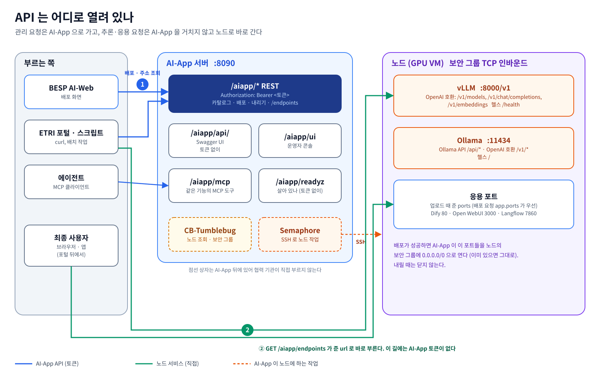

| 층 | 주소 | 인증 | 누가 부르나 |
|---|---|---|---|
| 관리 API | `http://<AI-App 호스트>:8090/aiapp/...` (9절 목록) | `Authorization: Bearer <토큰>` (5절). `readyz`·Swagger·콘솔은 토큰 없이 | AI-Web, ETRI 스크립트, MCP 클라이언트 |
| Swagger | `http://<AI-App 호스트>:8090/aiapp/api/index.html` | 없음 (화면에서 Authorize 로 토큰을 넣고 바로 불러 볼 수 있음) | 개발자 |
| 추론 서비스 (vLLM) | `http://<노드>:8000/v1` (OpenAI 호환: `/v1/models`, `/v1/chat/completions`, `/v1/embeddings`) | 없음 | 응용, 포털 |
| 추론 서비스 (Ollama) | `http://<노드>:11434` (Ollama API `/api/*`), `http://<노드>:11434/v1` (OpenAI 호환) | 없음 | 응용, 포털 |
| 응용 | `http://<노드>:<응용 포트>` (Dify `80`, Open WebUI `3000`, Langflow `7860`) | 응용 자체의 로그인 | 사람 (브라우저), 응용 API |

- 노드 쪽 주소는 직접 조립하지 않고 `GET /aiapp/endpoints` 로 받습니다. 추론 서비스는 `url`·`healthUrl`, 응용은 `urls[]` 입니다.
- 노드 쪽 포트는 배포가 성공하면 AI-App 이 노드의 보안 그룹에 엽니다(8절). **출처 제한 없이(`0.0.0.0/0`) 열리고 추론 서비스에는
  인증이 없습니다.** 시험 환경 기준이며 운영에서 막을 방법은 열린 문제입니다.
- AI-App 의 토큰은 노드 쪽 서비스에 쓰이지 않습니다.
- 노드를 정지했다가 다시 켜면 CSP 에 따라 공인 IP 가 바뀝니다(aws 에서 확인). `GET /aiapp/endpoints` 의 주소는 **배포할 때의 IP**
  이므로, 다시 켠 뒤에는 그 노드에 다시 배포해야 새 주소가 나옵니다. 지금 노드 IP 는 CB-Tumblebug 의 노드 조회로 봅니다.

실제 응답 예입니다(2026-11-03, IP 는 `<vm2>` 로 가림).

```sh
curl -sS -H "Authorization: Bearer $AIAPP_AUTH_TOKEN" "$AIAPP_URL/endpoints?nodeId=vm2b-2"
```

```json
{"endpoints": [
  {"nodeId": "vm2b-2", "csp": "azure", "type": "app", "workKey": "app-open-webui", "name": "open-webui", "version": 1,
   "urls": [{"port": 3000, "url": "http://<vm2>:3000"}], "portsOpened": true,
   "openedPorts": [{"securityGroupId": "travel-vm2b", "port": 3000, "protocol": "TCP", "result": "added"}]},
  {"nodeId": "vm2b-2", "csp": "azure", "type": "inference", "workKey": "ms-ollama",
   "runtimeId": "ollama", "modelId": "qwen3-vl-8b", "artifactId": "ollama-gguf",
   "url": "http://<vm2>:11434/v1", "healthUrl": "http://<vm2>:11434/", "portsOpened": true}
]}
```

받은 `url` 로 모델을 바로 부릅니다. 아래는 vm1 의 vLLM 임베딩 서비스를 부른 실제 결과입니다.

```sh
curl -sS http://<vm1>:8000/v1/embeddings -H 'Content-Type: application/json' \
  -d '{"model":"Qwen/Qwen3-Embedding-0.6B","input":["남산서울타워 야경"]}'
# 결과: model Qwen/Qwen3-Embedding-0.6B, 1024차원 벡터 하나, prompt_tokens 10
```

Swagger 화면입니다. 모든 경로와 필드 설명이 여기 있습니다.

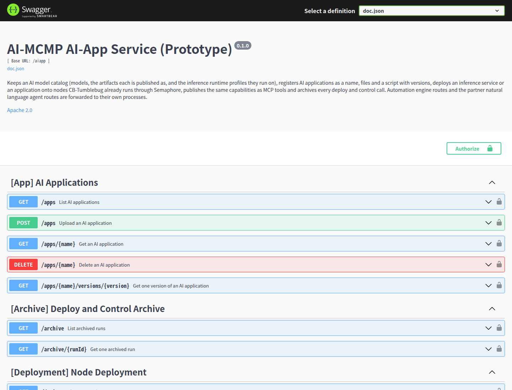

## 2. 전체 흐름

전체 구조는 맨 위 한 장 요약의 그림입니다. 번호는 부르는 순서입니다.

- AI-App 은 VM 을 만들지 않습니다. 노드 제어(정지·재개·재부팅·종료)는 AI-App 이 CB-Tumblebug 으로 부릅니다.
- 노드에 실제로 명령을 돌리는 것은 Semaphore 입니다. AI-App 은 Semaphore 에 그 노드의 SSH 키와 주소를 잠깐 등록하고
  playbook(Ansible 작업 파일)을 실행시킨 뒤 지웁니다.

노드 하나에서 일어나는 일은 아래 순서입니다.


## 3. Semaphore 구조

### 3-1. Semaphore 가 무엇인가

**Ansible** 은 SSH 로 여러 서버에 같은 작업을 돌리는 도구입니다. 무엇을 할지는 **playbook**(YAML 작업 파일)에 적습니다.
예를 들면 "docker 를 깔아라", "이 파일을 복사하고 `docker compose up` 을 해라" 같은 것입니다.
**Semaphore**(Semaphore UI, `semaphoreui/semaphore:v2.12.17`)는 Ansible 을 웹 화면과 REST API 로 돌려 주는 서버입니다.
누가 언제 무엇을 돌렸는지, 성공했는지, 출력이 무엇이었는지를 태스크 이력으로 남깁니다.

AI-App 은 노드에 직접 SSH 하지 않고 Semaphore 에 맡깁니다. 그래서 노드에서 일어난 일을 사람이 Semaphore 화면에서 그대로 볼 수
있습니다. 협력 기관은 Semaphore 를 직접 부르지 않습니다. AI-App API 의 `GET /aiapp/deployments/{id}/logs` 가 같은 출력을
돌려주고, 단계마다 Semaphore 화면 링크(`taskUrl`)를 붙입니다.

| Semaphore 의 말 | 뜻 | AI-App 에서는 |
|---|---|---|
| 프로젝트 (project) | 작업 묶음 | `aiapp` 하나. 처음 배포할 때 AI-App 이 만듭니다 |
| 저장소 (repository) | playbook 이 있는 곳 | 이 repo 의 `deploy/ansible/` 을 Semaphore 컨테이너에 마운트한 폴더 |
| 키 저장소 (key store) | SSH 키·비밀번호 | 배포할 노드의 SSH 키. CB-Tumblebug 에서 받아 **실행할 때만** 넣고 끝나면 지웁니다 |
| 인벤토리 (inventory) | 작업할 서버 목록 | 그 노드의 주소 한 줄. 키와 같이 실행 때만 있습니다 |
| 템플릿 (task template) | "이 playbook 을 이 인벤토리에" 의 저장된 실행 설정 | playbook 마다 하나씩 고정(`aiapp-install-docker`, `aiapp-compose-up`, `aiapp-copy-and-run`, `aiapp-compose-down`) |
| 태스크 (task) | 템플릿을 한 번 실행한 것 | 노드 하나의 단계 하나. 배포 기록의 `nodes[].steps[]` 와 1:1 |

아래는 시험 환경의 실제 화면입니다(2026-11-03). 태스크 목록에는 AI-App 이 돌린 태스크가 템플릿 이름, 성공·실패, 걸린 시간과
함께 쌓입니다. 한 줄을 열면 playbook 의 단계가 하나씩 찍힌 로그가 나옵니다.

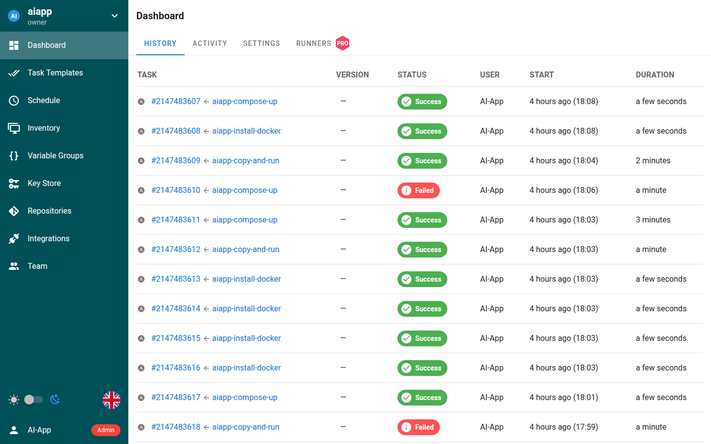

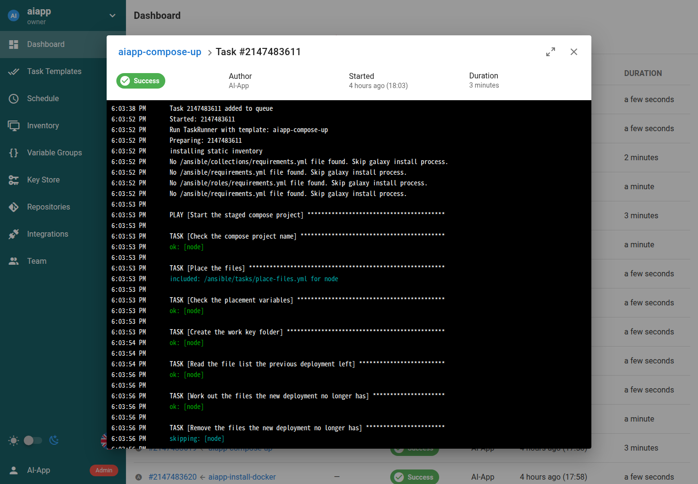

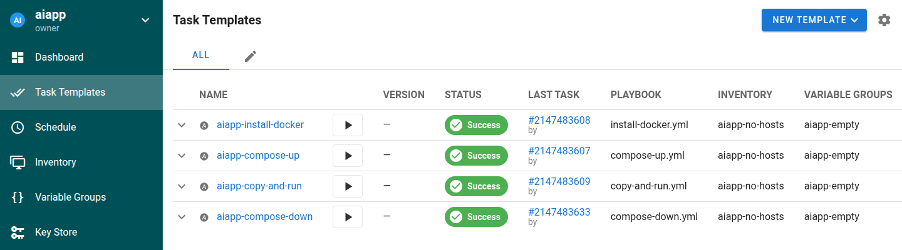

### 3-2. AI-App 이 Semaphore 를 쓰는 방법

Semaphore 에 관리자 계정이 있고(docker compose 의 `deploy` 프로필이 `AIAPP_SEMAPHORE_USERNAME`·`AIAPP_SEMAPHORE_PASSWORD` 로 만듦)
AI-App 이 그것으로 로그인할 수 있으면(`AIAPP_SEMAPHORE_URL` 과 사용자·비밀번호 또는 `AIAPP_SEMAPHORE_TOKEN`), 나머지는 AI-App 이
첫 배포 때 스스로 만듭니다. Semaphore 화면에서 미리 만들 것은 없습니다. 이것은 AI-App 운영자(이노그리드)가 맞추는 부분입니다.


- **template 은 playbook 마다 하나로 고정**하고 지우지 않습니다. Semaphore 는 template 을 지우면 그 태스크 이력과 로그도
  같이 지우기 때문입니다.
- **SSH 키와 inventory 는 실행마다** 등록하고, 성공·실패와 상관없이 끝나면 지웁니다. 태스크 요청에 이번 inventory 를 넣어
  template 의 빈 inventory 를 덮어씁니다. 키는 배포 기록·응답·로그에 나오지 않습니다.
- playbook 은 넷입니다 (`deploy/ansible/`).

  | playbook | 하는 일 |
  |---|---|
  | `install-docker.yml` | 노드에 docker 와 compose 플러그인을 깔고 docker 서비스를 켬. GPU 노드면 NVIDIA Container Toolkit 도 깜. 이미 있으면 그대로 둠. `/etc/os-release` 를 보고 Ubuntu·Debian 은 apt, RHEL 계열·Fedora·Amazon Linux 2023 은 dnf 로 깖 |
  | `compose-up.yml` | 추론 서비스. stage 의 compose 파일을 노드로 복사하고 `docker compose up`, 노드 안에서 런타임 헬스 경로가 응답할 때까지 기다림. GPU 를 쓰면 런타임이 GPU 위에 있는지도 봄 |
  | `copy-and-run.yml` | 응용. 업로드 파일을 노드로 복사하고 이전 컨테이너를 내린 뒤 `deploy.sh` 를 실행. 이어서 응용 포트가 응답하고 컨테이너가 재시작 없이 도는지 확인 |
  | `compose-down.yml` | 내리기. `docker compose down` (named volume 과 노드 폴더는 남김) |

- **작업 키**는 노드 위에서 무엇이 자리를 차지하는지를 정하는 이름입니다. 추론 서비스는 `ms-<runtimeId>`(예 `ms-vllm`),
  응용은 `app-<name>`(예 `app-dify`)입니다. 같은 노드에 같은 작업 키로 다시 배포하면 앞의 것을 바꿉니다. 그래서 노드 하나에
  추론 서비스는 런타임당 하나, 응용은 이름당 하나입니다.
- **화면 링크.** `AIAPP_SEMAPHORE_UI_URL` 을 설정하면 배포 기록의 각 단계(`nodes[].steps[]`)에 `taskUrl` 이 붙어, 그 태스크 로그를
  Semaphore 화면에서 바로 열 수 있습니다. 브라우저가 닿는 주소여야 합니다. docker compose 기본값은
  `http://127.0.0.1:3001` 이라 AI-App 을 띄운 호스트에서만 열립니다. 다른 곳에서 보려면 그 호스트 주소로 바꿉니다.
- **연결 상태.** `GET /aiapp/status` 가 그때그때 Semaphore 에 닿는지, 로그인되는지, 버전, 프로젝트와 template 넷이 있는지,
  CB-Tumblebug 이 응답하는지, stage 폴더에 쓸 수 있는지를 돌려줍니다. template 이 아직 없는 것은 오류가 아닙니다(첫 배포가 만듦).
  `GET /aiapp/readyz` 는 AI-App 이 떴는지만 봅니다.

## 4. 부르는 순서


1. 카탈로그를 읽어 무엇을 올릴지 고릅니다. 모델은 `modelId` + `artifactId`, 런타임은 아티팩트의 `runtimes[].runtimeId` 중 하나입니다
   (빼면 첫 번째). 응용은 `GET /aiapp/apps` 의 `name` 입니다.
2. 추론 서비스를 먼저 배포합니다. 응용이 추론 서비스 주소를 env 로 받아야 하기 때문입니다.
3. 끝나면 `GET /aiapp/endpoints` 로 추론 서비스 주소(`url`)를 읽습니다.
4. 응용을 배포하면서 `app.env` 에 그 주소를 넣습니다. 이름은 응용마다 다릅니다(Open WebUI `OLLAMA_BASE_URL`,
   Dify `VLLM_BASE_URL`, Langflow `MODEL_BASE_URL`, [etri.md](etri.md) 3절).
5. 응용 주소도 `GET /aiapp/endpoints` 로 읽습니다.
6. 내릴 때는 `DELETE /aiapp/deployments/{id}` 입니다.

[examples/](examples/) 의 스크립트가 이 순서 그대로입니다.

| 스크립트 | 부르는 것 |
|---|---|
| `00-status.sh` | `GET /readyz`, `GET /status` |
| `01-catalog.sh` | `GET /runtimes`, `GET /models`, `GET /apps` |
| `02-upload-app.sh [폴더] [이름] [포트]` | `POST /apps` (기본 `examples/apps/open-webui`, 포트 `3000`) |
| `03-deploy-inference.sh nsId infraId nodeId [modelId] [artifactId] [runtimeId]` | `POST /deployments` (type inference) 후 끝날 때까지 `GET /deployments/{id}` |
| `04-deploy-app.sh nsId infraId nodeId 이름 [KEY=VALUE ...]` | `POST /deployments` (type app) 후 같은 대기 |
| `05-endpoints.sh [nsId] [infraId] [nodeId]` | `GET /endpoints` |
| `06-logs.sh 배포ID [줄 수]` | `GET /deployments/{id}/logs` |
| `07-remove.sh 배포ID` | `DELETE /deployments/{id}` 후 끝날 때까지 대기 |

```sh
export AIAPP_URL=http://<AI-App 호스트>:8090/aiapp   # 기본 http://localhost:8090/aiapp
export AIAPP_AUTH_TOKEN=<받은 토큰>                  # 파일에 적지 않습니다
docs/api/examples/00-status.sh
```

`curl` 과 `jq` 가 필요합니다. 대기는 `POLL_INTERVAL`(기본 10초) 간격으로 `POLL_MAX`(기본 90번)까지 읽고, 넘으면 실패로 끝납니다
(배포는 AI-App 에서 계속 돕니다).

## 5. 인증

`AIAPP_AUTH_TOKEN` 을 설정한 AI-App 은 모든 요청에 아래 헤더를 요구합니다. 토큰은 하나이고 기관별로 나뉘지 않습니다.
기관별 토큰과 사용자·역할 인증은 나중에 붙입니다.

```
Authorization: Bearer <토큰>
```

- 토큰 없이 열리는 경로: `GET /aiapp/readyz`, `GET /aiapp/ui`(운영자 콘솔), `/aiapp/api/*`(Swagger UI), `/aiapp/engine/readyz`, `/aiapp/partner/nl/readyz`.
- 토큰이 틀리거나 없으면 `401 {"message":"Unauthorized"}` 입니다.
- `AIAPP_AUTH_TOKEN` 이 비어 있으면 인증이 꺼집니다(기동 로그가 경고).

Swagger UI: `http://<AI-App 호스트>:8090/aiapp/api/index.html`. 모든 필드의 설명이 거기 있습니다.

## 6. 오류와 상태 코드

오류 본문은 항상 같은 모양입니다.

```json
{"message":"deployment not found: nope"}
```

| 코드 | 언제 |
|---|---|
| `200` | 조회 성공, dry-run 배포(파일 배치까지 끝난 기록), 할 일이 없는 내리기 |
| `202` | 배포·내리기를 받았고 뒤에서 진행 중. 본문은 그 시점의 기록 (`pending` 또는 `removing`) |
| `400` | 요청 형식이 틀림 (필드 누락, 이름 규칙 위반, env 이름·값 규칙 위반, 숫자가 아닌 포트) |
| `401` | 토큰 없음·틀림 |
| `404` | 없는 모델·아티팩트·런타임·응용·배포, `POST /deployments` 의 대상 노드가 CB-Tumblebug 에 없음 (메시지에 `nsId/infraId/nodeId`) |
| `409` | 아직 진행 중(`pending`·`running`)이거나 내리는 중(`removing`)인 배포를 `DELETE` |
| `413` | 응용 업로드가 상한(`AIAPP_APP_UPLOAD_MAX_BYTES`, 기본 256 MiB)을 넘음 |
| `422` | `kind: k8s` 대상(자리만 있음), 그 런타임이 못 읽는 아티팩트 |
| `500` | 기록·파일 저장 실패, 추천 구현이 카탈로그에 없는 후보를 돌려줌 |
| `501` | 추천 구현이 설정되지 않음 (`/aiapp/recommendations/*`, 지금은 항상) |
| `502` | `/aiapp/engine/*` 을 넘길 자동화 엔진이 응답하지 않음, `POST /deployments` 가 대상 노드를 읽는데 CB-Tumblebug 이 실패하거나 응답하지 않음 |

`POST /deployments` 는 받기 전에 대상 노드를 모두 CB-Tumblebug 에서 읽습니다. 하나라도 없거나 읽지 못하면 기록을 만들지 않고 `404`·`502` 로 거절합니다.
CB-Tumblebug 0.13.8 은 없는 노드와 없는 인프라에 `404` 가 아니라 `500` (`no Node found`)을 주므로, AI-App 이 이것을 없는 노드로 읽어 `404` 로 돌려줍니다.
받은 뒤에 노드 하나가 실패해도 배포 요청 자체는 `202` 입니다. 노드의 실패는 배포 기록의 `nodes[].status`·`nodes[].error` 로 봅니다.

## 7. 배포는 비동기다

- `POST /aiapp/deployments` 는 요청을 카탈로그와 대조하고 대상 노드가 있는지 CB-Tumblebug 에서 확인한 뒤 바로 `202` 와 `pending` 기록을 돌려주고, 뒤에서 진행합니다.
  `GET /aiapp/deployments/{id}` 를 `status` 가 `pending`·`running` 이 아닐 때까지 읽습니다. 모델을 처음 받는 노드는 수십 분이 걸릴 수
  있습니다(Semaphore 태스크 하나의 상한 `AIAPP_SEMAPHORE_TIMEOUT` 기본 30분).
- **dry-run** 은 노드 조회와 파일 배치만 하고 Semaphore 에 아무것도 올리지 않는 모드입니다. AI-App 설정
  `AIAPP_TUMBLEBUG_DRY_RUN`(기본 `true`)으로 정하며 요청으로 바꿀 수 없습니다. 이때 `POST` 는 끝난 기록(`dry-run`)을 `200` 으로
  돌려줍니다. 지금 모드는 `GET /aiapp/status` 의 `dryRun` 으로 봅니다.
- `DELETE /aiapp/deployments/{id}` 도 같습니다. 노드에서 내릴 것이 있으면 `202`·`removing`, 할 것이 없으면(이미 내렸음, dry-run 배포)
  `200` 입니다.
- 한 배포에 노드를 32개까지 넣을 수 있고, 동시에 4개씩 진행합니다.

배포 상태(`status`)는 아래 열 가지입니다. 노드 상태(`nodes[].status`)는 `partial` 을 뺀 같은 값입니다.

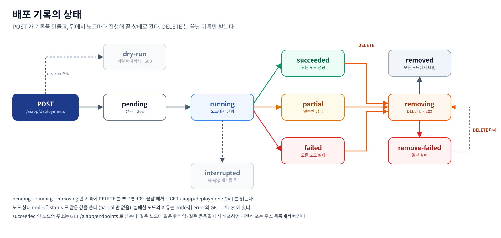

| 상태 | 뜻 | 다음 |
|---|---|---|
| `pending` | 받았고 아직 시작 전 | 계속 읽음 |
| `running` | 노드에서 진행 중 | 계속 읽음 |
| `succeeded` | 모든 노드 성공 | `GET /aiapp/endpoints` |
| `failed` | 모든 노드 실패 | `nodes[].error`, `GET .../logs` |
| `partial` | 일부 노드만 성공 | 실패한 노드만 다시 배포 |
| `dry-run` | 파일 배치까지만 함 | 실제 배포는 AI-App 운영자가 dry-run 을 꺼야 함 |
| `interrupted` | 진행 중에 AI-App 이 멈췄거나 재기동됨. 노드가 어떻게 됐는지 모름 | 다시 배포 |
| `removing` | `DELETE` 를 받아 노드에서 내리는 중 | 계속 읽음 |
| `removed` | 모든 노드에서 내림 | 끝 |
| `remove-failed` | 일부 노드에서 내리기 실패 | `nodes[].error` 를 보고 `DELETE` 를 다시 부르면 남은 노드만 다시 시도 |

노드 하나가 `succeeded` 가 되기까지 확인하는 것은 아래와 같습니다. 자세한 것은 그림 아래 두 문단입니다.

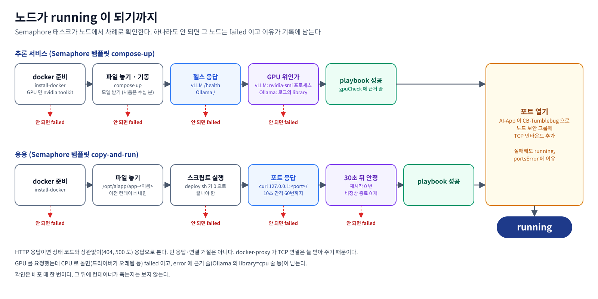

헬스: 추론 서비스는 `compose-up` 이 노드 안에서 런타임 헬스 경로(vLLM `/health`, Ollama `/`)가 응답할 때까지 기다려야 노드가
`succeeded` 가 됩니다. GPU 를 쓰는 추론 서비스(`nodes[].gpu` 가 `true`)는 그다음 런타임이 GPU 위에 있는지 봅니다. vLLM 은
호스트 `nvidia-smi` 의 compute 프로세스 중 그 compose 프로젝트 컨테이너의 것이 있는지, Ollama 는 `engine` 로그의
`msg="inference compute"` 줄이 `library=CUDA` 인지 봅니다. 아니면 노드는 `failed` 이고 `error` 에 근거 줄이 남습니다(드라이버가 오래돼
CPU 로 도는 경우). 성공하면 근거 줄이 `nodes[].gpuCheck` 에 남습니다(예 `nvidia-smi: 3499, VLLM::EngineCore, 13524 MiB`).
응용은 `deploy.sh` 가 0 으로 끝난 뒤 `copy-and-run` 이 두 가지를 더 확인해야 `succeeded` 가 됩니다.

1. **포트 응답.** 응용 포트(8절의 포트, `nodes[].ports` 와 같은 목록) 하나하나에 노드 안에서 `curl http://127.0.0.1:<port>/` 를
   10초 간격으로 60번까지 보냅니다. HTTP 응답이 오면 상태 코드와 상관없이(`404`, `500` 도) 응답한 것으로 봅니다. 빈 응답이나 연결
   거절, 연결 끊김은 응답이 아닙니다. docker 는 공개 포트를 docker-proxy 로 받기 때문에 컨테이너 안에서 아무도 안 듣고 있어도 TCP
   연결 자체는 됩니다. 그래서 포트가 열렸는지가 아니라 HTTP 응답이 오는지를 봅니다. 포트가 없는 응용은 이 단계를 건너뜁니다.
2. **컨테이너 안정.** 포트가 응답한 뒤 30초를 기다리고, 그 응용의 compose 프로젝트(`aiapp-app-<name>`)에 속한 컨테이너를 모두
   봅니다. 재시작 중이거나, 한 번이라도 재시작했거나(`RestartCount` 가 0 보다 큼), 0 이 아닌 코드로 끝난 컨테이너가 있으면 노드는
   `failed` 입니다. 0 으로 끝난 컨테이너(한 번 돌고 끝나는 초기화 컨테이너)는 괜찮습니다. `nodes[].error` 는
   `copy-and-run.yml ended with status "error"` 이고, `GET .../logs` 의 그 단계 출력에 문제 컨테이너마다 상태, 재시작 횟수, 종료 코드,
   마지막 로그 5줄이 남습니다. 포트가 없는 응용도 이 단계는 합니다.

포트 하나만 응답하고 다른 컨테이너가 재시작을 되풀이하는 경우(예: Dify 의 nginx 는 응답하는데 agent backend 와 local sandbox 가
죽고 뜨기를 반복)가 있어서 두 가지를 다 봅니다. 확인은 배포 시점에 한 번이고, 그 뒤에 컨테이너가 죽는지는 보지 않습니다.

## 8. 서빙 포트 열기

노드의 playbook 이 성공하면 AI-App 이 그 배포가 쓰는 포트를 CB-Tumblebug 보안 그룹에 엽니다.

- **어느 포트:** 추론 서비스는 런타임 포트(vLLM `8000`, Ollama `11434`), 응용은 업로드 때 준 `ports`(배포 요청의 `app.ports` 가 있으면 그것).
  기록의 `nodes[].ports` 에 남습니다.
- **어디에:** 노드 정보의 `securityGroupIds` 에 있는 보안 그룹 전부. 규칙은 **TCP 인바운드, 출처 `0.0.0.0/0`** 입니다(시험 환경 기준이라
  출처 제한은 열린 문제입니다).
- **이미 있는 규칙은 다시 보내지 않습니다.** 보안 그룹을 먼저 읽어 같은 포트를 `0.0.0.0/0` 에서 이미 받는 규칙이 있으면 건너뜁니다.
  CB-Tumblebug 은 같은 규칙이 하나라도 섞이면 요청 전체를 거절하기 때문입니다. 결과는 `nodes[].openedPorts[]` 에
  `{securityGroupId, port, protocol, result}` 로 남고 `result` 는 `added`(이번에 추가) 또는 `existing`(이미 있었음)입니다.
- **실패해도 배포는 성공입니다.** 포트를 못 열면 `nodes[].portsError` 와 `notes` 에 이유를 남기고 노드는 `succeeded` 입니다.
  `GET /aiapp/endpoints` 의 `portsOpened` 가 `false` 면 밖에서 안 닿을 수 있습니다.
- **내릴 때 닫지 않습니다.** 같은 보안 그룹을 다른 작업이 쓸 수 있어서입니다. 필요하면 CB-Tumblebug 에서 닫습니다.
- dry-run 이면 열지 않습니다. `AIAPP_DEPLOYMENT_OPEN_PORTS=false`(기본 `true`)면 열지 않고 포트만 기록하며 `notes` 에 그렇게 적습니다.

## 9. API 목록

모든 경로는 `/aiapp` 아래입니다. 요청·응답 필드는 Swagger(`/aiapp/api/index.html`, 파일은 `api/docs/swagger.yaml`)에 있습니다.

### 9-1. 상태

| 메서드 | 경로 | 하는 일 |
|---|---|---|
| GET | `/aiapp/readyz` | AI-App 이 떴는지. 토큰 없이 열림 |
| GET | `/aiapp/status` | Semaphore·CB-Tumblebug·stage 연결 상태, dry-run, 포트 열기 설정 |

### 9-2. 카탈로그

| 메서드 | 경로 | 하는 일 |
|---|---|---|
| GET | `/aiapp/runtimes` | 런타임 목록 (`id`, `image`, `formats`, `port`, `healthPath`, `apiBasePath`) |
| GET | `/aiapp/runtimes/{runtimeId}` | 런타임 하나 |
| GET | `/aiapp/models` | 모델 목록과 아티팩트. 필터 `task`, `modality`, `format`, `runtimeId`, `source` |
| POST | `/aiapp/models` | 모델 등록. 같은 `id` 면 바꿔 씀 |
| GET | `/aiapp/models/{modelId}` | 모델 하나 |
| DELETE | `/aiapp/models/{modelId}` | 모델 삭제. 이미 떠 있는 추론 서비스는 그대로 |
| GET | `/aiapp/models/{modelId}/artifacts/{artifactId}/compose` | 노드에 갈 compose 파일 미리 보기 (쿼리 `runtimeId`, `gpu`, 되풀이하는 `arg`) |
| POST | `/aiapp/apps` | 응용 업로드 (multipart: `name`, `script`, `files` 여러 개, `ports`). 같은 이름이면 다음 버전 |
| GET | `/aiapp/apps` | 응용 목록 (버전, 파일, 포트) |
| GET | `/aiapp/apps/{name}` | 응용 하나 (모든 버전) |
| GET | `/aiapp/apps/{name}/versions/{version}` | 응용 한 버전 |
| DELETE | `/aiapp/apps/{name}` | 응용 삭제 (모든 버전). 노드에 올라간 것은 그대로 |

### 9-3. 배포와 주소

| 메서드 | 경로 | 하는 일 |
|---|---|---|
| POST | `/aiapp/deployments` | 추론 서비스(`type: inference`) 또는 응용(`type: app`)을 노드에 배포. `202`, dry-run 이면 `200` |
| GET | `/aiapp/deployments` | 배포 목록 (최신순). 필터 `type`, `nsId`, `status` |
| GET | `/aiapp/deployments/{id}` | 배포 기록 하나 (노드별 상태, 주소, 단계, 연 포트) |
| GET | `/aiapp/deployments/{id}/logs` | 노드·단계별 Semaphore 태스크 출력과 `taskUrl` |
| DELETE | `/aiapp/deployments/{id}` | 노드에서 내림 (`docker compose down`, named volume 유지) |
| POST | `/aiapp/deployments/{id}/control` | 배포의 노드 전부에 CB-Tumblebug 노드 제어 (`suspend`·`resume`·`reboot`·`terminate`). `terminate` 는 VM 을 지움 |
| GET | `/aiapp/endpoints` | 지금 떠 있는 추론 서비스·응용 주소. 필터 `nsId`, `infraId`, `nodeId`, `type` |

### 9-4. 추천 (자리만)

| 메서드 | 경로 | 하는 일 |
|---|---|---|
| POST | `/aiapp/recommendations/models` | 요구에 맞는 모델 후보. 구현이 없어 지금은 `501` ([khu.md](khu.md)) |
| POST | `/aiapp/recommendations/apps` | 요구에 맞는 응용 후보. 지금은 `501` |

### 9-5. 그 밖 (운영·도구)

| 메서드 | 경로 | 하는 일 |
|---|---|---|
| GET | `/aiapp/ui` | 운영자 콘솔 화면 |
| GET | `/aiapp/api/*` | Swagger UI |
| GET | `/aiapp/tools` | MCP 도구 목록과 등급, dry-run 상태 |
| (any) | `/aiapp/mcp` | 같은 도구의 MCP 서버 (Streamable HTTP) |
| GET | `/aiapp/archive` | 배포·제어 아카이브 목록 |
| GET | `/aiapp/archive/{runId}` | 아카이브 한 건 |
| (any) | `/aiapp/engine/*` | 자동화 엔진으로 넘김 |
| (any) | `/aiapp/partner/nl/*` | 자연어 에이전트(모의)로 넘김 |
| (any) | `/aiapp/partner/rec/*` | 인프라 추천 API(모의)로 넘김 |

## 10. 배포 요청 모양

배포는 `POST /aiapp/deployments` 하나이고, `type` 이 무엇을 어디서 가져와 올릴지 정합니다.

| `type` | 무엇을 올리나 | 어디서 가져오나 | 요청에서 가리키는 것 | 노드에서 하는 일 |
|---|---|---|---|---|
| `inference` | 추론 서비스 (런타임 + 모델) | **모델 카탈로그** (`GET /aiapp/models`) 와 런타임 목록 (`GET /aiapp/runtimes`) | `inference.modelId` + `artifactId` (+ `runtimeId`) | AI-App 이 compose 파일을 만들어 `docker compose up` |
| `app` | 응용 (Dify, Open WebUI, Langflow 등) | **응용 카탈로그** (응용 저장소, `GET /aiapp/apps`). 먼저 `POST /aiapp/apps` 로 올려 두어야 함 | `app.name` (+ `version`, 빼면 최신) | 올린 파일을 노드에 복사하고 올린 스크립트(`deploy.sh`) 실행 |

두 카탈로그는 서로 이어져 있지 않습니다. 응용이 쓸 모델은 응용 카탈로그에 적지 않고, 배포할 때 `app.env` 로 추론 서비스 주소를
넘깁니다(4절의 순서: 추론 서비스 배포 → `GET /aiapp/endpoints` 로 주소 → 그 주소를 `app.env` 에 넣어 응용 배포).

추론 서비스:

```json
{
  "type": "inference",
  "targets": [{ "kind": "node", "nsId": "etri", "infraId": "travel", "nodeId": "vm2" }],
  "inference": { "modelId": "qwen3-vl-8b", "artifactId": "ollama-gguf", "runtimeId": "ollama" }
}
```

응용:

```json
{
  "type": "app",
  "targets": [{ "kind": "node", "nsId": "etri", "infraId": "travel", "nodeId": "vm2" }],
  "app": { "name": "open-webui", "env": { "OLLAMA_BASE_URL": "http://203.0.113.12:11434" } }
}
```

| 필드 | 규칙 |
|---|---|
| `targets[]` | `kind: node` 와 `nsId`·`infraId`·`nodeId`. 32개까지, 같은 노드는 한 번만. 클라우드·리전·IP·SSH 키는 CB-Tumblebug 노드 정보에서 읽음 |
| `inference.runtimeId` | 빼면 아티팩트의 첫 런타임 |
| `inference.gpu` | 빼면 노드 스펙의 `acceleratorType` 이 `gpu` 인지로 정함. 스펙을 못 읽으면 `false` 이고 `notes` 에 이유. `true` 로 정해지면 런타임이 GPU 위에 있는지 확인하고, 아니면 노드가 `failed`(7절 헬스) |
| `inference.args` | 런타임 명령 뒤에 붙는 인자. vLLM 이면 서비스가 넣는 `--model`·`--port` 와 카탈로그 아티팩트의 `runtimes[].args` 가 먼저 오고 그 뒤에 붙음. 같은 플래그가 되풀이되면 vLLM 은 마지막 값을 써서 요청이 카탈로그 인자를 덮어씀. 예 `["--max-model-len", "16384"]`. 32개까지, 하나에 1~256자, 제어 문자·줄바꿈 불가, `--model`·`--port`·`--host` 는 `400`. Ollama 는 받지 않아 `400` |
| `app.version` | 빼거나 `0` 이면 최신 버전 |
| `app.ports` | 이 배포에서만 업로드 때의 `ports` 를 바꿈 |
| `inference.env`, `app.env` | 이름 `[A-Z_][A-Z0-9_]*`, 값에 줄바꿈·작은따옴표 불가. 배포 기록과 노드의 `.env` 에 **평문으로** 남으므로 비밀값은 조심 |

## 11. 알아 둘 것

- 노드의 배포판은 Ubuntu, Debian, RHEL, Rocky, AlmaLinux, CentOS Stream, Oracle Linux, Fedora, Amazon Linux 2023 중 하나여야 합니다(`/etc/os-release` 의 `ID`, 파생 배포판은 `ID_LIKE`). 그 밖이면 노드가 `failed` 가 되고 로그에 `install-docker supports only ...` 가 남습니다. 배포판마다 어떻게 까는지는 [etri.md 2절](etri.md#2-vm-이-갖춰야-할-것) 에 있습니다.
- docker 는 있는데 compose 플러그인이 없으면 노드의 저장소에서 `docker-compose-plugin` 이나 `moby-compose` 를 깝니다. 둘 다 없을 때 apt 를 쓰는 노드는 실패하고, dnf 를 쓰는 노드는 compose 플러그인을 GitHub 에서 직접 받아 깝니다.
- `install-docker` 는 docker 와 compose 플러그인만 깝니다. 예시 응용이 노드에서 쓰는 도구는 이미지에 있어야 합니다. Dify 는 `git`(`openssl` 은 없으면 `/dev/urandom` 으로 대신함), Langflow 는 `MODEL_BASE_URL` 을 줄 때 `python3` 입니다.
- 주소(`url`, `urls`)는 노드의 공인 IP 로 만듭니다. 공인 IP 가 없으면 사설 IP 입니다.
- 한 런타임(Ollama 포함)에 모델은 하나입니다. 같은 노드에 같은 런타임으로 다른 모델을 배포하면 앞의 모델을 바꿉니다.
- 이전 버전에서 올라오는 경우(2026-11-03 이전 코드로 띄운 AI-App): 저장해 둔 모델 카탈로그 파일(docker compose 의 named volume
  `catalog`, `/app/data/catalog/models.json`)은 아티팩트 필드가 `engines` 라 새 코드가 읽지 못해 기동이 실패합니다. 그 파일을 지우면 기본
  모델 3개로 다시 시작합니다. 옛 배포 기록의 `type: model-service` 는 `inference` 로 읽히지 않습니다(목록에는 남지만 필터와 주소 조회에서 빠짐).
  자세한 것은 저장소 README 의 "업그레이드" 절.

## 12. 예시 응용 셋은 어떻게 동작하나

**응용은 모델 카탈로그에 없습니다.** AI-App 이 담고 있는 것은 셋이고 정해지는 곳이 다릅니다.

| 무엇 | 어디에 정해져 있나 | 어떻게 늘리나 | 조회 |
|---|---|---|---|
| 런타임 (`vllm`, `ollama`) | AI-App 코드에 들어 있음 (이미지 태그 고정) | 코드 변경 | `GET /aiapp/runtimes` |
| 모델 · 아티팩트 | 모델 카탈로그. 기본 3개(시드)가 코드에 있고, 등록한 것은 카탈로그 파일에 저장 | `POST /aiapp/models` | `GET /aiapp/models` |
| 응용 (Dify, Open WebUI, Langflow, 그 밖의 것) | **응용 카탈로그(응용 저장소).** 처음에는 비어 있고, 업로드한 파일 묶음과 스크립트가 버전마다 AI-App 의 저장 폴더(`AIAPP_APP_STORE_DIR`)에 남음 | `POST /aiapp/apps` (multipart: `name`, `script`, `files`, `ports`) | `GET /aiapp/apps` |

`examples/apps/` 는 이 repo 에 들어 있는 업로드용 예시 묶음일 뿐이고, AI-App 이 저절로 읽지 않습니다. 쓰려면 누군가 한 번 업로드합니다
([etri.md](etri.md) 3절의 curl, `docs/api/examples/02-upload-app.sh`). 배포 요청은 `app.name`(과 `version`)으로 업로드한 것을 가리키고, AI-App 은
그 버전의 파일을 노드의 `/opt/aiapp/app-<name>/` 에 복사해 스크립트를 실행합니다. 응용 안에서 쓸 모델은 카탈로그가 아니라
배포 요청의 `app.env` 로 이어 줍니다.

`examples/apps/` 의 세 응용은 업로드(`POST /aiapp/apps`)해서 바로 배포할 수 있는 예시입니다. 셋 다 노드에서 `deploy.sh` 가
`docker compose up -d` 로 컨테이너를 띄우는 같은 방식이고, 다른 것은 **모델 주소를 어떻게 받느냐** 입니다.
배포 요청의 `app.env` 가 노드의 `.env` 가 되고, 응용은 그 값으로 추론 서비스를 부릅니다.

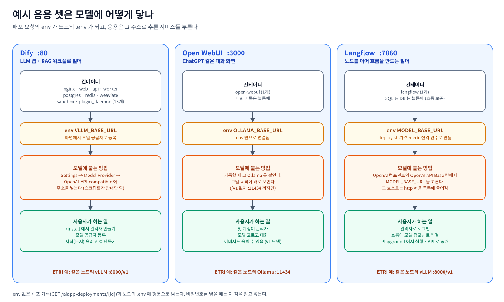

| | Dify | Open WebUI | Langflow |
|---|---|---|---|
| 무엇인가 | LLM 앱·RAG(문서 검색 + 생성)·워크플로를 화면에서 만드는 플랫폼 | ChatGPT 같은 대화 화면 | 컴포넌트를 선으로 이어 LLM 흐름(에이전트)을 만들고 API 로 공개하는 빌더 |
| 버전 | 1.18.0 (공식 compose 를 그 태그로 받음) | v0.12.4 | 1.13.0 |
| 컨테이너 | 16개 (nginx, web, api, worker, postgres, redis, weaviate, sandbox, plugin_daemon 등) | 1개 | 1개 (내장 SQLite) |
| 포트 | `80` | `3000` | `7860` |
| 모델 주소 env | `VLLM_BASE_URL` (안내용) | `OLLAMA_BASE_URL` (필수) | `MODEL_BASE_URL` |
| 모델에 붙는 방법 | Dify 는 모델 공급자를 화면이나 콘솔 API 로 등록합니다. 스크립트는 넣을 주소를 출력만 합니다 | 기동할 때 그 Ollama 를 붙입니다. 모델 목록이 바로 보입니다. 주소는 `/v1` 없이 `:11434` 까지입니다 | `deploy.sh` 가 Langflow 가 뜬 뒤 그 API 로 Generic 전역 변수 `MODEL_BASE_URL` 을 만들고, 그 호스트를 `LANGFLOW_SSRF_ALLOWED_HOSTS` 에 넣습니다. OpenAI 컴포넌트의 `OpenAI API Base` 칸에서 그 변수를 고릅니다 |
| 그 밖의 env | `DIFY_PORT`, `DIFY_AGENT_LOCAL_SANDBOX_AUTH_TOKEN` (없으면 노드에서 만들어 둠) | `OPEN_WEBUI_PORT` | `LANGFLOW_SUPERUSER_PASSWORD` (필수), `LANGFLOW_SUPERUSER`, `LANGFLOW_PORT`, `LANGFLOW_SSRF_ALLOWED_HOSTS` (없으면 `MODEL_BASE_URL` 의 호스트) |
| 첫 화면에서 할 일 | `/install` 에서 관리자 계정 만들기 | 처음 가입한 계정이 관리자 | env 로 준 관리자로 로그인 |

env 값은 배포 기록과 노드의 `.env` 에 평문으로 남습니다(10절). 비밀번호를 넣을 때는 이 점을 알고 넣습니다.

### 12-0. 시험한 노드 (2026-11-03)

아래 화면은 모두 이 노드 3대에서 찍었습니다. 값은 CB-Tumblebug 의 노드·스펙 조회와 노드 안의 명령(`uname -m`, `nvidia-smi`,
`docker ps`)으로 확인한 것입니다. vm3 는 계획상 gcp `g2-standard-4`(L4) 이지만 gcp 서비스 계정 권한 문제로 일단 aws `g6.xlarge`(L4) 로
진행했습니다.

| 노드 | CSP · 리전 (존) | 스펙 | 아키텍처 | 이미지 · OS | GPU 드라이버 · docker |
|---|---|---|---|---|---|
| vm1 (`vm1-2`) | aws `ap-northeast-1` 도쿄 (`ap-northeast-1a`) | `g4dn.xlarge`: 4 vCPU, 16 GiB, NVIDIA T4 1장(16 GB), 디스크 150 GB | x86_64 | `ami-0e8e3e0f677c0f395`, Ubuntu 22.04.5 LTS | 595.112.07 · 29.9.2 |
| vm2 (`vm2b-2`) | azure `koreacentral` (존 1) | `Standard_NC4as_T4_v3`: 4 vCPU, 28 GiB, NVIDIA T4 1장(16 GB), 디스크 150 GB | x86_64 | `microsoft-dsvm:ubuntu-hpc:2204:22.04.2026100101`, Ubuntu 22.04.5 LTS | 580.178.04 · 29.8.1 |
| vm3 (`vm3-2`) | aws `ap-northeast-1` 도쿄 (`ap-northeast-1a`) | `g6.xlarge`: 4 vCPU, 16 GiB, NVIDIA L4 1장(24 GB), 디스크 150 GB | x86_64 | `ami-0e8e3e0f677c0f395`, Ubuntu 22.04.5 LTS | 595.112.07 · 29.9.2 |

| 노드 | 런타임 (엔진) 버전 | 모델 · 아티팩트 | 응용 · 버전 |
|---|---|---|---|
| vm1 | vLLM `v0.32.0` (`vllm/vllm-openai:v0.32.0`), 포트 8000 | `qwen3-embedding-0.6b` / `hf-bf16` (`Qwen/Qwen3-Embedding-0.6B`, BF16, 1024차원 임베딩) | Dify `1.18.0` (plugin_daemon `0.6.10`, weaviate `1.39.13`, postgres 15, redis 6), 포트 80 |
| vm2 | Ollama `0.40.13` (`ollama/ollama:0.40.13`), 포트 11434 | `qwen3-vl-8b` / `ollama-gguf` (`qwen3-vl:8b`, GGUF Q4_K_M, 6.2 GB) | Open WebUI `v0.12.4`, 포트 3000 |
| vm3 | vLLM `v0.32.0` (`vllm/vllm-openai:v0.32.0`), 포트 8000 | `ministral-3-8b` / `hf-fp8` (`mistralai/Ministral-3-8B-Instruct-2512`, FP8, 카탈로그 인자 `--max-model-len 32768` 등) | Langflow `1.13.0`, 포트 7860 |

### 12-1. Open WebUI (azure vm2, Ollama + Qwen3-VL-8B)

`OLLAMA_BASE_URL=http://<vm2>:11434` 로 배포했습니다. 관리자 설정의 연결 화면에 그 주소가 들어가 있고, 대화 화면에서
`qwen3-vl:8b` 를 바로 고를 수 있습니다. 이 모델은 답하기 전에 생각하는 단계가 있어 "N초 동안 생각함" 이 먼저 보입니다.
답의 내용(장소 설명이 틀린 것 포함)은 모델의 몫이고 AI-App 이 고치지 않습니다.

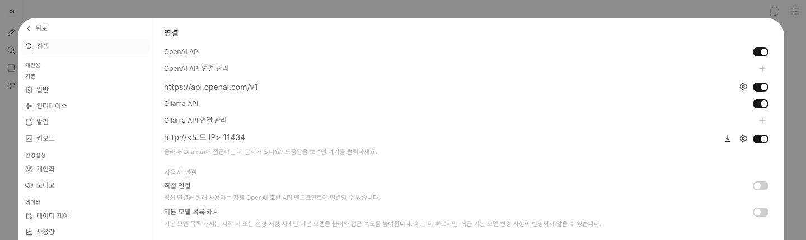

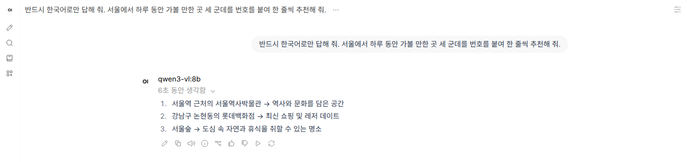

### 12-2. Dify (aws vm1, vLLM + Qwen3-Embedding-0.6B)

vm1 의 모델은 임베딩 모델이라, Dify 의 **지식(Knowledge)** 기능으로 RAG 의 검색 쪽을 확인했습니다.

1. `/install` 에서 관리자를 만들고 로그인합니다.
2. 플러그인 `langgenius/openai_api_compatible` 를 설치하고, 모델 공급자 OpenAI-API-compatible 에 Text Embedding 모델
   `Qwen/Qwen3-Embedding-0.6B`, API endpoint `http://<vm1>:8000/v1` 을 등록합니다. Dify 는 등록할 때 그 주소를 실제로 불러 봅니다.
3. 관광 안내 문서(경복궁, 북촌, 남산서울타워, 한강공원, 광장시장 다섯 단락)를 지식으로 올립니다. 인덱스 방식은 고품질(임베딩)입니다.
   단락마다 vLLM 이 1024차원 벡터를 만들고 Dify 의 weaviate 에 저장합니다.
4. 검색 테스트에서 "밤에 서울 야경을 보려면 어디로 가야 해?" 를 넣으면 남산서울타워 단락이 맨 위(점수 0.44)로 나옵니다.
   질문에 "남산" 이라는 말이 없는데도 뜻으로 찾았습니다.

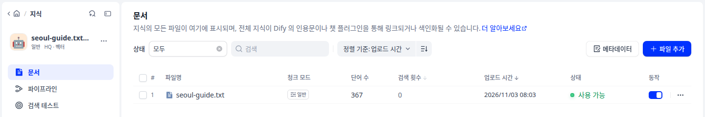

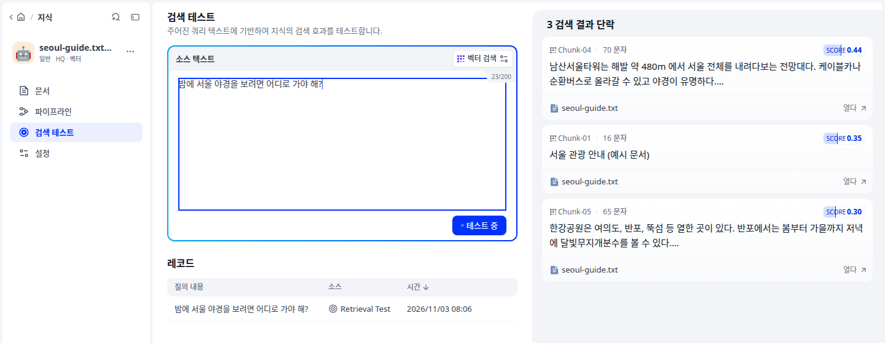

이 지식을 쓰는 대화 앱(검색한 단락을 붙여 LLM 이 답함)을 만들려면 대화 모델이 하나 더 있어야 합니다. 예를 들어 vm2 의 Ollama 나 vm3 의
vLLM 을 같은 방법으로 LLM 공급자로 등록합니다.

### 12-3. Langflow (aws vm3, vLLM + Ministral 3 8B)

`MODEL_BASE_URL=http://<vm3>:8000/v1` 로 배포했습니다(응용 버전 5). 배포 출력에 `created the Langflow global variable MODEL_BASE_URL` 이
찍히고, Langflow 의 전역 변수 목록에 `MODEL_BASE_URL`(Generic)이 생깁니다. 관리자로 로그인해 흐름
`Chat Input → Prompt → OpenAI(모델 mistralai/Ministral-3-8B-Instruct-2512, OpenAI API Base = 변수 MODEL_BASE_URL) → Chat Output` 을
만들고 Playground 에서 여행 일정을 물으면 같은 노드의 vLLM 이 답합니다.

- Langflow 1.13 의 기본 모델 컴포넌트(Language Model)에는 OpenAI 호환 주소를 넣는 칸이 없습니다. **OpenAI 컴포넌트**를 쓰고, API Key 칸에는
  아무 값이나 넣습니다(vLLM 은 키를 보지 않습니다).
- 만든 흐름은 API 로도 부를 수 있습니다: `POST http://<vm3>:7860/api/v1/run/<flow id>` (헤더 `x-api-key`, Langflow 화면에서 만든 키).

예시를 고치기 전(버전 2)에는 세 가지 때문에 Langflow 가 모델을 부르지 못하거나 흐름을 잃었습니다. 2026-11-03 에 확인하고 고쳤습니다.

| # | 증상 | 원인 (Langflow 1.13.0) | 고친 것 |
|---|---|---|---|
| 1 | `Cannot use a Credential-typed global variable in 'openai_api_base'` | env 로 받은 전역 변수(`LANGFLOW_VARIABLES_TO_GET_FROM_ENVIRONMENT`)는 항상 Credential 형식으로 만들어지고, Credential 은 주소 칸에 못 씀 | env 로 넘기지 않고 `deploy.sh` 가 API 로 Generic 변수를 만듦 |
| 2 | `Provider endpoint 'http://<vm3>:8000/v1' must use https ... LANGFLOW_SSRF_ALLOWED_HOSTS` | `http` 모델 주소는 운영자가 허용한 호스트만 받음 | `LANGFLOW_SSRF_ALLOWED_HOSTS` 를 받고, 없으면 `MODEL_BASE_URL` 의 호스트를 넣음 |
| 3 | 다시 배포하면 흐름과 API 키가 사라짐 | DB(`langflow.db`)가 볼륨이 아니라 이미지 안(`site-packages/langflow/`)에 생김 | `LANGFLOW_SAVE_DB_IN_CONFIG_DIR=true` 로 DB 를 볼륨(`/app/langflow`)에 둠 |

고친 뒤 같은 노드에 두 번 더 배포해 흐름이 남고, 두 번째부터는 변수를 새로 만들지 않고 값만 바꾸는 것(`updated the Langflow global variable MODEL_BASE_URL`)을 확인했습니다.

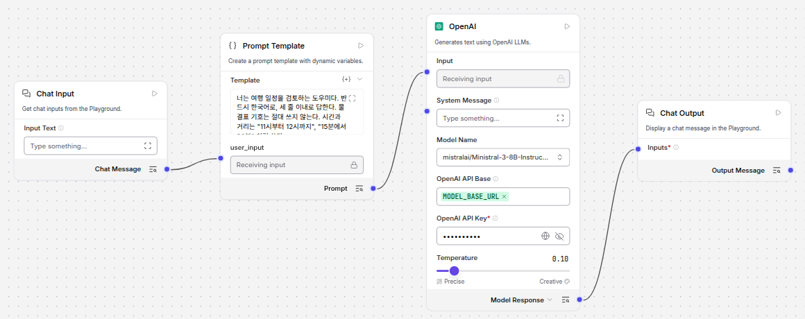

OpenAI 컴포넌트의 `OpenAI API Base` 칸에 전역 변수 `MODEL_BASE_URL` 이 들어가 있습니다. 모델 이름은 vLLM 이 띄운
`mistralai/Ministral-3-8B-Instruct-2512` 입니다.

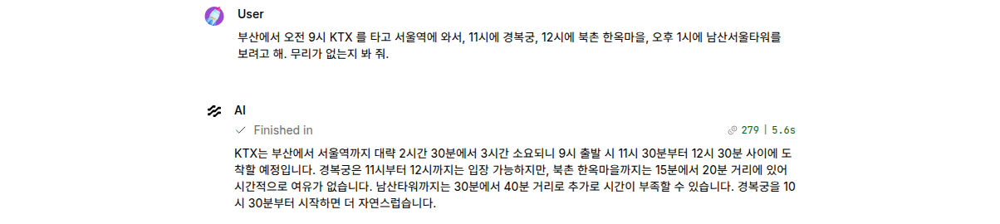

Playground 에서 일정을 물으면 4.6초 만에 답이 옵니다. 답의 내용(9시에 떠나 11시 30분에 도착한다면서 11시 경복궁이 무리 없다고 함)은
모델의 몫이고 AI-App 이 고치지 않습니다.
