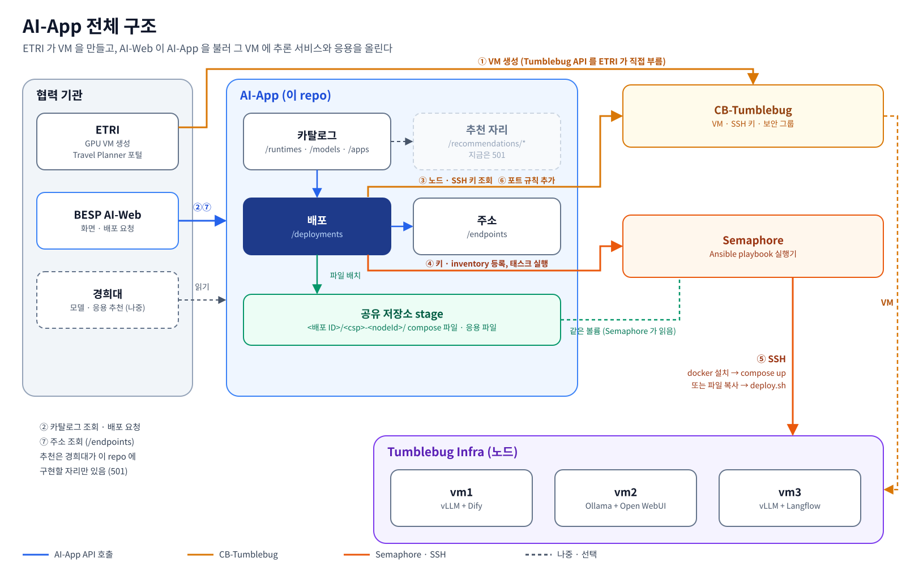
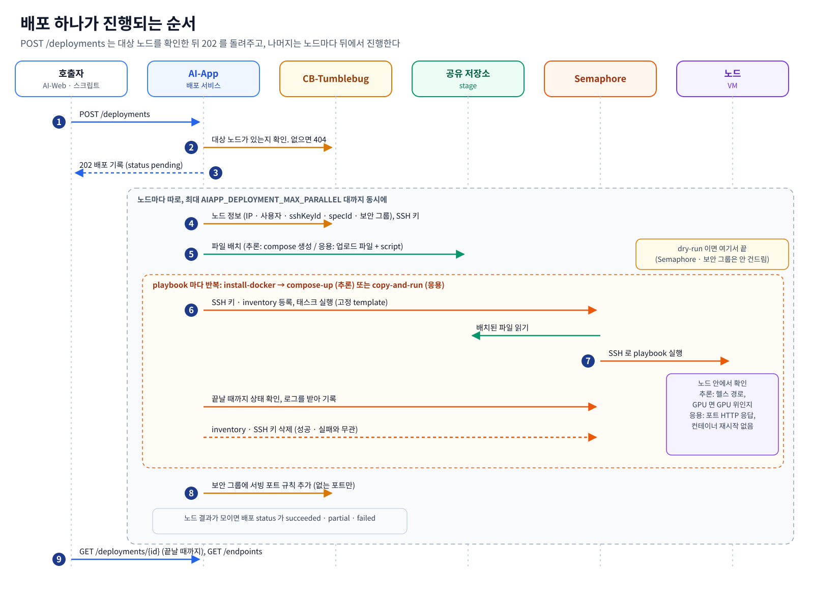
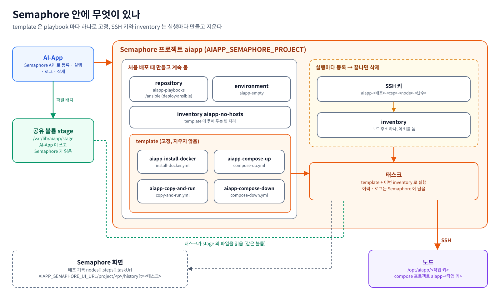
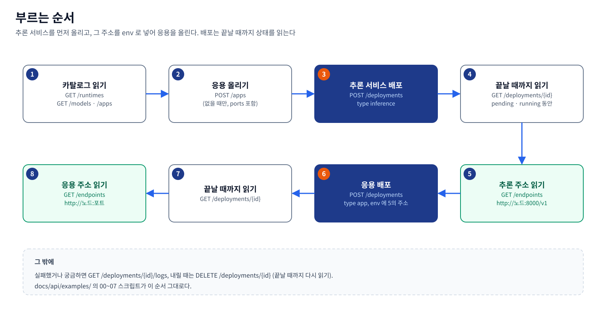

# AI-App API 연동 가이드

> 대상: AI-App API 를 부르는 협력 기관 개발자 (ETRI, BESP, 경희대). 2026-11-03 기준 코드(`main`)에 맞춰 썼습니다.
> 기관별 문서: [etri.md](etri.md) (GPU VM 과 배포), [besp.md](besp.md) (AI-Web), [khu.md](khu.md) (추천 구현 자리).
> 실제 클라우드 시험 결과: [live-test-2026-11-03.md](live-test-2026-11-03.md) (aws·azure GPU VM 3대).
> 실행해 볼 수 있는 curl 예제: [examples/](examples/).

## 한 장 요약



| 질문 | 답 |
|---|---|
| AI-App 은 무엇을 하나 | CB-Tumblebug 이 이미 만든 VM(노드)에 **추론 서비스(런타임 + 모델)와 AI 응용을 올리고 내리는 API** 입니다. VM 은 만들지 않습니다 (1절) |
| 기관마다 무엇을 하나 | ETRI 는 Tumblebug API 로 GPU VM 을 만듭니다([etri.md](etri.md)). BESP AI-Web 은 카탈로그를 읽고 배포를 요청하고 주소를 읽습니다([besp.md](besp.md)). 경희대는 모델·응용 추천을 이 repo 안에 구현합니다. 지금은 자리만 있고 `501` 입니다([khu.md](khu.md)) |
| 무엇을 올릴 수 있나 | 런타임은 `vllm`, `ollama` 입니다. 모델은 카탈로그(`GET /aiapp/models`)의 아티팩트 단위로 올립니다. 응용은 올린 파일 묶음과 `deploy.sh` 이고, Dify, Open WebUI, Langflow 예시가 있습니다 (9절) |
| 런타임과 모델은 따로 고르나 | 한 쌍으로 고릅니다. 아티팩트가 자신을 띄울 수 있는 런타임(`runtimes[]`)과 그 런타임에 필요한 인자(`runtimes[].args`)를 적어 두므로, 부르는 쪽은 `modelId` 와 `artifactId` 만 주면 됩니다 |
| 배포는 어떻게 진행되나 | `POST /aiapp/deployments` 가 대상 노드를 확인하고 `202` 를 돌려줍니다. 그 뒤 노드마다 Semaphore 가 SSH 로 docker 를 깔고, 추론 서비스는 `docker compose up`, 응용은 `deploy.sh` 를 실행합니다 (2, 3절) |
| 언제 `succeeded` 인가 | 추론 서비스는 헬스 경로가 응답하고, GPU 노드면 런타임이 실제로 GPU 위에 있어야 합니다. 응용은 포트가 HTTP 로 응답하고 컨테이너가 재시작 없이 돌아야 합니다 (7절) |
| 주소는 어디서 얻나 | `GET /aiapp/endpoints` 입니다. 서빙 포트는 배포가 성공하면 노드 보안 그룹에 자동으로 열립니다 (8절) |
| 내리기는 | `DELETE /aiapp/deployments/{id}` 입니다. 노드에서 `docker compose down` 을 하고 named volume 은 남깁니다 (7절) |
| 실제 VM 에서 돌려 봤나 | 2026-11-03 에 aws, azure GPU VM 3대에서 추론 3개와 응용 3개를 올리고, 고친 뒤 같은 노드로 다시 확인했습니다 ([live-test-2026-11-03.md](live-test-2026-11-03.md)) |

---

## 1. AI-App 이 하는 일

AI-App 은 **CB-Tumblebug 이 이미 만든 VM 에 추론 서비스와 AI 응용을 올리고 내리는 API** 입니다. VM 을 만들지는 않습니다.

| 말 | 뜻 |
|---|---|
| 노드 | CB-Tumblebug 이 만든 VM 하나. `nsId`(네임스페이스) / `infraId`(Infra) / `nodeId`(노드) 셋으로 가리킵니다 |
| 런타임 (runtime) | 모델을 띄우는 추론 서버. 지금은 `vllm`, `ollama` 두 가지이고 조회만 됩니다 |
| 모델 (model) / 아티팩트 (artifact) | 모델은 Qwen3-VL-8B 같은 모델 하나, 아티팩트는 그 모델이 어디에 어떤 형식으로 올라와 있는지(HF 의 BF16 safetensors, Ollama 의 GGUF)입니다. 배포는 아티팩트 단위입니다 |
| 추론 서비스 (inference) | 런타임 + 모델 아티팩트 한 쌍을 노드에 띄운 것. OpenAI 호환 API(`http://<노드>:<포트>/v1`)를 엽니다 |
| 응용 (app) | 업로드한 파일 묶음과 노드에서 돌릴 스크립트(`deploy.sh`). Open WebUI, Dify, Langflow 예시가 있습니다 |
| 배포 (deployment) | 추론 서비스나 응용을 노드에 올린 기록 하나. ID 는 UUID 입니다 |
| 엔드포인트 (endpoint) | 지금 노드에서 떠 있는 추론 서비스·응용의 주소 |

2차 통합 일정(2026-11-03 기준)에서 AI-App 이 맡는 곳은 아래와 같습니다.

| # | 항목 | 담당 | 마감 | AI-App 과의 관계 |
|---|------|------|------|------------------|
| 1 | FW REST API 배포 (전체 기관) | 전체 | 11/06 | 이 문서와 Swagger 가 AI-App 몫 |
| 2 | 활용 Runtime, Model, AI-App 확정 | INNO | 11/? | `GET /aiapp/runtimes`, `/aiapp/models`, `/aiapp/apps` 의 내용 |
| 3 | 통합 VM 배포 및 공유 | ETRI | 11/06 | |
| 4 | Tumblebug API 기반 GPU-VM 배포 | ETRI | 11/13 | AI-App 이 배포할 노드를 ETRI 가 만듦 |
| 5 | AI-App API 기반 Runtime/Model/App 배포 | INNO | 11/20 | `POST /aiapp/deployments` |
| 6 | AI-Web 기반 전체 배포 | BESP | 11/30 | AI-Web 이 AI-App API 를 부름 ([besp.md](besp.md)) |
| 7 | Travel Planner 통합 | ETRI | 12/11 | 포털이 `GET /aiapp/endpoints` 의 주소를 씀 |

## 2. 전체 흐름

전체 구조는 맨 위 한 장 요약의 그림입니다. 번호는 부르는 순서입니다.

- AI-App 은 VM 을 만들지 않습니다. 노드 제어(정지·재개·재부팅·종료)는 AI-App 이 CB-Tumblebug 으로 부릅니다.
- 노드에 실제로 명령을 돌리는 것은 Semaphore 입니다. AI-App 은 Semaphore 에 그 노드의 SSH 키와 주소를 잠깐 등록하고
  playbook(Ansible 작업 파일)을 실행시킨 뒤 지웁니다.

노드 하나에서 일어나는 일은 아래 순서입니다.



## 3. Semaphore 구조

Semaphore 는 Ansible playbook 을 웹 화면과 API 로 돌려 주는 도구입니다(`semaphoreui/semaphore:v2.12.17`).
Semaphore 에 관리자 계정이 있고(docker compose 의 `deploy` 프로필이 `AIAPP_SEMAPHORE_USERNAME`·`AIAPP_SEMAPHORE_PASSWORD` 로 만듦)
AI-App 이 그것으로 로그인할 수 있으면(`AIAPP_SEMAPHORE_URL` 과 사용자·비밀번호 또는 `AIAPP_SEMAPHORE_TOKEN`), 나머지는 AI-App 이
첫 배포 때 스스로 만듭니다. Semaphore 화면에서 미리 만들 것은 없습니다. 이것은 AI-App 운영자(이노그리드)가 맞추는 부분입니다.



- **template 은 playbook 마다 하나로 고정**하고 지우지 않습니다. Semaphore 는 template 을 지우면 그 태스크 이력과 로그도
  같이 지우기 때문입니다.
- **SSH 키와 inventory 는 실행마다** 등록하고, 성공·실패와 상관없이 끝나면 지웁니다. 태스크 요청에 이번 inventory 를 넣어
  template 의 빈 inventory 를 덮어씁니다. 키는 배포 기록·응답·로그에 나오지 않습니다.
- playbook 은 넷입니다 (`deploy/ansible/`).

  | playbook | 하는 일 |
  |---|---|
  | `install-docker.yml` | Ubuntu 노드에 docker 와 compose 플러그인을 깔고, GPU 노드면 NVIDIA Container Toolkit 도 깜. 이미 있으면 그대로 둠 |
  | `compose-up.yml` | 추론 서비스. stage 의 compose 파일을 노드로 복사하고 `docker compose up`, 노드 안에서 런타임 헬스 경로가 응답할 때까지 기다림. GPU 를 쓰면 런타임이 GPU 위에 있는지도 봄 |
  | `copy-and-run.yml` | 응용. 업로드 파일을 노드로 복사하고 이전 컨테이너를 내린 뒤 `deploy.sh` 를 실행. 이어서 응용 포트가 응답하고 컨테이너가 재시작 없이 도는지 확인 |
  | `compose-down.yml` | 내리기. `docker compose down` (named volume 과 노드 폴더는 남김) |

- **작업 키**는 노드 위에서 무엇이 자리를 차지하는지를 정하는 이름입니다. 추론 서비스는 `ms-<runtimeId>`(예 `ms-vllm`),
  응용은 `app-<name>`(예 `app-dify`)입니다. 같은 노드에 같은 작업 키로 다시 배포하면 앞의 것을 바꿉니다. 그래서 노드 하나에
  추론 서비스는 런타임당 하나, 응용은 이름당 하나입니다.
- **화면 링크.** `AIAPP_SEMAPHORE_UI_URL` 을 설정하면 배포 기록의 각 단계(`nodes[].steps[]`)에 `taskUrl` 이 붙어, 그 태스크 로그를
  Semaphore 화면에서 바로 열 수 있습니다. 브라우저가 닿는 주소여야 합니다. docker compose 기본값은
  `http://127.0.0.1:3001` 이라 AI-App 을 띄운 호스트에서만 열립니다. 다른 곳에서 보려면 그 호스트 주소로 바꿉니다.
- **연결 상태.** `GET /aiapp/status` 가 그때그때 Semaphore 에 닿는지, 로그인되는지, 버전, 프로젝트와 template 넷이 있는지,
  CB-Tumblebug 이 응답하는지, stage 폴더에 쓸 수 있는지를 돌려줍니다. template 이 아직 없는 것은 오류가 아닙니다(첫 배포가 만듦).
  `GET /aiapp/readyz` 는 AI-App 이 떴는지만 봅니다.

## 4. 부르는 순서



1. 카탈로그를 읽어 무엇을 올릴지 고릅니다. 모델은 `modelId` + `artifactId`, 런타임은 아티팩트의 `runtimes[].runtimeId` 중 하나입니다
   (빼면 첫 번째). 응용은 `GET /aiapp/apps` 의 `name` 입니다.
2. 추론 서비스를 먼저 배포합니다. 응용이 추론 서비스 주소를 env 로 받아야 하기 때문입니다.
3. 끝나면 `GET /aiapp/endpoints` 로 추론 서비스 주소(`url`)를 읽습니다.
4. 응용을 배포하면서 `app.env` 에 그 주소를 넣습니다. 이름은 응용마다 다릅니다(Open WebUI `OLLAMA_BASE_URL`,
   Dify `VLLM_BASE_URL`, Langflow `MODEL_BASE_URL`, [etri.md](etri.md) 3절).
5. 응용 주소도 `GET /aiapp/endpoints` 로 읽습니다.
6. 내릴 때는 `DELETE /aiapp/deployments/{id}` 입니다.

[examples/](examples/) 의 스크립트가 이 순서 그대로입니다.

| 스크립트 | 부르는 것 |
|---|---|
| `00-status.sh` | `GET /readyz`, `GET /status` |
| `01-catalog.sh` | `GET /runtimes`, `GET /models`, `GET /apps` |
| `02-upload-app.sh [폴더] [이름] [포트]` | `POST /apps` (기본 `examples/apps/open-webui`, 포트 `3000`) |
| `03-deploy-inference.sh nsId infraId nodeId [modelId] [artifactId] [runtimeId]` | `POST /deployments` (type inference) 후 끝날 때까지 `GET /deployments/{id}` |
| `04-deploy-app.sh nsId infraId nodeId 이름 [KEY=VALUE ...]` | `POST /deployments` (type app) 후 같은 대기 |
| `05-endpoints.sh [nsId] [infraId] [nodeId]` | `GET /endpoints` |
| `06-logs.sh 배포ID [줄 수]` | `GET /deployments/{id}/logs` |
| `07-remove.sh 배포ID` | `DELETE /deployments/{id}` 후 끝날 때까지 대기 |

```sh
export AIAPP_URL=http://<AI-App 호스트>:8090/aiapp   # 기본 http://localhost:8090/aiapp
export AIAPP_AUTH_TOKEN=<받은 토큰>                  # 파일에 적지 않습니다
docs/api/examples/00-status.sh
```

`curl` 과 `jq` 가 필요합니다. 대기는 `POLL_INTERVAL`(기본 10초) 간격으로 `POLL_MAX`(기본 90번)까지 읽고, 넘으면 실패로 끝납니다
(배포는 AI-App 에서 계속 돕니다).

## 5. 인증

`AIAPP_AUTH_TOKEN` 을 설정한 AI-App 은 모든 요청에 아래 헤더를 요구합니다. 토큰은 하나이고 기관별로 나뉘지 않습니다.
기관별 토큰과 사용자·역할 인증은 나중에 붙입니다.

```
Authorization: Bearer <토큰>
```

- 토큰 없이 열리는 경로: `GET /aiapp/readyz`, `GET /aiapp/ui`(운영자 콘솔), `/aiapp/api/*`(Swagger UI), `/aiapp/engine/readyz`, `/aiapp/partner/nl/readyz`.
- 토큰이 틀리거나 없으면 `401 {"message":"Unauthorized"}` 입니다.
- `AIAPP_AUTH_TOKEN` 이 비어 있으면 인증이 꺼집니다(기동 로그가 경고).

Swagger UI: `http://<AI-App 호스트>:8090/aiapp/api/index.html`. 모든 필드의 설명이 거기 있습니다.

## 6. 오류와 상태 코드

오류 본문은 항상 같은 모양입니다.

```json
{"message":"deployment not found: nope"}
```

| 코드 | 언제 |
|---|---|
| `200` | 조회 성공, dry-run 배포(파일 배치까지 끝난 기록), 할 일이 없는 내리기 |
| `202` | 배포·내리기를 받았고 뒤에서 진행 중. 본문은 그 시점의 기록 (`pending` 또는 `removing`) |
| `400` | 요청 형식이 틀림 (필드 누락, 이름 규칙 위반, env 이름·값 규칙 위반, 숫자가 아닌 포트) |
| `401` | 토큰 없음·틀림 |
| `404` | 없는 모델·아티팩트·런타임·응용·배포, `POST /deployments` 의 대상 노드가 CB-Tumblebug 에 없음 (메시지에 `nsId/infraId/nodeId`) |
| `409` | 아직 진행 중(`pending`·`running`)이거나 내리는 중(`removing`)인 배포를 `DELETE` |
| `413` | 응용 업로드가 상한(`AIAPP_APP_UPLOAD_MAX_BYTES`, 기본 256 MiB)을 넘음 |
| `422` | `kind: k8s` 대상(자리만 있음), 그 런타임이 못 읽는 아티팩트 |
| `500` | 기록·파일 저장 실패, 추천 구현이 카탈로그에 없는 후보를 돌려줌 |
| `501` | 추천 구현이 설정되지 않음 (`/aiapp/recommendations/*`, 지금은 항상) |
| `502` | `/aiapp/engine/*` 을 넘길 자동화 엔진이 응답하지 않음, `POST /deployments` 가 대상 노드를 읽는데 CB-Tumblebug 이 실패하거나 응답하지 않음 |

`POST /deployments` 는 받기 전에 대상 노드를 모두 CB-Tumblebug 에서 읽습니다. 하나라도 없거나 읽지 못하면 기록을 만들지 않고 `404`·`502` 로 거절합니다.
CB-Tumblebug 0.13.8 은 없는 노드와 없는 인프라에 `404` 가 아니라 `500` (`no Node found`)을 주므로, AI-App 이 이것을 없는 노드로 읽어 `404` 로 돌려줍니다.
받은 뒤에 노드 하나가 실패해도 배포 요청 자체는 `202` 입니다. 노드의 실패는 배포 기록의 `nodes[].status`·`nodes[].error` 로 봅니다.

## 7. 배포는 비동기다

- `POST /aiapp/deployments` 는 요청을 카탈로그와 대조하고 대상 노드가 있는지 CB-Tumblebug 에서 확인한 뒤 바로 `202` 와 `pending` 기록을 돌려주고, 뒤에서 진행합니다.
  `GET /aiapp/deployments/{id}` 를 `status` 가 `pending`·`running` 이 아닐 때까지 읽습니다. 모델을 처음 받는 노드는 수십 분이 걸릴 수
  있습니다(Semaphore 태스크 하나의 상한 `AIAPP_SEMAPHORE_TIMEOUT` 기본 30분).
- **dry-run** 은 노드 조회와 파일 배치만 하고 Semaphore 에 아무것도 올리지 않는 모드입니다. AI-App 설정
  `AIAPP_TUMBLEBUG_DRY_RUN`(기본 `true`)으로 정하며 요청으로 바꿀 수 없습니다. 이때 `POST` 는 끝난 기록(`dry-run`)을 `200` 으로
  돌려줍니다. 지금 모드는 `GET /aiapp/status` 의 `dryRun` 으로 봅니다.
- `DELETE /aiapp/deployments/{id}` 도 같습니다. 노드에서 내릴 것이 있으면 `202`·`removing`, 할 것이 없으면(이미 내렸음, dry-run 배포)
  `200` 입니다.
- 한 배포에 노드를 32개까지 넣을 수 있고, 동시에 4개씩 진행합니다.

배포 상태(`status`)는 아래 열 가지입니다. 노드 상태(`nodes[].status`)는 `partial` 을 뺀 같은 값입니다.

| 상태 | 뜻 | 다음 |
|---|---|---|
| `pending` | 받았고 아직 시작 전 | 계속 읽음 |
| `running` | 노드에서 진행 중 | 계속 읽음 |
| `succeeded` | 모든 노드 성공 | `GET /aiapp/endpoints` |
| `failed` | 모든 노드 실패 | `nodes[].error`, `GET .../logs` |
| `partial` | 일부 노드만 성공 | 실패한 노드만 다시 배포 |
| `dry-run` | 파일 배치까지만 함 | 실제 배포는 AI-App 운영자가 dry-run 을 꺼야 함 |
| `interrupted` | 진행 중에 AI-App 이 멈췄거나 재기동됨. 노드가 어떻게 됐는지 모름 | 다시 배포 |
| `removing` | `DELETE` 를 받아 노드에서 내리는 중 | 계속 읽음 |
| `removed` | 모든 노드에서 내림 | 끝 |
| `remove-failed` | 일부 노드에서 내리기 실패 | `nodes[].error` 를 보고 `DELETE` 를 다시 부르면 남은 노드만 다시 시도 |

헬스: 추론 서비스는 `compose-up` 이 노드 안에서 런타임 헬스 경로(vLLM `/health`, Ollama `/`)가 응답할 때까지 기다려야 노드가
`succeeded` 가 됩니다. GPU 를 쓰는 추론 서비스(`nodes[].gpu` 가 `true`)는 그다음 런타임이 GPU 위에 있는지 봅니다. vLLM 은
호스트 `nvidia-smi` 의 compute 프로세스 중 그 compose 프로젝트 컨테이너의 것이 있는지, Ollama 는 `engine` 로그의
`msg="inference compute"` 줄이 `library=CUDA` 인지 봅니다. 아니면 노드는 `failed` 이고 `error` 에 근거 줄이 남습니다(드라이버가 오래돼
CPU 로 도는 경우). 성공하면 근거 줄이 `nodes[].gpuCheck` 에 남습니다(예 `nvidia-smi: 3499, VLLM::EngineCore, 13524 MiB`).
응용은 `deploy.sh` 가 0 으로 끝난 뒤 `copy-and-run` 이 두 가지를 더 확인해야 `succeeded` 가 됩니다.

1. **포트 응답.** 응용 포트(8절의 포트, `nodes[].ports` 와 같은 목록) 하나하나에 노드 안에서 `curl http://127.0.0.1:<port>/` 를
   10초 간격으로 60번까지 보냅니다. HTTP 응답이 오면 상태 코드와 상관없이(`404`, `500` 도) 응답한 것으로 봅니다. 빈 응답이나 연결
   거절, 연결 끊김은 응답이 아닙니다. docker 는 공개 포트를 docker-proxy 로 받기 때문에 컨테이너 안에서 아무도 안 듣고 있어도 TCP
   연결 자체는 됩니다. 그래서 포트가 열렸는지가 아니라 HTTP 응답이 오는지를 봅니다. 포트가 없는 응용은 이 단계를 건너뜁니다.
2. **컨테이너 안정.** 포트가 응답한 뒤 30초를 기다리고, 그 응용의 compose 프로젝트(`aiapp-app-<name>`)에 속한 컨테이너를 모두
   봅니다. 재시작 중이거나, 한 번이라도 재시작했거나(`RestartCount` 가 0 보다 큼), 0 이 아닌 코드로 끝난 컨테이너가 있으면 노드는
   `failed` 입니다. 0 으로 끝난 컨테이너(한 번 돌고 끝나는 초기화 컨테이너)는 괜찮습니다. `nodes[].error` 는
   `copy-and-run.yml ended with status "error"` 이고, `GET .../logs` 의 그 단계 출력에 문제 컨테이너마다 상태, 재시작 횟수, 종료 코드,
   마지막 로그 5줄이 남습니다. 포트가 없는 응용도 이 단계는 합니다.

포트 하나만 응답하고 다른 컨테이너가 재시작을 되풀이하는 경우(예: Dify 의 nginx 는 응답하는데 agent backend 와 local sandbox 가
죽고 뜨기를 반복)가 있어서 두 가지를 다 봅니다. 확인은 배포 시점에 한 번이고, 그 뒤에 컨테이너가 죽는지는 보지 않습니다.

## 8. 서빙 포트 열기

노드의 playbook 이 성공하면 AI-App 이 그 배포가 쓰는 포트를 CB-Tumblebug 보안 그룹에 엽니다.

- **어느 포트:** 추론 서비스는 런타임 포트(vLLM `8000`, Ollama `11434`), 응용은 업로드 때 준 `ports`(배포 요청의 `app.ports` 가 있으면 그것).
  기록의 `nodes[].ports` 에 남습니다.
- **어디에:** 노드 정보의 `securityGroupIds` 에 있는 보안 그룹 전부. 규칙은 **TCP 인바운드, 출처 `0.0.0.0/0`** 입니다(시험 환경 기준이라
  출처 제한은 열린 문제입니다).
- **이미 있는 규칙은 다시 보내지 않습니다.** 보안 그룹을 먼저 읽어 같은 포트를 `0.0.0.0/0` 에서 이미 받는 규칙이 있으면 건너뜁니다.
  CB-Tumblebug 은 같은 규칙이 하나라도 섞이면 요청 전체를 거절하기 때문입니다. 결과는 `nodes[].openedPorts[]` 에
  `{securityGroupId, port, protocol, result}` 로 남고 `result` 는 `added`(이번에 추가) 또는 `existing`(이미 있었음)입니다.
- **실패해도 배포는 성공입니다.** 포트를 못 열면 `nodes[].portsError` 와 `notes` 에 이유를 남기고 노드는 `succeeded` 입니다.
  `GET /aiapp/endpoints` 의 `portsOpened` 가 `false` 면 밖에서 안 닿을 수 있습니다.
- **내릴 때 닫지 않습니다.** 같은 보안 그룹을 다른 작업이 쓸 수 있어서입니다. 필요하면 CB-Tumblebug 에서 닫습니다.
- dry-run 이면 열지 않습니다. `AIAPP_DEPLOYMENT_OPEN_PORTS=false`(기본 `true`)면 열지 않고 포트만 기록하며 `notes` 에 그렇게 적습니다.

## 9. API 목록

모든 경로는 `/aiapp` 아래입니다. 요청·응답 필드는 Swagger(`/aiapp/api/index.html`, 파일은 `api/docs/swagger.yaml`)에 있습니다.

### 9-1. 상태

| 메서드 | 경로 | 하는 일 |
|---|---|---|
| GET | `/aiapp/readyz` | AI-App 이 떴는지. 토큰 없이 열림 |
| GET | `/aiapp/status` | Semaphore·CB-Tumblebug·stage 연결 상태, dry-run, 포트 열기 설정 |

### 9-2. 카탈로그

| 메서드 | 경로 | 하는 일 |
|---|---|---|
| GET | `/aiapp/runtimes` | 런타임 목록 (`id`, `image`, `formats`, `port`, `healthPath`, `apiBasePath`) |
| GET | `/aiapp/runtimes/{runtimeId}` | 런타임 하나 |
| GET | `/aiapp/models` | 모델 목록과 아티팩트. 필터 `task`, `modality`, `format`, `runtimeId`, `source` |
| POST | `/aiapp/models` | 모델 등록. 같은 `id` 면 바꿔 씀 |
| GET | `/aiapp/models/{modelId}` | 모델 하나 |
| DELETE | `/aiapp/models/{modelId}` | 모델 삭제. 이미 떠 있는 추론 서비스는 그대로 |
| GET | `/aiapp/models/{modelId}/artifacts/{artifactId}/compose` | 노드에 갈 compose 파일 미리 보기 (쿼리 `runtimeId`, `gpu`, 되풀이하는 `arg`) |
| POST | `/aiapp/apps` | 응용 업로드 (multipart: `name`, `script`, `files` 여러 개, `ports`). 같은 이름이면 다음 버전 |
| GET | `/aiapp/apps` | 응용 목록 (버전, 파일, 포트) |
| GET | `/aiapp/apps/{name}` | 응용 하나 (모든 버전) |
| GET | `/aiapp/apps/{name}/versions/{version}` | 응용 한 버전 |
| DELETE | `/aiapp/apps/{name}` | 응용 삭제 (모든 버전). 노드에 올라간 것은 그대로 |

### 9-3. 배포와 주소

| 메서드 | 경로 | 하는 일 |
|---|---|---|
| POST | `/aiapp/deployments` | 추론 서비스(`type: inference`) 또는 응용(`type: app`)을 노드에 배포. `202`, dry-run 이면 `200` |
| GET | `/aiapp/deployments` | 배포 목록 (최신순). 필터 `type`, `nsId`, `status` |
| GET | `/aiapp/deployments/{id}` | 배포 기록 하나 (노드별 상태, 주소, 단계, 연 포트) |
| GET | `/aiapp/deployments/{id}/logs` | 노드·단계별 Semaphore 태스크 출력과 `taskUrl` |
| DELETE | `/aiapp/deployments/{id}` | 노드에서 내림 (`docker compose down`, named volume 유지) |
| POST | `/aiapp/deployments/{id}/control` | 배포의 노드 전부에 CB-Tumblebug 노드 제어 (`suspend`·`resume`·`reboot`·`terminate`). `terminate` 는 VM 을 지움 |
| GET | `/aiapp/endpoints` | 지금 떠 있는 추론 서비스·응용 주소. 필터 `nsId`, `infraId`, `nodeId`, `type` |

### 9-4. 추천 (자리만)

| 메서드 | 경로 | 하는 일 |
|---|---|---|
| POST | `/aiapp/recommendations/models` | 요구에 맞는 모델 후보. 구현이 없어 지금은 `501` ([khu.md](khu.md)) |
| POST | `/aiapp/recommendations/apps` | 요구에 맞는 응용 후보. 지금은 `501` |

### 9-5. 그 밖 (운영·도구)

| 메서드 | 경로 | 하는 일 |
|---|---|---|
| GET | `/aiapp/ui` | 운영자 콘솔 화면 |
| GET | `/aiapp/api/*` | Swagger UI |
| GET | `/aiapp/tools` | MCP 도구 목록과 등급, dry-run 상태 |
| (any) | `/aiapp/mcp` | 같은 도구의 MCP 서버 (Streamable HTTP) |
| GET | `/aiapp/archive` | 배포·제어 아카이브 목록 |
| GET | `/aiapp/archive/{runId}` | 아카이브 한 건 |
| (any) | `/aiapp/engine/*` | 자동화 엔진으로 넘김 |
| (any) | `/aiapp/partner/nl/*` | 자연어 에이전트(모의)로 넘김 |
| (any) | `/aiapp/partner/rec/*` | 인프라 추천 API(모의)로 넘김 |

## 10. 배포 요청 모양

추론 서비스:

```json
{
  "type": "inference",
  "targets": [{ "kind": "node", "nsId": "etri", "infraId": "travel", "nodeId": "vm2" }],
  "inference": { "modelId": "qwen3-vl-8b", "artifactId": "ollama-gguf", "runtimeId": "ollama" }
}
```

응용:

```json
{
  "type": "app",
  "targets": [{ "kind": "node", "nsId": "etri", "infraId": "travel", "nodeId": "vm2" }],
  "app": { "name": "open-webui", "env": { "OLLAMA_BASE_URL": "http://203.0.113.12:11434" } }
}
```

| 필드 | 규칙 |
|---|---|
| `targets[]` | `kind: node` 와 `nsId`·`infraId`·`nodeId`. 32개까지, 같은 노드는 한 번만. 클라우드·리전·IP·SSH 키는 CB-Tumblebug 노드 정보에서 읽음 |
| `inference.runtimeId` | 빼면 아티팩트의 첫 런타임 |
| `inference.gpu` | 빼면 노드 스펙의 `acceleratorType` 이 `gpu` 인지로 정함. 스펙을 못 읽으면 `false` 이고 `notes` 에 이유. `true` 로 정해지면 런타임이 GPU 위에 있는지 확인하고, 아니면 노드가 `failed`(7절 헬스) |
| `inference.args` | 런타임 명령 뒤에 붙는 인자. vLLM 이면 서비스가 넣는 `--model`·`--port` 와 카탈로그 아티팩트의 `runtimes[].args` 가 먼저 오고 그 뒤에 붙음. 같은 플래그가 되풀이되면 vLLM 은 마지막 값을 써서 요청이 카탈로그 인자를 덮어씀. 예 `["--max-model-len", "16384"]`. 32개까지, 하나에 1~256자, 제어 문자·줄바꿈 불가, `--model`·`--port`·`--host` 는 `400`. Ollama 는 받지 않아 `400` |
| `app.version` | 빼거나 `0` 이면 최신 버전 |
| `app.ports` | 이 배포에서만 업로드 때의 `ports` 를 바꿈 |
| `inference.env`, `app.env` | 이름 `[A-Z_][A-Z0-9_]*`, 값에 줄바꿈·작은따옴표 불가. 배포 기록과 노드의 `.env` 에 **평문으로** 남으므로 비밀값은 조심 |

## 11. 알아 둘 것

- 노드는 **Ubuntu** 여야 합니다(`install-docker` 가 Ubuntu 만 다룸). docker 는 있는데 compose 플러그인이 없으면 실패합니다.
- 주소(`url`, `urls`)는 노드의 공인 IP 로 만듭니다. 공인 IP 가 없으면 사설 IP 입니다.
- 한 런타임(Ollama 포함)에 모델은 하나입니다. 같은 노드에 같은 런타임으로 다른 모델을 배포하면 앞의 모델을 바꿉니다.
- 이전 버전에서 올라오는 경우(2026-11-03 이전 코드로 띄운 AI-App): 저장해 둔 모델 카탈로그 파일(docker compose 의 named volume
  `catalog`, `/app/data/catalog/models.json`)은 아티팩트 필드가 `engines` 라 새 코드가 읽지 못해 기동이 실패합니다. 그 파일을 지우면 기본
  모델 3개로 다시 시작합니다. 옛 배포 기록의 `type: model-service` 는 `inference` 로 읽히지 않습니다(목록에는 남지만 필터와 주소 조회에서 빠짐).
  자세한 것은 저장소 README 의 "업그레이드" 절.
