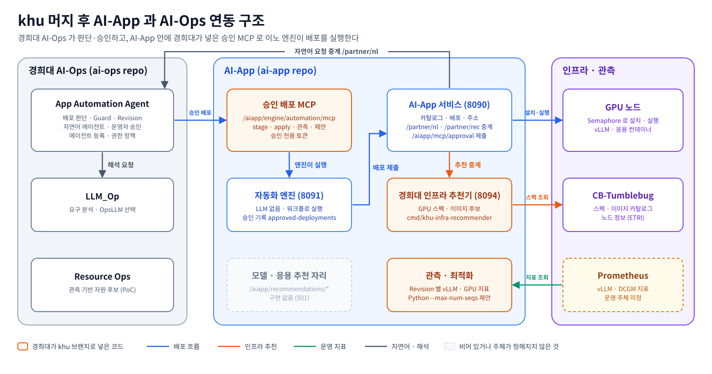
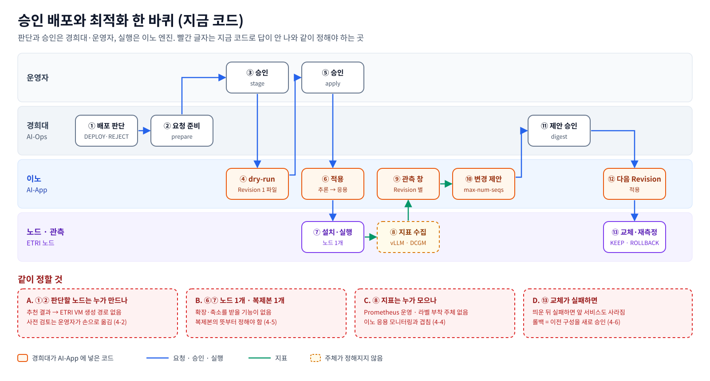
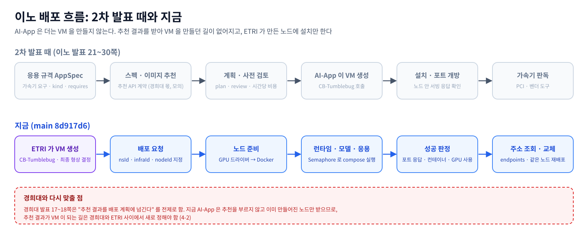
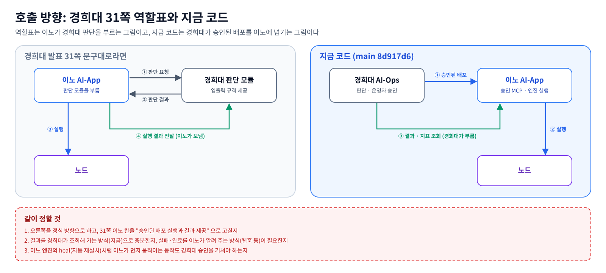
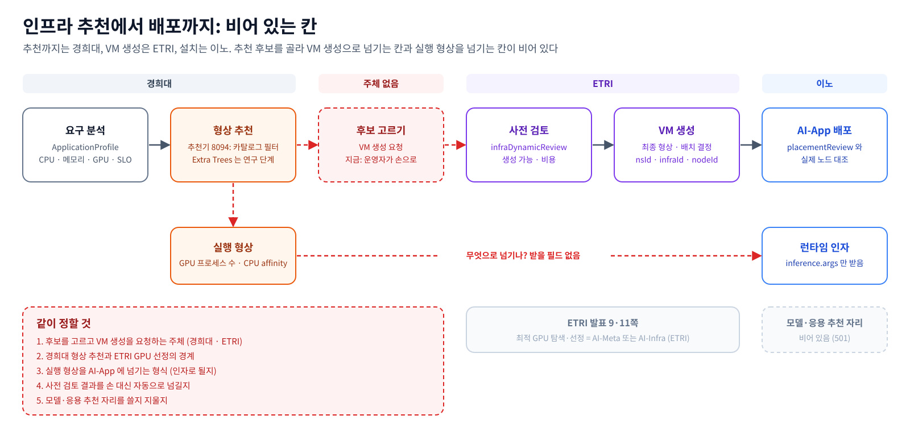
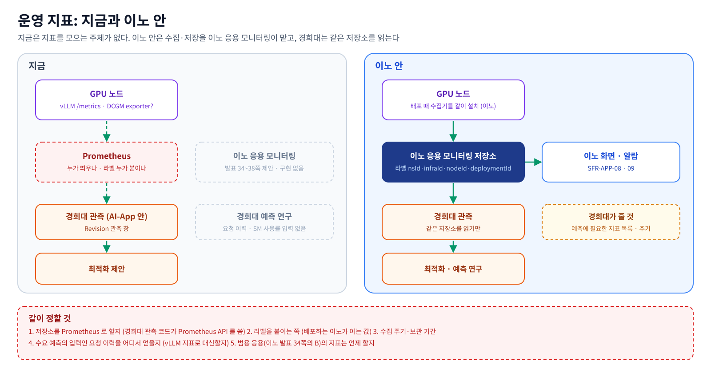
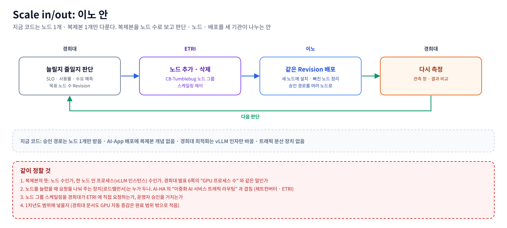
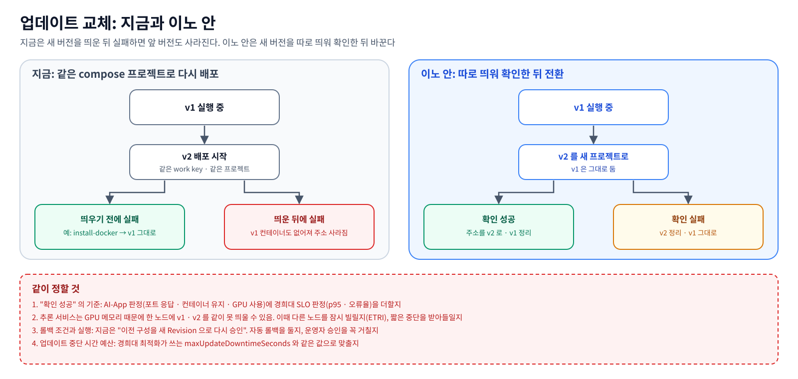
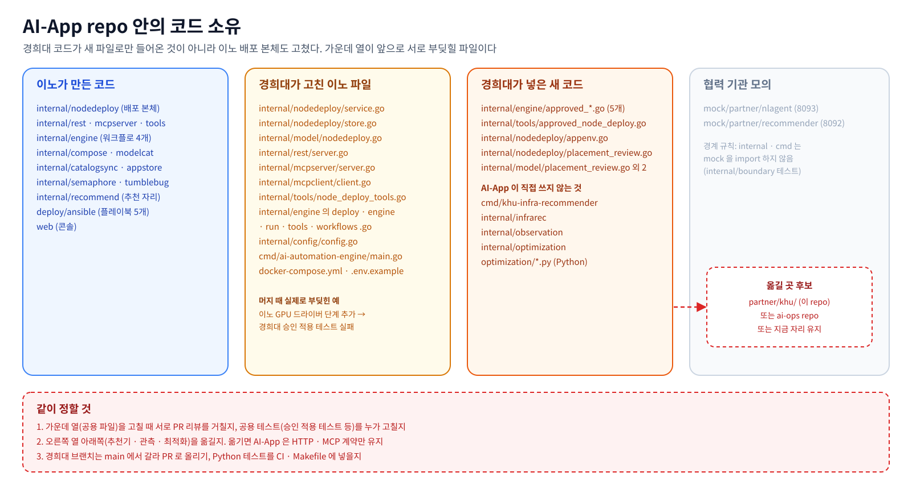

# AI-MCMP 이노그리드 · 경희대 협업 방안

기준 형상: AI-App `cloud-barista/ai-app` main `8d917d6` (khu 머지 포함), AI-Ops `cloud-barista/ai-ops` main `a9bc0d2`.
대조한 자료: 경희대 1차년도 2차 워크숍 발표(2026-10-20), 이노 2차 워크샵 발표(2026-10-21), ETRI 2차 워크샵 발표(통합 시험 계획).
그림 원본은 `docs/figures/13~21` 에 있고, 안건 그림마다 아래쪽 빨간 상자가 회의에서 같이 정할 것입니다.

## 한 장 요약

- **2차 워크샵 때와 지금 형상이 많이 다릅니다.**
  - 이노: AI-App 이 더는 VM 을 만들지 않습니다. 발표에서 보인 AppSpec, plan → review → deploy, 도구 15개, 가속기 판독은 지금 코드에서 모두 빠졌습니다. 지금은 ETRI 가 만든 노드에 런타임·모델·응용을 설치하는 구조입니다.
  - 경희대: 발표 20쪽에서 실행을 넘기던 대상인 경희대 자체 AppDeployer 를 빼고, AI-App 의 **승인 배포 MCP** 로 실행을 넘깁니다. 이 MCP 는 경희대가 khu 브랜치로 AI-App 에 넣었고, 지금 main 에 들어와 있습니다.
- **경희대 32쪽 협의 항목 8개 가운데 3개는 코드로 일부 답이 나왔습니다.** 응용 정보 연동(P0), 추천·배포 실행 연계(P0), 자동 업데이트의 실행 주체(P1)입니다. 남은 핵심은 셋입니다: **운영 지표를 누가 모으나**(P0, 이노 발표 34~38쪽과 겹침), **Scale in/out**(P1, 지금 코드에 없음), **인프라 추천과 ETRI 최종 VM 결정의 경계**(P0).
- **발표끼리 서로 어긋나는 곳이 하나 있습니다.** 경희대 31쪽 역할표는 이노의 연동 책임을 "판단 모듈 호출 및 실행 결과 전달" 로 적었습니다. 이노가 경희대 판단을 부른다는 뜻입니다. 그런데 지금 코드는 반대로 경희대가 AI-App 을 부릅니다. 역할표 문구를 지금 구조에 맞춰 고칠지 정해야 합니다.

## 1. 지금 형상

### 1-0. 담당과 용어

담당은 이노 2차 발표 5쪽 "회의 후 이노그리드 개발 범위" 그림(빨간 점선 이노그리드, 보라 점선 경희대, 파란 점선 ETRI)을 따릅니다.

| 그림의 칸 | 담당 | 하는 일 |
|---|---|---|
| AI-App 모델 통합 관리 (모델 등록·버전, 모델 배포 및 관리, 메타 정보, 다중 포맷) | 이노그리드 | 모델 카탈로그, 추론 서비스를 노드에 배포·교체·내리기 |
| AI-App 응용 등록 및 버전 관리 | 이노그리드 | 응용 목록·버전 |
| AI-App 응용 라이프사이클 관리 | 이노그리드 | 노드 일시정지·재개·재부팅·종료(종료는 VM 삭제라 ETRI 와 권한 확인) |
| AI-App 응용 모니터링 관리 (통합 모니터링, 추론 성능, 정보 저장, 오류·알람) | 이노그리드 | 응용 운영 지표 수집 |
| AI-Infra 인프라 통합 모니터링/알람, AI-Conn 인프라 추상화 | 이노그리드 | 인프라 지표·알람, 연동 드라이버 |
| AI-Ops 자동배포/자동제어 엔진 | 이노그리드 | 정해진 워크플로로 배포·제어 실행 (LLM 없음) |
| AI-App 응용 배포 자동화 및 업데이트 | 경희대 | 배포·업데이트·스케일 판단, 판단 검증, 배포 구성 Revision 관리 |
| AI-App 응용 요구 분석 및 인프라 추천 | 경희대 | VM 사양·실행 형상 추천. 최종 VM 결정·생성은 ETRI |
| AI-Ops AI LLM 운영 관리 (자연어 지원 에이전트, Ops LLM 실행 관리, 에이전트 등록 관리) | 경희대 | 자연어 요구사항 → ApplicationProfile, 분석용 LLM 선정, 에이전트 등록·권한 |
| AI-Ops 응용 배포/운영 정보 기반 추론 최적화 | 경희대 | 실행 형상 추천, 수요·위험·GPU 사용률 예측, 반복 예측 재사용 |
| AI-Ops 가시화 및 리포팅 | ETRI | - |

| 용어 | 이 문서에서의 뜻 |
|---|---|
| 응용 | 모델 서비스를 가져다 쓰는 프로그램(Dify, Open WebUI, Langflow 등). 경희대 자료는 추론 서비스도 응용에 넣음 |
| 추론 서비스 | 노드에서 모델을 띄워 API 로 여는 것(vLLM, Ollama) |
| 에이전트 | AI-Ops 안의 기능 단위. 각 프레임워크의 기능을 불러 일을 시키는 쪽 |
| MCP | 각 프레임워크가 자기 API 를 "도구" 로 내놓는 연결 규격. ai-ops 는 AI-App 의 엔진 MCP(이노 작성)와 승인 MCP(경희대 작성)를 부름 |
| Revision | 경희대 AI-Ops 가 승인한 배포 구성의 버전. 응용 버전과는 다른 축 |

### 1-1. 구성 요소

| 구성 | 포트 | 담당 | 하는 일 |
|---|---|---|---|
| AI-App 서비스 | 8090 | 이노 | 모델·런타임·응용 카탈로그, 노드 배포·교체·삭제, 노드 제어, 주소 조회, MCP 도구 13개. `/partner/nl`, `/partner/rec` 를 다른 서비스로 넘김 |
| 자동화 엔진 | 8091 | 이노 | LLM 없이 워크플로 4개(deploy·heal·control·status) 실행. 승인 배포의 dry-run·적용 실행 |
| 승인 배포 MCP | 8090 `/aiapp/engine/automation/mcp` | 경희대 (AI-App 안) | AI-Ops 가 승인한 배포를 받아 엔진이 실행. 관측·최적화 제안 조회 |
| 경희대 인프라 추천기 | 8094 | 경희대 (AI-App 안) | CB-Tumblebug 스펙·이미지 카탈로그로 GPU 후보와 호환 이미지 |
| 관측·최적화 | 엔진 안 + `optimization/*.py` | 경희대 (AI-App 안) | Prometheus 의 vLLM·DCGM 지표를 Revision 별로 묶음. vLLM `--max-num-seqs` 변경을 제안 |
| LLM_Op | 18110 | 경희대 (ai-ops) | 요구사항 → ApplicationProfile, 분석용 LLM(OpsLLM) 선택 |
| App Automation Agent | 18130 | 경희대 (ai-ops) | 배포 판단·Guard·Revision, 자연어 에이전트, 운영자 승인, 에이전트 등록·권한 |
| Resource Ops | - | 경희대 (ai-ops) | 관측 기반 자원 후보 (PoC) |
| CB-Tumblebug | - | ETRI | VM 생성, 스펙·이미지 카탈로그, 노드 정보 |
| Semaphore | - | 이노 운영 | AI-App 이 노드에 플레이북(GPU 드라이버 → Docker → compose/스크립트)을 돌리는 곳 |
| Prometheus | - | **정해지지 않음** | 경희대 관측 코드가 읽는 곳 |

### 1-2. 지금 동작하는 흐름

**자연어 요청**
1. 운영자가 AI-App 콘솔에 지시를 넣습니다.
2. 8090 이 `/partner/nl` 로 경희대 App Automation Agent 에 넘깁니다.
3. 에이전트가 LLM_Op 으로 지시를 해석합니다.
4. 조회 지시면 AI-App 엔진 MCP 를 불러 바로 답합니다. 배포·변경 지시면 바로 실행하지 않고 제안으로 기록합니다.

**승인 배포**
1. AI-Ops 가 `deployment-plans` 로 배포를 판단합니다.
2. AI-Ops `prepare` 가 판단 결과를 AI-App 배포 요청 본문으로 바꿉니다.
3. 운영자가 승인하면 `stage_approved_deployment` 가 dry-run 으로 Revision 1 의 파일만 준비합니다.
4. 운영자가 다시 승인하면 `apply_approved_revision` 이 추론 서비스를 먼저 띄우고, 응용을 그 추론 서비스에 연결해 띄웁니다.
5. 같은 노드의 다음 Revision(응용 버전 변경, vLLM 인자 변경)도 같은 경로로 적용합니다.

그림 아래 A~D 네 곳은 지금 코드로 답이 안 나와 4절에서 다룹니다.

**최적화**
1. `get_inference_observation` 이 Revision 의 관측 창 지표를 읽습니다.
2. `optimization/policy.py` 가 학습한 뒤 제안을 게시합니다.
3. AI-Ops 에서 제안을 승인하면 다음 Revision 으로 적용됩니다.
4. 적용 뒤 같은 부하로 다시 재서 `KEEP` 또는 `ROLLBACK_REVIEW` 를 판정합니다.

**인프라 추천**
- 8090 `/partner/rec` → 경희대 추천기 → CB-Tumblebug `recommendSpec` 으로 후보를 돌려줍니다.
- AI-App 배포 경로는 이 추천을 부르지 않습니다. 추천 결과로 VM 을 만드는 것은 ETRI 쪽 일입니다.

### 1-3. 열려 있는 도구 (서버를 띄워 직접 받은 목록)

| 어디 | 도구 |
|---|---|
| AI-App MCP `/aiapp/mcp` (13개) | 읽기: `list_models`, `get_model`, `list_runtimes`, `get_runtime`, `list_apps`, `get_app`, `list_node_deployments`, `get_deployment`, `get_deployment_logs`, `list_endpoints` / 쓰기: `create_deployment`, `control_node`(suspend·resume·reboot·terminate) / 파괴: `delete_deployment` |
| 엔진 MCP `/aiapp/engine/mcp` (5개) | `list_applications`, `application_status`, `deploy_application`, `heal_application`, `control_application` |
| 승인 MCP `/aiapp/engine/automation/mcp` (적용·관측을 켰을 때 5개) | `stage_approved_deployment`, `get_approved_deployment`, `apply_approved_revision`, `get_applied_revision`, `get_inference_observation`. 제안 폴더를 설정하면 최적화 제안 조회·비교 도구가 더 열림 |
| 모델·응용 추천 `/aiapp/recommendations/*` | 자리만 있음. 호출하면 501 |

엔진 워크플로 4개는 이렇게 동작합니다.

| 워크플로 | 하는 일 |
|---|---|
| deploy | 모델·응용 확인 → 배포 요청 → 끝날 때까지 상태 조회(최대 15분, `AIAPP_HEALTH_TIMEOUT`) |
| heal | 끝났지만 `running` 이 아닌 배포를 같은 요청으로 한 번 다시 배포(새 배포 ID). 진행 중인 배포, 내린 배포, **승인 경로 배포는 하지 않음** |
| control | 배포된 노드의 일시정지·재개·재부팅·종료. 종료(`terminate`)는 VM 을 지움 |
| status | 배포 기록과 노드별 마지막 로그 5줄 |

쓰기·파괴 도구는 `AIAPP_TUMBLEBUG_DRY_RUN=true`(기본값)이면 계획과 기록만 남기고 실제로 실행하지 않습니다. 배포 대상은 CB-Tumblebug 노드(`kind: node`)만 받습니다. `kind: k8s` 는 자리만 있고 거절합니다.

## 2. 이노 2차 발표 대비 지금 형상

쪽 번호는 슬라이드에 찍힌 번호입니다(PDF 쪽보다 하나 작음).

| 발표 쪽 | 발표 내용 | 지금 형상 | 논의에 걸리는 점 |
|---|---|---|---|
| 5 | 회의 후 개발 범위: 경희대는 요구 분석·인프라 추천, 배포 자동화·업데이트, LLM 운영 관리, 추론 최적화 | 그대로 | 경희대 코드가 AI-App repo 안에 들어옴 (4-7) |
| 14~19 | 모델·엔진·메타데이터. 모델 축은 HF 에서 자동, 엔진·가속기 축은 직접 정의. 국산 NPU 는 사전 컴파일이 필요 | 카탈로그가 HF·Ollama 를 수집하고, 런타임(vLLM·Ollama)으로 띄울 수 있는지, 런타임 인자(`args`), 검증 여부를 기록. NPU 런타임 없음 | 경희대 추천이 읽을 메타데이터(크기, 파라미터 수, 지원 런타임)는 있음. VRAM 계산은 추천 쪽 몫 |
| 21 | 성과표: AppSpec 규격, AWS GPU VM 생성·설치·삭제, 업데이트·정지·재개·종료, 도구 15+5개 | AppSpec 과 VM 생성 경로를 뺌. 응용은 이름 + 파일 + 실행 스크립트 + 정수 버전으로 등록. 배포는 ETRI 노드에 설치만. 업데이트는 같은 노드에 다시 배포하면 교체. 도구는 13 + 5개 | 경희대 31쪽 역할표의 이노 칸("배포 실행, 실행·제어 기능")과는 맞음 |
| 22 | 스펙·이미지는 추천 API 계약으로 받음. 추천은 경희대 몫(모의) | 배포 경로가 추천을 부르지 않음. 추천은 `/partner/rec` 로 넘기기만 하고, 그 뒤에 경희대 추천기가 붙음 | 추천 결과가 VM 생성으로 이어지는 길은 경희대·ETRI 몫 (4-2) |
| 24~25 | dry-run 게이트, 사전 검토는 항상 먼저 | dry-run 게이트는 그대로. 승인 경로는 dry-run 단계(stage)를 반드시 거쳐야 적용됨. 비용 사전 검토는 AI-App 에서 빠지고, CB-Tumblebug 사전 검토 결과를 `placementReview` 로 받아 실제 노드와 대조 | 사전 검토를 누가 부르는지 (지금은 운영자가 손으로 옮김) |
| 26 | 응용 검색(규칙 매처), 서빙 응답 확인, 가속기 판독 | 검색 도구와 가속기 판독 경로는 없음. 배포 성공은 포트 응답·컨테이너 유지, GPU 를 받은 추론 노드가 실제로 GPU 를 쓰는지(nvidia-smi 또는 로그)로 판정 | 자연어 검색은 경희대 에이전트로 넘어감 |
| 27~30 | 도구표와 엔진 deploy 10단계 예 | 엔진 deploy 는 추론 서비스를 먼저 확인·배포하고 응용을 배포. 승인 경로는 경희대가 넣은 별도 워크플로 | - |
| 32~33 | 인프라 통합 모니터링·알람 (기반 오픈소스 분석, CPU/GPU 수집, 6채널 알람) | AI-App repo 밖의 별도 작업. AI-App 코드에는 수집기가 없음 | 경희대 관측과 같은 저장소를 쓸지 (4-4) |
| 34~38 | 응용 모니터링 대상 제안: A. 추론 서버(vLLM `/metrics`, DCGM), B. 범용 응용(작업 상태·프로세스별 GPU·로그) | **이노 구현 없음.** 경희대 관측 코드가 A 의 일부(vLLM 지연·처리량·대기, DCGM 사용률·VRAM)를 Prometheus 를 전제로 읽음 | **가장 큰 겹침.** 수집은 이노 모니터링, 판단 입력은 경희대로 나눌지 (4-4) |
| 마지막 | 10~11월 연동 테스트, 12월 마무리 | 경희대가 2026-11-11 기존 배포 API 와 실제 Semaphore 로 AWS T4 노드에 Ollama·`qwen3-vl:8b` 를 올려 추론 응답까지 확인함([khu-implementation.md](khu-implementation.md), [gpu-installation.md](gpu-installation.md)). 승인 경로의 실배포·업데이트는 경희대도 확인하지 않았다고 적음 | 통합 시험 일정에 넣을지 (4-9) |

## 3. 경희대 2차 발표 대비 지금 형상

| 발표 쪽 | 발표 내용 | 지금 코드에 있는 것 | AI-App 과의 접점, 논의할 것 |
|---|---|---|---|
| 5~6 | Extra Trees 로 실행 형상(GPU 프로세스 수, CPU affinity 코어 수) 성능 예측 → 최소 형상 추천. 오승인 6 → 0건 | ai-ops 연구 코드(`poc/optimization_research`). AI-App 에 연결된 것은 없음. AI-App 의 경희대 추천기는 Extra Trees 가 아니라 카탈로그 조건 필터 + 비용순 | AI-App 은 실행 형상을 런타임 인자(`args`)로만 받음. 프로세스 수·affinity 를 어떻게 넘길지 (4-2) |
| 7 | 최근 요청 이력으로 다음 5분 입력 토큰 수요 예측, 준비 시간 반영 | 연구 (시뮬레이션) | 입력인 "요청 이력" 을 AI-App 이 모으지 않음. vLLM 지표로 대신할지 (4-4) |
| 8 | GPU 사용률로 30분 고사용률 위험·1시간 SM 사용률 예측 | 연구 | DCGM 지표가 필요. 경희대 관측 코드가 DCGM 을 읽음 (4-4) |
| 9 | 판단 추론 최적화 (예측 재사용 95%, 병렬 11% 단축) | 연구 | 경희대 내부. 접점 없음 |
| 10~12 | GAW GPU 스케줄링 정책 학습. T4 4장·A100 4장 시뮬레이션 | 연구 | AI-App 은 노드 하나에 GPU 를 통째로 잡음. 공유·분할·K8s 없음 (Q2) |
| 13~16 | 자연어 → ApplicationProfile, 단위 정규화, 검증·오류 정보 | ai-ops LLM_Op 구현 | `app_id` = AI-App 응용 이름, `app_version` = 버전 문자열. 경희대 추천기가 `profile` 을 바로 받음 |
| 17~18 | 요구사항과 추천 결과를 ID·버전으로 잇고 후보를 순위화. 비교 VM 은 m6a·g6 5종 | 경희대 추천기가 CB-Tumblebug 카탈로그 전체를 대상으로 GPU 후보를 고름. 가용성 대부분 `Unverified` | 후보 중 무엇을 고를지와 VM 생성은 ETRI 와 함께 (4-2) |
| 19 | Agent Registry 권한 확인 → 규칙 기반 DEPLOY/REJECT/RETRY → Go Guard → Manifest Revision 1 | ai-ops App Automation Agent 구현. AI-App 쪽 `stage` 가 Revision 1 을 dry-run 으로 받음 | 응용 버전(AI-App)과 배포 구성 Revision(AI-Ops) 두 축을 같이 들고 다님 |
| 20 | prepare → submit 으로 AppDeployer 에 실행 요청. 상태·성능 관측 → 유지·확장·축소 → Revision n+1 | **AppDeployer 대신 AI-App** 으로 바뀜(prepare → stage → apply). 관측은 `get_inference_observation`. 유지·확장·축소(복제본) 판단 결과를 받을 기능은 AI-App 에 없음 | Scale in/out 을 어떻게 할지 (4-5) |
| 21 | 기능 6단계: 분석 → 추천 → 판단 → 배포·상태 → 운영 최적화(ScalingDecision) → 명세 Revision n+1 | ①~③ ai-ops, ④ AI-App apply·배포 조회, ⑤ 지금은 ScalingDecision 이 아니라 vLLM 인자 제안, ⑥ AI-App apply 로 다음 Revision | ⑤ 를 복제본까지 넓힐지 (4-5) |
| 22 | 연계 API 표 (분석·외부 결과 연계·준비·제출·상태·피드백·흐름 조회) | 제출 대상이 AI-App 승인 MCP 로 바뀜 | 31쪽과 방향이 다름 (4-1) |
| 23 | AWS g5.xlarge 1차 통합 시험(BERT Tiny, AppDeployer 경로). 이슈: "기관 간 연동 인터페이스 협의 필요" | AI-App 경로로는 실제 노드 시험 기록 없음 | AI-App 경로로 다시 시험 (4-9) |
| 24 | 중간 현황: 배포·운용 PoC(복제본 제어는 로컬 CPU 수준), LLM 운영 관리 일부(최적 LLM 선정 11월 초), 추론 최적화·스케줄링은 시뮬레이션 | 같음. 추가로 AI-App 승인 경로 구현 | - |
| 31 | 역할표. 이노 연동 책임 "판단 모듈 호출 및 실행 결과 전달" | 실제로는 경희대가 AI-App 을 호출 | 역할표 문구 (4-1) |
| 32 | P0~P2 협의 8개 | 4절 | - |

## 4. 논의 안건

### 4-0. 지금 바로 쓸 수 있는 것과 협의 순서

아래는 협의 없이 지금 API 가이드([README.md](README.md))와 경희대 기능 문서([approved-deployment.md](approved-deployment.md), [inference-observation.md](inference-observation.md), [inference-optimization.md](inference-optimization.md), [infra-recommendation.md](infra-recommendation.md))로 할 수 있습니다.

| # | 경희대가 할 수 있는 것 | API 가이드 |
|---|---|---|
| 1 | 모델 목록, 응용 목록·버전 조회 | 9-2절 |
| 2 | 배포 요청 모양 확인 (노드를 반드시 지정) | 10절 |
| 3 | 배포 요청과 진행 조회 (승인 경로는 approved-deployment.md) | 7절 |
| 4 | 배포 성공·실패와 로그 조회 | 7절, 9-3절 |
| 5 | 새 버전으로 다시 배포(교체), 노드 일시정지·재개·재부팅·종료 | 3-2절, 9-3절, 11절 |

협의 순서는 이렇게 제안합니다.

- 11월 2차 통합 시험은 VM 을 ETRI 가 만들고 배포할 런타임·모델·응용이 이미 정해져 있어(ETRI 2차 발표 13~15쪽), 추천(4-2) 없이 할 수 있다고 봅니다. 경희대 확인이 필요합니다.
- 그래서 호출 방향(4-1), 응용 정보(4-3), 운영 지표(4-4) 규격부터 정하고, 추천(4-2)은 ETRI 와 함께 이어서 정합니다.

각 안건은 **근거(발표) / 지금 코드 / 그림 / 같이 정할 것 / 이노 안** 순서로 씁니다. 이노 안은 협의 때 낼 안이고, 결정은 협의에서 합니다.

### 4-1. 호출 방향과 31쪽 역할표 (P0 추천·배포 실행 연계)

- **근거:** 경희대 31쪽 "이노: 판단 모듈 호출 및 실행 결과 전달", 20쪽 "AppDeployer 에 실행 요청".
- **지금 코드:** AI-Ops 가 판단하고 운영자가 승인하면, AI-App 승인 MCP 를 거쳐 이노 엔진이 실행합니다. 이노는 경희대 판단을 부르지 않습니다.

- **같이 정할 것:**
  - 오른쪽(지금 코드)을 정식 방향으로 하고, 31쪽 이노 칸을 "승인된 배포 실행과 결과 제공" 으로 고칠지.
  - 결과를 경희대가 조회해 가는 지금 방식으로 충분한지, 실패·완료를 이노가 먼저 알려 주는 방식(웹훅 등)이 필요한지.
  - 이노 엔진의 heal(서빙이 답하지 않으면 재설치)처럼 이노가 먼저 움직이는 동작도 경희대 승인을 거쳐야 하는지.
  - 승인 경로 배포가 실패했을 때 자동 재시도를 둘지. 지금은 heal 대상이 아니고, 운영자가 새 Revision 으로 다시 승인해 재적용합니다.
- **이노 안:** 지금 방향을 정식으로 합니다. 판단·승인은 경희대, 실행·결과는 이노입니다.

### 4-2. 인프라 추천과 실행 형상 (P0 인프라 정보 연동)

- **근거:** 경희대 5~6·17~18쪽(형상 추천), 31쪽 ETRI "최종 VM 형상·배치 결정", ETRI 9·11쪽 "최적 GPU 탐색 및 선정: AI-Meta 또는 AI-Infra".
- **지금 코드:**
  - 경희대 추천기는 CB-Tumblebug 카탈로그를 필터해 후보를 돌려줍니다.
  - CB-Tumblebug 사전 검토 결과는 운영자가 손으로 `placementReview` 에 옮깁니다. AI-App 은 그 값과 실제 노드의 스펙·이미지를 대조만 합니다.
  - Extra Trees 의 실행 형상(프로세스 수·affinity)을 받을 필드는 없습니다.

- **같이 정할 것:**
  - 후보를 고르고 VM 생성을 요청하는 주체. 경희대와 ETRI 가 정할 일이고 이노는 결과만 받습니다.
  - 경희대 형상 추천과 ETRI GPU 탐색·선정의 경계.
  - 실행 형상(GPU 프로세스 수, CPU affinity)을 AI-App 에 넘기는 형식. 런타임 인자로 표현되는지.
  - CB-Tumblebug 사전 검토 결과를 운영자 손 대신 자동으로 넘길지.
  - 우리가 만들어 둔 모델·응용 추천 자리(`/aiapp/recommendations/*`)를 쓸지 지울지.
- **이노 안:**
  - AI-App 은 "만들어진 노드 + `placementReview` " 를 받는 지금 계약을 유지합니다.
  - 실행 형상은 런타임 인자(`args`)로 받습니다. vLLM 이 인자로 표현하지 못하는 것(affinity 등)이 있으면 그 목록을 받아 필드 추가를 검토합니다.
  - 모델·응용 추천 자리는 경희대가 쓰지 않을 거면 지웁니다.

### 4-3. 응용 정보 (P0 응용 정보 연동)

- **근거:** 경희대 32쪽 "App ID·모델 정보·버전·워크로드 특성을 요구 분석 모듈에 전달".
- **지금 코드:**
  - `app_id`·`app_version` 을 AI-App 응용 이름·버전으로 맞췄습니다. 버전은 정수만 받습니다(ai-ops 도 정수로 바꿔 읽고, 경희대 발표 15쪽의 "1.0.0" 은 예시입니다).
  - 모델에는 버전이 없고, 형식·양자화는 `artifactId` 로 나뉩니다.
  - 응용에는 용도·필요 자원·워크로드 특성이 없습니다.

| 항목 | 줄 수 있나 | 비고 |
|---|---|---|
| 모델 목록, 응용 목록·버전 | 있음 | `GET /aiapp/models`, `GET /aiapp/apps` |
| 모델 크기(파라미터 수, 파일 크기, 정밀도) | 참고값 | Hugging Face·Ollama 가 적은 값을 그대로 옮김. 빈 값이 있을 수 있고, 파일 크기는 GPU 메모리와 다름 |
| 필요한 GPU 메모리 | 없음 | 경희대 Profile 에는 운영자 입력 기준 `accelerator_memory_mib` 가 있음(경희대 15쪽). 모델 기준 추정은 누가 할지 정해야 함 |
| 실제 GPU 사용량 | 배포 때 한 번 | 배포 기록의 `nodes[].gpuCheck` 에 근거 줄이 남음. 사용량(MiB)은 vLLM 만(nvidia-smi), Ollama 는 로그로 판정. 운영 중 사용량은 4-4 |
| 워크로드 특성 | 없음 | 경희대 15쪽의 `workload_type` 같은 값 |

- **같이 정할 것:**
  - 워크로드 특성을 AI-App 응용 등록에 둘지, 경희대 Profile 에만 둘지.
  - 필요한 GPU 메모리를 모델 기준으로 누가 추정할지.
  - 경희대 요구 분석이 실제로 쓰는 항목 목록(용도, 최소 자원, 요청 크기·빈도 등).
- **이노 안:** AI-App 응용 등록에 선택 필드(용도, 최소 CPU·메모리·GPU, 워크로드 종류)를 추가하고, 경희대가 그 필드를 읽습니다.

### 4-4. 운영 지표 (P0 모니터링·실행 피드백, 이노 34~38쪽)

- **근거:** 경희대 7·8·20쪽(수요·GPU 예측, 실측 피드백), 이노 34~38쪽(응용 모니터링 대상 제안), 이노 5쪽 담당 그림(응용 모니터링 관리와 인프라 통합 모니터링/알람은 이노).
- **지금 코드:**
  - 이노 응용 모니터링은 구현이 없습니다.
  - 경희대 관측 코드는 Prometheus 를 전제로 vLLM·DCGM 지표를 읽습니다. 스크레이프 대상에 `nsId`·`infraId`·`nodeId`·`deploymentId` 라벨이 붙어 있어야 합니다.
  - Prometheus 를 누가 띄우는지는 정해지지 않았습니다.

- **같이 정할 것:**
  - 저장소를 Prometheus 로 할지. 경희대 관측 코드가 Prometheus API 를 쓰므로 바꾸면 경희대 코드도 바뀝니다.
  - 라벨(`nsId`·`infraId`·`nodeId`·`deploymentId`)을 붙이는 쪽. 배포하는 이노가 이 값을 압니다.
  - 수집 주기와 보관 기간. 경희대 관측은 스크레이프 간격 45초 이하를 요구합니다.
  - 수요 예측의 입력인 요청 이력을 어디서 얻을지. vLLM 지표로 대신할지.
  - 범용 응용(이노 발표 34쪽의 B)의 지표는 언제 할지.
- **이노 안:**
  - 수집과 저장은 이노 응용 모니터링이 맡습니다. 배포할 때 vLLM·DCGM 수집을 함께 켜고, 라벨은 경희대 문서의 규칙을 따릅니다.
  - 경희대 관측 코드는 그 저장소를 읽기만 합니다.
  - 경희대는 예측에 필요한 지표 목록을 줍니다.

### 4-5. Scale in/out (P1)

- **근거:** 경희대 20~21쪽(유지·확장·축소 → Revision n+1), 32쪽 P1.
- **지금 코드:**
  - AI-App 배포에는 복제본 개념이 없고 노드 단위입니다.
  - 승인 경로는 노드 하나, 복제본 하나만 받습니다.
  - 경희대 최적화는 vLLM 인자만 다룹니다.

- **같이 정할 것:**
  - 스케일 단위: 한 노드 안의 vLLM 인스턴스(복제본)인지, 노드인지, VM 인지. 경희대 발표 6쪽의 "GPU 프로세스 수" 와 같은 말인지.
  - 노드를 늘렸을 때 요청을 나눠 주는 장치(로드밸런서)를 누가 두는지. AI-HA 의 "이중화 AI 서비스 트래픽 라우팅" 과 겹칩니다.
  - 노드 그룹 스케일링을 경희대가 ETRI 에 직접 요청하는지, 운영자 승인을 거치는지.
  - 1차년도 범위에 넣을지. 경희대 문서도 GPU 자동 증감은 완료 범위 밖으로 적었습니다.
- **이노 안:**
  - 1차는 노드 수로 봅니다.
  - 노드 추가·삭제는 ETRI 가, 추가된 노드에 같은 Revision 을 배포하는 것은 이노가, 언제 늘리고 줄일지는 경희대가 맡습니다.
  - AI-App 은 승인 경로가 노드 여러 개를 받도록 넓힙니다.

### 4-6. 자동 업데이트와 롤백 (P1)

- **근거:** 경희대 32쪽 "배포 버전, 업데이트 제약, 성공·실패 판정, 롤백 조건 및 실행 주체 협의".
- **지금 코드:**
  - 실행은 이노 엔진(`apply_approved_revision`)이, 판단·승인은 AI-Ops 가 합니다.
  - 응용만 실패하면 같은 구성을 새 Revision 으로 다시 적용합니다.
  - 롤백은 "이전 구성을 새 Revision 으로 다시 승인" 입니다.
  - 같은 노드에 다시 배포하면 교체되는데, 새 서비스를 띄운 **뒤에** 실패하면 앞 서비스도 사라집니다.

- **같이 정할 것:**
  - "확인 성공" 의 기준: AI-App 판정(포트 응답, 컨테이너 유지, GPU 사용)에 경희대 SLO 판정(p95, 오류율)을 더할지.
  - 추론 서비스는 GPU 메모리 때문에 한 노드에 v1·v2 를 같이 못 띄울 수 있습니다. 그때 다른 노드를 잠시 빌릴지(ETRI), 짧은 중단을 받아들일지.
  - 롤백: 지금은 "이전 구성을 새 Revision 으로 다시 승인" 입니다. 자동 롤백을 둘지, 운영자 승인을 꼭 거칠지.
  - 업데이트 중단 시간 예산을 경희대 최적화가 쓰는 `maxUpdateDowntimeSeconds` 와 같은 값으로 맞출지.
- **이노 안:**
  - 실행 주체는 지금대로 합의합니다.
  - 이노는 교체가 실패했을 때 앞 버전을 살려 두는 배포 방식을 만듭니다.
  - 판정 기준은 AI-App 배포 성공 조건(포트 응답, 컨테이너 유지, GPU 사용)에 경희대 SLO 판정을 더합니다.

### 4-7. 코드 유지 경계 (머지에서 생긴 안건)

- **지금 코드:**
  - 경희대 코드가 AI-App 의 `internal/`, `cmd/`, `optimization/` 에 들어왔습니다.
  - 경희대가 AI-App 배포 서비스 본체(`internal/nodedeploy/service.go` 등)와 라우트·MCP 서버를 고쳤습니다.
  - 그래서 머지할 때 우리 GPU 드라이버 변경과 경희대 테스트가 부딪혀 테스트를 고쳐야 했습니다.

- **같이 정할 것:**
  - 가운데 열(경희대가 고친 이노 파일)을 고칠 때 서로 PR 리뷰를 거칠지. 공용 테스트(승인 적용 테스트 등)가 깨지면 누가 고칠지.
  - 오른쪽 열 아래쪽(추천기, 관측, 최적화)을 옮길지. 옮기면 AI-App 은 HTTP·MCP 계약만 유지합니다.
  - 경희대 브랜치를 main 에서 갈라 PR 로 올리는 방식. Python 테스트를 CI·Makefile 에 넣을지.
- **이노 안:**
  - 경희대 코드는 경희대가 유지합니다.
  - 공용 파일을 고칠 때는 서로 PR 리뷰를 거칩니다.
  - 추천기·최적화처럼 AI-App 이 직접 쓰지 않는 코드는 하위 폴더(예: `partner/khu/`)나 ai-ops 로 옮기는 것을 검토합니다.

### 4-8. 에이전트 권한·생명주기와 가속기 확장 (P1, P2)

- **지금 코드:**
  - 토큰이 셋으로 나뉩니다: 일반, 엔진 등록, 승인. AI-Ops 는 정책 파일로 호출 주체·프레임워크·네임스페이스·작업 단위의 권한을 줍니다.
  - 우리 엔진 카드는 경희대 등록부가 받습니다.
  - GPU 추론은 NVIDIA 만 받습니다. 경희대 추천기도 AMD 를 `Unsupported` 로 표시합니다. 우리 노드 준비 단계는 AMD 드라이버도 설치합니다.
  - AI-App 런타임은 지금 vLLM·Ollama 둘입니다. 경희대 32쪽 P2 의 "런타임 호환성" 은 이 런타임 목록과 이어집니다.
  - 노드 제어의 종료(`terminate`)는 VM 을 지웁니다. VM 은 ETRI 가 만든 것이라 누가 종료할 수 있는지 ETRI 와 권한을 확인해야 합니다.
- **같이 정할 것:** 통합 시험용 토큰과 정책, 다음에 지원할 가속기와 런타임, 노드 종료 권한.
- **이노 안:** 시험용 토큰은 별도로 주고받습니다. 가속기는 **NVIDIA 를 먼저** 합니다. AMD 는 Azure(Radeon Pro V710) 말고는 지금 쓸 수 있는 곳을 거의 보지 못해 뒤로 둡니다([GPU 드라이버 시험](../test/gpu-driver-test-2026-11-09.md)). TPU 는 런타임 호환부터 함께 조사합니다.

### 4-9. 통합 시험

- **근거:** ETRI 2차 발표의 2차 통합 시험 계획(Travel Planner, AWS·Azure·GCP VM 3대, 런타임·모델·응용 사전 결정). 경희대 23쪽 1차 통합 시험은 AppDeployer 경로였습니다.
- **지금 코드:** 경희대가 기존 배포 API 경로로는 AWS T4 실배포를 확인했고, 재현 절차와 시험 스크립트(`scripts/gpu-test.sh`)를 [gpu-installation.md](gpu-installation.md) 로 남겼습니다. 승인 경로를 실제 노드에서 돌린 기록은 아직 없습니다.
- **같이 정할 것:** 2차 통합 시험에 승인 경로를 넣을지, 넣는다면 어느 VM 에서 할지.
- **이노 안:** Travel Planner 의 VM 하나(예: GCP VM 3 의 vLLM + Langflow)를 승인 경로로 배포하는 시나리오를 하나 넣습니다. 경희대 문서의 예시가 바로 그 조합입니다.

## 5. 경희대에 물을 것

| # | 질문 | 자료에서 확인한 것 | 아직 모르는 것 |
|---|---|---|---|
| Q1 | 판단 메커니즘이 추론 엔진을 VM 에 띄워 보고, 추천 스펙이 맞는지 측정해서 스펙을 다시 조정하는 것인가 | 5~6쪽 Extra Trees 는 실행 형상을 미리 예측함. 지금 코드는 배포 후 실측해서 **vLLM 인자**를 조정함. VM 스펙(인스턴스 종류)을 바꾸는 순환은 자료에 없음 | VM 스펙 재조정까지 할지. 한다면 VM 재생성은 ETRI 몫이라 세 기관 흐름이 됨 |
| Q2 | GAW 스케줄러는 VM 한 대에 GPU 가 여러 장인 경우인가, K8s 에 GPU 노드가 여러 개인 경우인가 | 12쪽은 T4 4장·A100 4장 시뮬레이션. ai-ops 문서는 1차년도를 VM 기반으로 하고 K8s 를 요구하지 않는다고 적음. AI-App 은 노드 하나에 GPU 를 통째로 잡고, `kind: k8s` 는 자리만 있음 | 실제 대상 환경과 시기. AI-App 에 GPU 지정(장치 번호) 같은 기능이 필요한지 |
| Q3 | 승인 경로를 실제 노드에서 돌려 봤는가 | 경희대 테스트(`internal/rest/khu_approved_apply_test.go`)는 Semaphore 대신 플레이북 이름만 기록하는 대역을 씀. 경희대 실배포 시험(2026-11-11)은 기존 배포 API 경로였고, 승인 경로의 실배포는 확인하지 않았다고 적음 | 승인 경로를 언제 어느 노드에서 시험할지 |
| Q4 | Extra Trees 형상 추천과 수요·위험 예측을 AI-App 경로에 언제 붙일 계획인가 | 지금 AI-App 의 추천기는 카탈로그 필터 | 일정과 필요한 입력 |

## 6. 이노가 할 일

| 언제 | 할 일 | 안건 |
|---|---|---|
| 협의 전 | 경희대에 khu 브랜치 정리와 PR 방식 요청 | 4-7 |
| 협의 전 | 승인 경로를 실제 노드 하나에서 dry-run → 적용까지 돌려 보기 | 4-9 |
| 협의 뒤 | `docs/api/khu.md` 를 합의 결과로 다시 씀. 지금은 1·4·5·7·9절이 낡음 | 전체 |
| 협의 뒤 | 응용 등록에 용도·최소 자원·워크로드 종류 필드 추가 | 4-3 |
| 협의 뒤 | 응용 모니터링 수집(vLLM·DCGM)과 라벨 규칙 | 4-4 |
| 협의 뒤 | 승인 경로를 노드 여러 개로 넓히기, 교체 실패 때 앞 버전 유지 | 4-5, 4-6 |
| 협의 뒤 | NVIDIA 경로(드라이버 설치, Compose GPU 예약·확인)를 실제 노드에서 먼저 확인. AMD 는 Azure 밖 사례가 생기면 | 4-8 |
| 나중 | 린트 13건(기존) + 3건(경희대) 정리 | 부록 |

## 7. 경희대에 보낼 협의 안건

이 절만 잘라 보내도 읽히도록 썼습니다.

1. khu 브랜치의 작업 커밋(`77824d8`)을 AI-App main 에 반영했습니다(저자 그대로, `580239f`). khu 브랜치는 지워 주시고, 다음부터는 main 에서 갈라진 브랜치로 PR 을 올려 주시기 바랍니다. 반영하면서 GPU 드라이버 설치 단계가 추가된 것에 맞춰 승인 적용 테스트의 기대값을 고쳤습니다. 린트(errcheck) 3건과 repo 밖을 가리키는 문서 링크 2곳은 확인을 부탁드립니다.
2. **호출 방향:** "AI-Ops 판단 → 운영자 승인 → AI-App 승인 MCP → 이노 엔진 실행" 을 정식 방향으로 하고, 발표 31쪽 역할표의 이노 칸을 이 구조로 고쳤으면 합니다. 승인 배포가 실패했을 때 자동 재시도를 둘지도 정했으면 합니다.
3. **인프라 추천:** 추천 결과가 ETRI 의 VM 생성으로 이어지는 방식은 ETRI 와 함께 정해 주시기 바랍니다. AI-App 은 만들어진 노드와 사전 검토 결과(`placementReview`)를 받습니다. 실행 형상(프로세스 수, affinity)을 AI-App 에 넘길 방법과, 모델·응용 추천 자리를 쓸지 정했으면 합니다.
4. **응용 정보:** AI-App 응용 등록에 용도·최소 자원·워크로드 종류를 넣으려 합니다. 필요한 항목과, 모델 기준으로 필요한 GPU 메모리를 누가 추정할지 알려 주시기 바랍니다.
5. **운영 지표:** vLLM·DCGM 수집과 저장은 이노 응용 모니터링이 맡고, 관측 코드는 그것을 읽는 구조를 제안합니다. 예측 연구에 필요한 지표 목록을 주시기 바랍니다.
6. **Scale in/out:** 복제본을 노드 수로 보고 "노드 추가 ETRI, 배포 이노, 판단 경희대" 로 나누는 안을 제안합니다.
7. **업데이트·롤백:** 실행 주체는 지금 구조대로 하고, 성공·실패 판정과 롤백 조건을 정했으면 합니다.
8. **코드 유지:** 경희대 코드의 유지 책임과, 공용 파일을 고칠 때의 리뷰 방식을 정했으면 합니다.
9. **통합 시험:** 2차 통합 시험은 추천 없이 할 수 있다고 보는데 맞는지 확인을 부탁드립니다. 승인 경로 시나리오를 하나 넣었으면 합니다.
10. **권한·가속기:** 노드 종료(VM 삭제) 권한은 ETRI 와 함께 확인하고, P2 의 런타임 호환은 AI-App 런타임(vLLM·Ollama) 기준으로 같이 정했으면 합니다. 가속기는 NVIDIA 를 먼저 합니다.
11. **질문:** 5절 Q1~Q4.

## 부록. khu 머지 기록

| 항목 | 내용 |
|---|---|
| khu 브랜치 | main 과 공통 조상이 없음. 18개 커밋 중 17개는 우리 커밋을 경희대 저자로 다시 만든 것(17번째 `3d84c60` 의 트리 = 우리 `e88e980`). 실제 작업은 `77824d8` 하나 |
| 반영 | `77824d8` 만 cherry-pick. `580239f` 경희대 커밋, `0489571` 테스트 기대값 수정, `8d917d6` README 두 판 갱신. 원격 main 에 빨리감기로 올림 |
| 두 번째 반영 | khu 브랜치의 `3943d19`(GPU 설치·시험 가이드, `khu-implementation.md`, `scripts/gpu-test.sh`, Semaphore 출력 설정)를 cherry-pick 해 `8d9df7c`. README 두 곳의 충돌은 경희대 줄에 협업 문서 링크를 더해 풀었고, dotenv 예시의 따옴표 자리표시자와 README 의 회사 이름은 커밋 훅 검사에 맞춰 고침. 이어서 경희대 문서의 repo 밖 상대 링크를 GitHub 주소로, khu 브랜치 해시를 main 해시와 짝지어 고침 |
| 테스트 | `go test ./...` 통과. 처음에는 `TestKHUApprovedApplyThroughAIAppPreservesPlacement` 가 GPU 드라이버 단계(우리 `fb6688f`) 이전의 플레이북 순서·개수를 기대해서 실패했고, 기대값을 고쳐 통과시킴. Python 최적화 테스트는 repo 루트에서 7건 통과 |
| 린트 | main 에 원래 13건, 머지로 3건 늘어 16건 (`internal/optimization/proposal.go` 2건, `internal/observation/prometheus.go` 1건). `make verify` 는 머지 전부터 린트에서 실패하던 상태 |
| 실제 기동 | 세 서버를 dry-run 으로 기동해 확인. 승인 토큰만 주면 "일반 인증 토큰이 따로 필요" 로 기동 거부. 승인 MCP 는 승인 토큰에만 응답(토큰 없음·일반 토큰은 401). 적용·관측을 켜면 도구 5개. 추천 경로는 CB-Tumblebug 을 거쳐 GCP L4 후보를 돌려줌. 실제 노드 배포는 하지 않음 |
