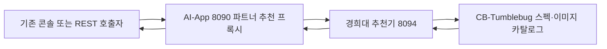
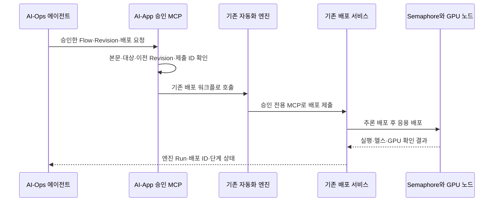

# 경희대 추가 구현과 AI-App의 역할

2026-11-11 작업 트리 기준이다. 경희대가 추가한 기능은 이노그리드의 AI-App REST·MCP·자동화 엔진과 배포 실행기를 사용한다. 인프라 추천, 승인된 배포·업데이트의 실행 연결, 배포 기록과 운영 지표의 연결, 추론 설정 최적화를 이 저장소에서 관리한다.

AI-App의 기존 기능은 main 의 `e88e980`(khu 브랜치 `3d84c60` 과 같은 트리)을 기준으로 구분했다. 경희대 추가 구현은 main 의 `580239f`(khu 브랜치 `77824d8`)와 이후 설치·시험 문서 및 스크립트 변경(`8d9df7c`, khu 브랜치 `3943d19`)에서 확인할 수 있다. AI-Ops의 구현과 책임은 [AI-Ops 구현 기록](https://github.com/cloud-barista/ai-ops/blob/main/docs/khu-implementation.md)에 정리했다.

## 저장소별 책임

| 구성 | 담당하는 일 | 연결 대상 |
| --- | --- | --- |
| AI-App 기존 서비스·엔진 (이노그리드) | 모델·런타임·응용 카탈로그, 응용 등록과 버전, 노드 배포·제거, 배포 로그·상태, 자동 배포·복구·제어 워크플로, 운영 콘솔 | CB-Tumblebug, Semaphore, 준비된 GPU 노드 |
| AI-App 추가 구현 (경희대) | 구조화한 응용 요구 분석과 인프라 추천, 승인 Revision 적용·업데이트 연결, 운영 지표 연결, 학습 기반 추론 설정 제안 | 기존 AI-App 배포 서비스·엔진과 Prometheus |
| AI-Ops (경희대) | OpsLLM 실행·라우팅, 자연어 지시 해석과 도구 선택, 에이전트 등록·권한·승인·실행 기록 관리 | AI-App와 다른 프레임워크의 MCP |
| CB-Tumblebug | CSP 스펙·이미지 조회와 사전 검토, VM 생성·상태 조회·제어·종료 | CSP API |
| Semaphore | AI-App이 요청한 Ansible 작업을 노드에서 실행 | SSH, Docker, Compose |

AI-App의 배포 대상은 CB-Tumblebug에서 준비한 `nsId/infraId/nodeId`다. VM 생성은 인프라 준비 절차에서 수행한다. 이 저장소의 추가 구현은 준비된 노드에 런타임·모델·응용을 배포하는 기존 실행 경로를 사용한다.

## 추가 구현과 기존 기능의 연결

| 추가 구현 | 코드 | 하는 일 | 활용하는 기존 기능 |
| --- | --- | --- | --- |
| 응용 요구 분석 | [internal/infrarec/app.go](../../internal/infrarec/app.go) | 기존 추천 요청의 `app` 또는 `ApplicationProfile`을 CPU·RAM·가속기·비용·SLO 조건으로 정규화한다 | 기존 추천 화면과 파트너 요청 형식 |
| GPU 스펙·이미지 추천 | [internal/infrarec/](../../internal/infrarec/), [추천기 진입점](../../cmd/khu-infra-recommender/main.go) | CB-Tumblebug 후보의 요구 충족 여부, 가용성, 가격, GPU 벤더와 이미지 드라이버 정보를 반환한다 | 8090의 기존 파트너 추천 프록시 |
| 승인 dry-run·Revision 적용 | [approved_deployment.go](../../internal/engine/approved_deployment.go), [approved_apply.go](../../internal/engine/approved_apply.go) | 승인 본문과 제출 ID를 저장하고 추론 서비스 준비 후 응용을 배포한다. 다음 Revision으로 업데이트·재시도를 연결한다 | 기존 `deploy_application`, MCP 배포 도구, Semaphore |
| 배포 조건 대조·응용 연결 | [placement_review.go](../../internal/nodedeploy/placement_review.go), [appenv.go](../../internal/nodedeploy/appenv.go) | 검토한 스펙·이미지와 실제 노드를 대조한다. 응용에 승인된 추론 주소와 서버 측 비밀값 참조를 연결한다 | 기존 노드 조회, 배포 요청·파일 생성 |
| 배포·운영 지표 연결 | [internal/observation/](../../internal/observation/), [approved_observation.go](../../internal/engine/approved_observation.go) | Revision·엔진 Run·배포 ID·노드·측정 창을 vLLM·DCGM 지표와 연결하고 품질을 검사한다 | 기존 배포 기록·엔진 아카이브·활성 엔드포인트 |
| 학습 기반 추론 최적화 | [optimization/](../../optimization/), [internal/optimization/](../../internal/optimization/), [approved_optimization.go](../../internal/engine/approved_optimization.go) | 실측 자료로 vLLM 설정 변경 효과를 예측하고 제안·검토·적용 전후 비교를 제공한다 | 위 관측 레코드와 기존 승인 Revision 적용 |
| 설치·실배포 시험 지원 | [gpu-installation.md](gpu-installation.md), [gpu-test.sh](../../scripts/gpu-test.sh) | 초기 설치부터 상태 조회·dry-run·배포·추론 응답 확인·종료까지 재현 절차를 제공한다 | 기존 API 예제 공통 함수와 Compose |

Semaphore의 제거된 `community.general.yaml` 출력 플러그인 오류에는 Compose 환경변수로 기본 Ansible 콜백과 YAML 출력 형식을 지정했다. 기존 플레이북과 배포 API를 그대로 사용한다.

## 인프라 추천 경로

`AIAPP_PARTNER_REC_URL`을 경희대 추천기 주소로 지정한다. 추천기는 `go run ./cmd/khu-infra-recommender`로 실행하며 기본 포트는 `8094`다. 원본 `mock/partner/recommender`는 원래 위치와 기본 동작을 유지한다.

| 8090 경로 | 추가 구현의 응답 |
| --- | --- |
| `POST /aiapp/partner/rec/recommendations/specs` | 요구 조건에 맞는 CB-Tumblebug 스펙 후보와 추천 사유 |
| `POST /aiapp/partner/rec/recommendations/image` | 선택한 스펙에 호환되는 이미지와 드라이버 확인 상태 |

후보는 가용성 상태별로 구분하고 그룹 안에서는 비용순을 유지한다. 지연·처리량 SLO와 저장공간은 실제 부하·프로비저닝 검토에서 확인할 조건으로 표시한다. [요청·설정·제약](infra-recommendation.md)

`POST /aiapp/recommendations/models`와 `/apps`는 별도의 모델·응용 추천 확장점이다. [khu.md](khu.md)에 정의된 인터페이스에 구현을 등록하지 않으면 `501`이다. 이번 인프라 추천 구현의 경로와 구분해야 한다. 현재 자연어 에이전트의 작업 분류와 이 스펙·이미지 추천을 하나의 자연어 추천 흐름으로 연결하는 작업도 후속 범위다.

## 배포 자동화·업데이트 경로

AI-Ops는 자연어 요청을 해석하고 권한·승인·계획을 관리한다. AI-App 추가 구현은 승인된 요청을 기존 엔진과 배포 서비스에 연결한다.

승인 MCP는 `:8090/aiapp/engine/automation/mcp`다. `stage_approved_deployment`, `get_approved_deployment`, `apply_approved_revision`, `get_applied_revision`으로 준비와 적용 결과를 관리한다. 엔진에서 배포 서비스로 제출할 때는 `/aiapp/mcp/approval`을 사용한다. 일반 조회·워크플로는 기존 `/aiapp/engine/mcp`를 사용한다.

응용 버전만 변경하면 추론 서비스를 재사용한다. 추론 설정을 변경하면 추론 서비스를 재배포하고 응용을 새 배포에 연결한다. 같은 제출 ID의 중복 수락을 막고, 현재 배포가 승인 당시의 이전 배포와 달라지면 교체를 거절한다. 이전 구성으로 복구하려면 그 구성을 새 Revision으로 승인한다. [승인·업데이트 계약](approved-deployment.md)

## 지표 연결과 최적화의 구분

운영 지표 연결은 읽기 기능이다. 승인 Revision의 추론·응용 Run과 현재 활성 배포를 대조한 뒤, 같은 노드·GPU·측정 창의 지연 p95, 요청·토큰 처리량, 대기 요청, 오류, GPU 사용률과 VRAM을 관측 레코드로 만든다. 지표 누락·수집 간격·충돌을 검사하며 변경안을 결정하지 않는다. [관측 계약](inference-observation.md)

최적화는 이 관측 레코드와 부하 발생기의 결과를 입력으로 사용한다. `optimization/policy.py`의 Random Forest가 vLLM `--max-num-seqs` 후보의 지연·SLO 충족 처리량·VRAM·오류율을 예측한다. 측정 범위, 검증 오차, SLO와 업데이트 중단 예산을 검사해 `KEEP`, `UPDATE`, `ABSTAIN`을 반환한다. 범위 밖 자료나 부족한 근거는 보류한다.

제안 게시물은 데이터·모델·대상·Revision과 연결한 해시로 식별한다. AI-Ops가 제안을 검토하고 승인하면 기존 Revision 적용 경로로 제출한다. `get_inference_optimization`과 `compare_inference_optimization`은 제안 확인과 적용 전후 비교를 제공한다. [학습·게시·승인 절차](inference-optimization.md)

## 활성화와 기록 보존

| 설정·저장 위치 | 용도 |
| --- | --- |
| `AIAPP_PARTNER_REC_URL`, `AIAPP_KHU_REC_ADDR` | 기존 추천 프록시와 추가 추천기 연결 |
| `AIAPP_TUMBLEBUG_BASE_URL`과 인증 설정 | 추천·노드 조회에 사용할 CB-Tumblebug |
| `AIAPP_ENGINE_APPROVAL_TOKEN` | AI-Ops 승인 서비스와 엔진·배포 서비스 사이의 전용 인증 |
| `AIAPP_ENGINE_APPLY_ENABLED` | 실제 승인 Revision 적용 도구 활성화 |
| `AIAPP_DEPLOYMENT_STORE_FILE`, `AIAPP_ENGINE_ARCHIVE_DIR` | 배포 기록, 제출 예약, 승인 영수증과 엔진 Run 보존 |
| `AIAPP_OBSERVATION_PROMETHEUS_URL` | vLLM·DCGM 관측 자료 조회 |
| `AIAPP_OPTIMIZATION_PROPOSAL_DIR` | Python 작업이 게시하고 엔진이 읽는 최적화 제안 |

일반 게이트웨이·엔진 등록·운영자·승인용 토큰은 용도별로 구분한다. 승인 기록·배포 저장소·아카이브 볼륨을 유지해야 재시작 후 결과를 확인할 수 있다. 현재 승인 아카이브는 엔진 프로세스 하나가 관리한다.

## 검증 범위

2026-11-11에 기존 배포 API와 Semaphore로 AWS T4 노드에 Ollama·`qwen3-vl:8b`를 배포했다. CUDA 사용, `running` 상태와 실제 추론 응답을 확인했다. 같은 모델을 OpsLLM에 연결한 AI-Ops 자연어·MCP 조회와 실행 기록 복구도 확인했다. 시험용 VM과 루트 EBS는 종료·삭제했다.

AI-App의 Go 테스트·vet와 GPU 시험 스크립트의 모의 HTTP 회귀 시험 9개를 통과했다. 새 스크립트의 `status`·`test`는 실제 노드에서 확인했다. 승인 Revision·관측·최적화는 단위·통합 표본 검증과 실제 GPU 성능 검증을 구분한다. 이번 시험에서 승인 경로의 실배포·업데이트, vLLM·DCGM 실계측에 의한 최적화 개선 폭, 새 호스트의 전체 재설치는 확인하지 않았다.

재현 절차는 [GPU 설치·시험 가이드](gpu-installation.md)에 있다. 환경별 실행 ID·원시 결과·종료 확인 자료는 Git에서 제외한 로컬 개발 기록에 보관한다.
