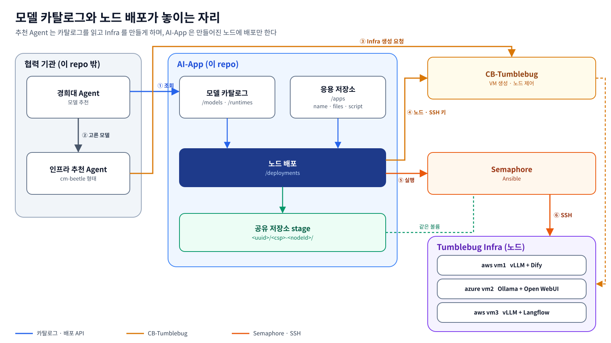
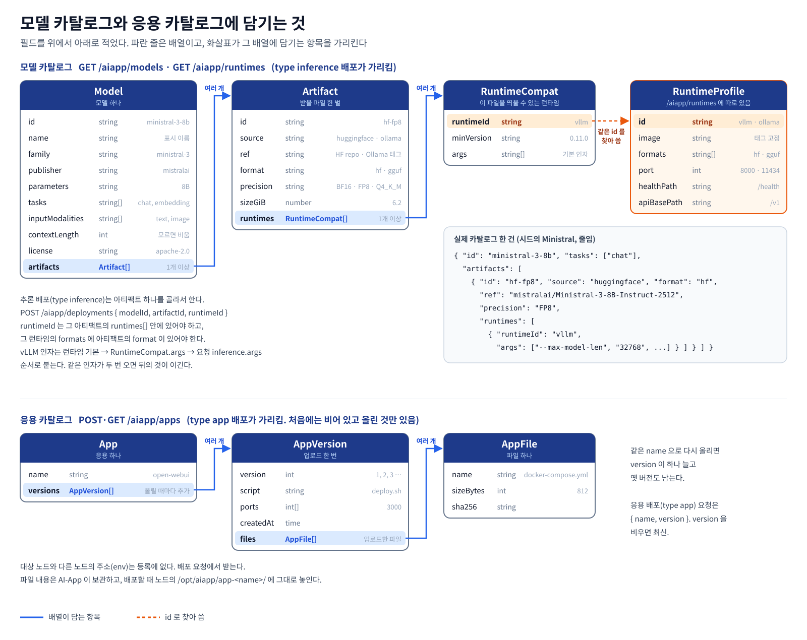
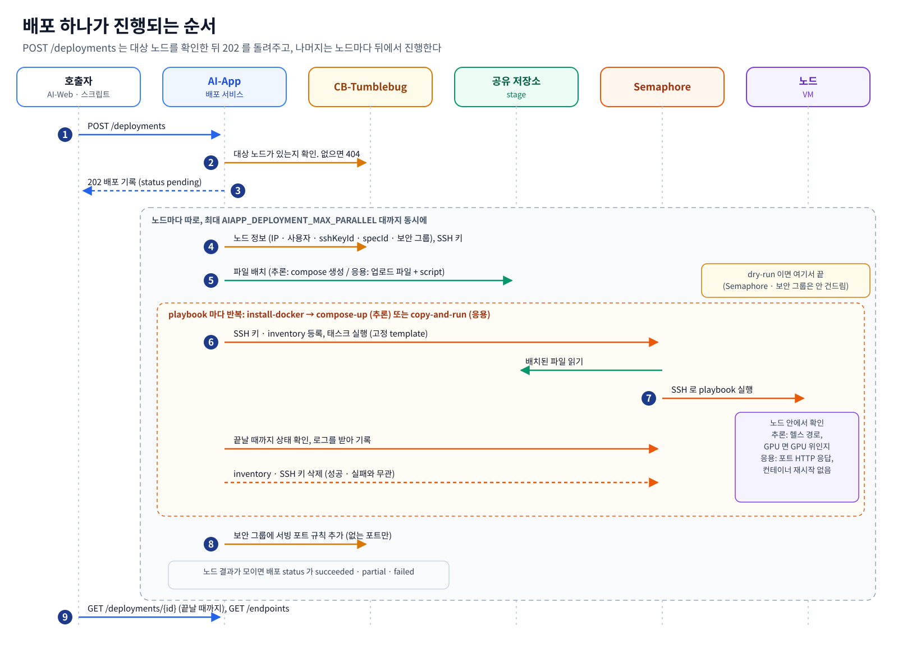
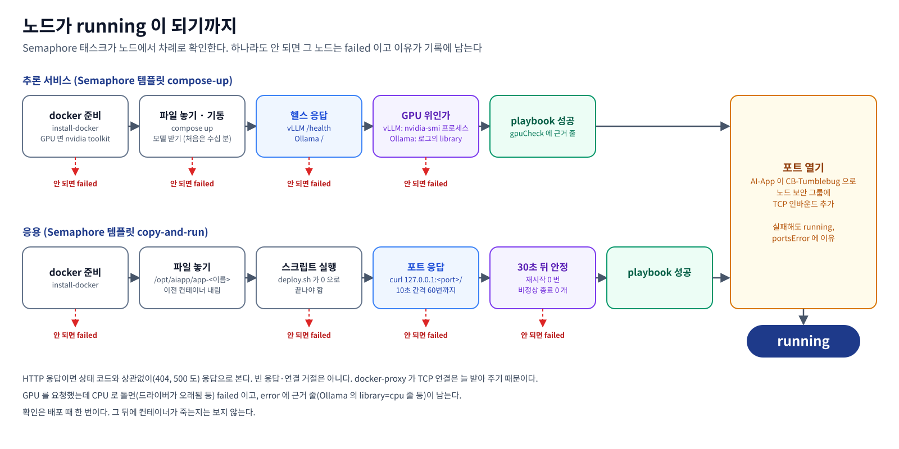
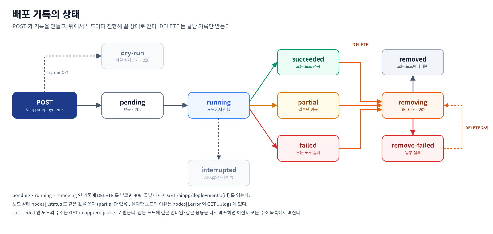
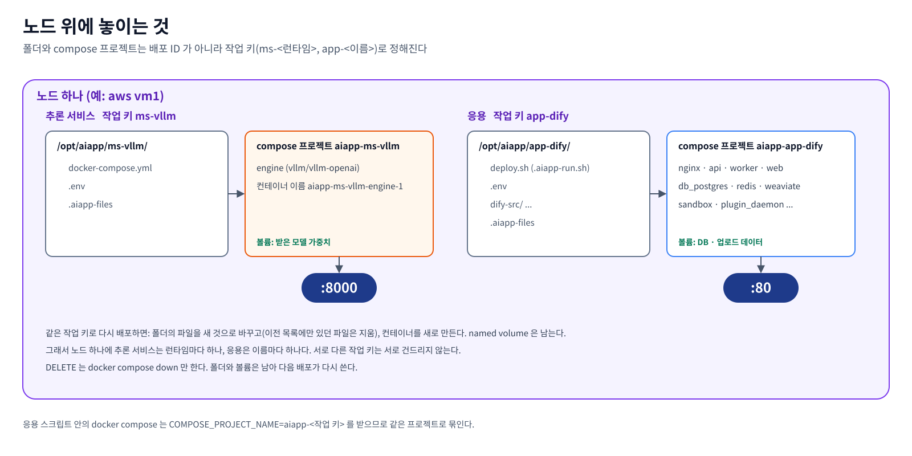
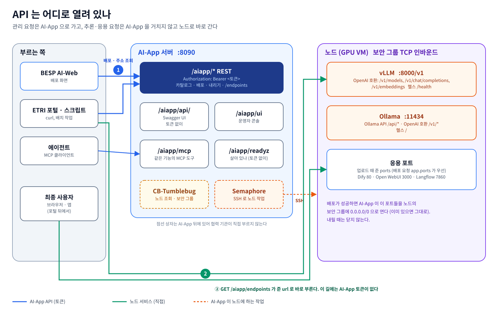
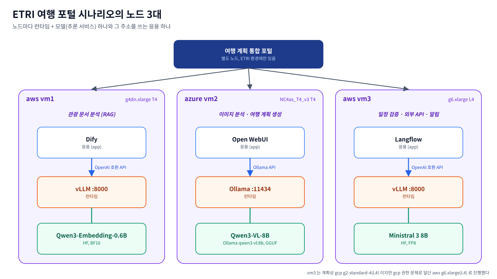

# AI 모델 카탈로그와 노드 배포 설계

> AI-App 의 데이터 모델(모델 카탈로그·응용 카탈로그)과 배포 실행 경로를 설명한다. API 계약과 부르는 순서는
> [docs/api/](../api/README.md) 에 있다.

## 한 장 요약



| 질문 | 답 |
|---|---|
| 무엇을 바꾸나 | 모델, 추론 엔진, 설치 명령을 한 항목에 묶던 것을 **카탈로그(모델 · 아티팩트 · 런타임)와 응용 저장소, 노드 배포** 셋으로 나눈다 (1, 3절) |
| VM 은 누가 만드나 | **AI-App 이 아니다.** 인프라 추천 쪽이나 운영자가 CB-Tumblebug 으로 만들고, AI-App 은 이미 있는 노드에 배포만 한다 (2절) |
| 모델과 런타임의 관계는 | 모델은 아티팩트(어디에 어떤 형식으로 있나)를 갖고, 아티팩트는 자신을 띄울 수 있는 런타임과 그 런타임에 필요한 인자를 적는다. 배포는 아티팩트 + 런타임 한 쌍이다 (3.1, 3.2) |
| 노드에는 어떻게 올리나 | AI-App 이 파일을 공유 저장소에 놓고, Semaphore 가 SSH 로 playbook 을 돌린다. template 은 고정, SSH 키와 inventory 는 실행마다 만들고 지운다 (4.3, 4.4) |
| 노드 위에서 겹치면 | 작업 키(`ms-<runtimeId>`, `app-<name>`)가 같으면 앞의 배포를 바꾼다. 노드 하나에 추론 서비스는 런타임당 하나, 응용은 이름당 하나다 (4.5) |
| 추천은 | 배포 경로가 부르지 않는다. AI-App 은 판단 재료(정밀도 · 크기 · 형식)를 원래 값 그대로 내준다. 경희대 인프라 추천기(`cmd/khu-infra-recommender`)는 이 repo 에 있고 `/aiapp/partner/rec/*` 로 넘긴다. 모델·응용 추천 자리(`/aiapp/recommendations/*`)는 비어 있다 (2절, [khu.md](../api/khu.md), [infra-recommendation.md](../api/infra-recommendation.md)) |
| 배포는 언제 끝나나 | 노드마다 `(GPU 노드면 드라이버) → docker 준비 → 파일 놓기·기동 → 헬스(응용은 포트 응답) → GPU(응용은 컨테이너 안정)` 를 확인해야 `running` 이다. 그 뒤 AI-App 이 보안 그룹에 포트를 연다 (4.4) |
| 부르는 쪽은 어디로 가나 | 관리 요청은 AI-App(`:8090/aiapp`), 모델 호출과 응용 화면은 노드로 바로 간다. 주소는 `GET /aiapp/endpoints` 가 준다 (5절) |
| 지금의 API 계약은 | 이 문서가 아니라 [docs/api/](../api/README.md) 에 있다. 이 문서는 왜 이렇게 나눴는지의 기록이다 |

---

## 1. 왜 이렇게 나누나

| 나눈 것 | 이유 |
|------|------|
| 모델 · 아티팩트 · 런타임을 따로 둔다 | 같은 모델이 출처마다 다른 형식(HF 의 safetensors, Ollama 의 GGUF)으로 있고, 형식마다 띄울 수 있는 런타임이 다르다. 한 항목에 묶으면 런타임·형식마다 통째로 복사해야 한다. 모델 정보만 보는 외부 모듈(경희대 모델 추천)이 설치 방법까지 받지 않아도 된다 |
| 모델에 용도·입력·출처·정밀도·크기를 원래 값 그대로 둔다 | 추천과 배포를 판단할 재료다. AI-App 은 계산하지 않고 내주기만 한다 |
| VM 생성과 배포를 나눈다 | VM 은 CB-Tumblebug 으로 만든 쪽이 갖고, AI-App 은 이미 있는 노드에 몇 번이든 배포·다시 배포·내리기를 한다. 파일을 넘기고 단계별 로그를 남길 수 있다 |
| 응용을 파일 묶음 + 스크립트로 받는다 | Dify 처럼 compose 파일과 설정 파일 여러 개가 필요한 응용도 올릴 수 있다 |

## 2. 전체 흐름

전체 흐름은 맨 위 한 장 요약의 그림이다.

- **AI-App 은 VM 을 만들지 않는다.** CB-Tumblebug 이 만든 노드를 받아 그 위에 배포한다.
  VM 생성은 인프라 추천 쪽(cm-beetle 은 추천 결과를 그대로 `POST /migration/ns/{nsId}/infra` 로 넘겨 Tumblebug 을 직접
  부른다)이나 운영자가 한다. 노드 제어(정지·재개·재부팅·종료)는 AI-App 이 계속 Tumblebug 으로 한다.
- 모델 추천(정밀도·크기로 필요 자원을 계산하는 것)과 인프라 추천은 경희대 몫이다. AI-App 은 판단 재료가 되는
  메타데이터를 **원래 값 그대로** 내준다. 경희대 인프라 추천기는 이 repo 안(`cmd/khu-infra-recommender`)에 있지만 배포 경로와는
  이어지지 않는다. 추천 결과로 VM 을 만드는 것은 경희대와 ETRI 사이의 일이다.
- 경희대 AI-Ops 는 판단과 운영자 승인을 거친 배포를 승인 배포 MCP 로 넘기고, 자동화 엔진이 이 문서의 배포 경로로 실행한다(6.1).

## 3. 데이터 모델



### 3.1 Model 과 Artifact

같은 모델이 출처마다 다른 형태로 배포된다(Qwen3-VL-8B 는 HF 에 BF16 safetensors 로, Ollama 에 GGUF 로). 그래서 포맷은
모델이 아니라 **아티팩트**에 둔다.

| Model 필드 | 뜻 | 예 |
|------------|----|----|
| `id` | 카탈로그 ID | `qwen3-vl-8b` |
| `name` | 표시 이름 | `Qwen3-VL-8B-Instruct` |
| `description` | 출처가 적은 설명 그대로 (없으면 비움) | `Qwen3 is the latest generation of ...` |
| `family`, `publisher` | 계열, 공개 주체 | `qwen3-vl`, `Qwen` |
| `parameters` | 파라미터 수 (원래 표기). 아티팩트마다 다르면 비우고 아티팩트에 둔다 | `8B` |
| `tasks` | 용도 | `chat`, `vision-chat`, `embedding` |
| `inputModalities` | 받는 입력 | `text`, `image` |
| `contextLength` | 문맥 길이 (모르면 비움) | `262144` |
| `license` | 라이선스 | `apache-2.0` |
| `artifacts[]` | 아래 표 | |
| `deployable` | 계산값. 아티팩트 중 하나라도 `deployable` 이면 `true`. 입력은 무시 | `true` |

| Artifact 필드 | 뜻 | 예 |
|---------------|----|----|
| `id` | 모델 안에서의 ID | `hf-bf16`, `ollama-q4km` |
| `source` | 출처 | `huggingface`, `kaggle`, `ollama`, `docker-model-runner` |
| `ref` | 출처에서의 이름 | `Qwen/Qwen3-VL-8B-Instruct`, `qwen3-vl:8b`, `ai/qwen3-vl` |
| `format` | 파일 형식 | `hf`(safetensors), `gguf` |
| `precision` | 정밀도·양자화, **원래 값 그대로** | `BF16`, `FP8`, `Q4_K_M` |
| `parameters` | 이 아티팩트의 파라미터 수, 출처 표기 그대로 (모르면 비움) | `8.2B`, `751.63M` |
| `sizeGiB` | 받을 크기 (모르면 0). HF 는 저장소의 `*.safetensors` 파일 합 | `6.2` |
| `runtimes[]` | 호환 런타임과 최소 버전, 그 런타임에 필요한 인자(`args`, 서비스 인자 뒤·요청 `inference.args` 앞에 붙음. `ollama` 는 받지 않음) | `{runtimeId: vllm, minVersion: 0.11.0, args: [--max-model-len, "32768"]}` |
| `deployable` | 계산값. `runtimes[]` 가 비어 있지 않으면 `true`. 입력은 무시 | `false` |

- 호환 런타임은 포맷만으로 정하지 않고 명시한다. 같은 safetensors 라도 아키텍처 지원 여부가 런타임 버전마다 다르다.
- 정밀도로 VRAM 을 계산하는 등의 추천 로직은 넣지 않는다(경희대 몫).
- `deployable` 은 저장하는 값이 아니라 `runtimes[]` 에서 계산한다. 배포할 수 있는 것만 보려면 `GET /aiapp/models?deployable=true` 다.

### 3.1.1 카탈로그를 채우는 길

| 길 | `origin` | 누가 |
|------|------|------|
| 기본 모델 (시드) | `seed` | 코드. 카탈로그 파일이 없을 때 한 번 |
| 자동 수집 | `huggingface`, `ollama` (기본). `docker-model-runner`, `ngc`, `kaggle` 은 켜야 돈다 | AI-App 이 기동 때와 주기마다 출처 API 를 읽어 넣는다 |
| 등록 | `manual` | 운영자·협력 기관이 `POST /aiapp/models` |

- 수집은 출처가 적은 값을 그대로 넣고, 모델이 쓸 만한지는 판단하지 않는다(경희대 몫). 우리가 정하는 것은 띄울 수 있는지 하나다.
  HF 는 고정한 vLLM 버전의 지원 아키텍처면 `vllm`, Ollama 라이브러리는 `ollama`, 나머지는 런타임 없음.
- 수집은 자기 출처의 항목만 바꾼다. `seed`·`manual` 은 건드리지 않고, 사라진 항목은 `stale` 로 둔다. 배포가 성공하면 `verifiedAt` 이 남고 수집이 그 값을 지우지 않는다.
- `docker-model-runner`, `ngc`, `kaggle` 은 그 아티팩트를 띄울 런타임이 아직 없어 기본으로 끈다. 설정(`AIAPP_CATALOG_SYNC_SOURCES`)에서 빠진 출처의 항목은 수집이 끝날 때 지운다. 켜 두었다가 끄면 목록에서 사라진다.
- 카탈로그 파일에 `origin` 이 없는 항목은 `manual` 로 읽는다. 다만 ID 가 시드 모델 ID 면 `origin` 이 생기기 전에 시드가 쓴 것이라 `seed` 로 읽는다.
- 출처가 닿지 않으면 그 출처만 건너뛴다. 동작과 설정은 [docs/api/README.md](../api/README.md) 9-2 에 있다.

### 3.2 Runtime 프로필

| 필드 | 예 (vllm) | 예 (ollama) |
|------|-----------|-------------|
| `id` | `vllm` | `ollama` |
| `image` | `vllm/vllm-openai:<ver>` | `ollama/ollama:<ver>` |
| `formats` | `hf` | `gguf` |
| `port`, `healthPath`, `apiBasePath` | `8000`, `/health`, `/v1` | `11434`, `/`, `/v1` |
| compose 틀 | `--model <ref>` 로 기동, GPU 예약 | 기동 후 `ollama pull <ref>` |

추론 서비스 배포 요청이 오면 아티팩트의 `format`·`runtimes` 와 런타임 프로필이 맞는지 보고, 맞으면 compose 파일을 만든다.

### 3.3 App

| 필드 | 뜻 |
|------|----|
| `name` | 응용 이름. 소문자·숫자·`_`·`-` 만 쓴다(4.5). 같은 이름으로 다시 올리면 새 `version` |
| `files[]` | 업로드한 파일들 (compose, 설정, 데이터) |
| `script` | 노드에서 실행할 스크립트. 파일들이 있는 폴더에서 실행된다 |
| `ports[]` | 응용이 노드에서 여는 TCP 포트. 배포가 끝나면 노드 보안 그룹에 열린다 |

등록은 multipart 하나로 받는다. 대상 노드와 다른 노드의 주소(env)는 등록이 아니라 **배포 요청**에서 받는다.

## 4. 배포

### 4.1 대상

CB-Tumblebug 구조 그대로 받는다.

```json
{ "kind": "node", "nsId": "etri", "infraId": "travel", "nodeId": "vm1" }
```

- csp·region·zone 은 요청으로 받지 않고 노드 정보(`GET /ns/{nsId}/infra/{infraId}/node/{nodeId}` 의
  `connectionConfig.providerName`, `regionZoneInfo`)에서 읽는다.
- SSH 사용자도 노드 정보(`nodeUserName`)에서 읽는다. CB-Tumblebug(cb-spider)은 로그인 사용자 `cb-user` 를 `useradd -G sudo` 로
  만드는데, `sudo` 그룹이 없는 이미지(RHEL, Rocky, AlmaLinux, Amazon Linux 는 `wheel`)에서는 이것이 실패해 노드에 `cb-user` 가 없고,
  이미지의 기본 사용자(aws `ec2-user` 등)가 같은 키를 받는다. 그래서 실제 배포(dry-run 이 아닌)는 playbook 전에 AI-App 이
  `golang.org/x/crypto/ssh` 로 CB-Tumblebug 의 키를 써서 SSH 공개키 인증만 해 본다(세션·명령 없음, 한 번에 10초, 노드마다 최대 6번).
  - CB-Tumblebug 의 사용자가 받아들여지면 그대로 쓴다(`sshUserSource: tumblebug`).
  - 서버가 응답했는데 그 사용자의 키를 거절하면(네트워크 오류가 아닌 인증 실패) 노드 이미지의 OS(노드 정보의 `image.osType`,
    `image.osDistribution`, 이미지 이름 순)에 맞는 기본 사용자를 차례로 시도해 처음 받아들여진 사용자를 쓴다(`sshUserSource: fallback`,
    `notes` 에 거절된 사용자와 쓴 사용자). OS 와 기본 사용자의 표는 `internal/nodedeploy/sshuser.go` 의 `osDefaultUsers` 한 곳에 있고,
    `root` 는 넣지 않는다.
  - 모두 거절되면 CB-Tumblebug 의 사용자로 두고 `notes` 에 남긴다.
  - 연결 자체가 안 되면(거부, 시간 초과: 부팅 중) 정하지 않고 CB-Tumblebug 의 사용자로 둔다. `install-docker` 의
    `wait_for_connection` 이 접속될 때까지 기다린다.

  대상에 `sshUser`(1~32자, `[a-z_][a-z0-9_-]*`)를 주면 인증을 시도하지 않고 그 노드의 Semaphore inventory 에 그 사용자를 쓴다
  (`sshUserSource: request`). 키는 어느 쪽이든 CB-Tumblebug 이 가진 키다. 접속한 사용자는 `nodes[].sshUser` 와 각 단계
  (`steps[].sshUser`)에 남고, 같은 배포를 내리는 compose-down 도 다시 고르지 않고 그 사용자로 접속한다. 노드 제어(`control`)는
  CB-Tumblebug API 로 보내므로 SSH 사용자와 상관없다.
- k8s(`k8sClusterId`, 노드 그룹)를 받을 자리(`kind: k8s`)만 정해 두고, 이번에는 거절한다(`422`).

### 4.2 요청

```json
{
  "type": "inference",
  "targets": [{ "kind": "node", "nsId": "etri", "infraId": "travel", "nodeId": "vm1" }],
  "inference": { "modelId": "qwen3-embedding-0.6b", "artifactId": "hf-bf16", "runtimeId": "vllm" }
}
```
```json
{
  "type": "inference",
  "targets": [{ "kind": "node", "nsId": "etri", "infraId": "travel", "nodeId": "vm4", "sshUser": "ec2-user" }],
  "inference": { "modelId": "qwen3-embedding-0.6b", "artifactId": "hf-bf16", "runtimeId": "vllm" }
}
```
```json
{
  "type": "app",
  "targets": [{ "kind": "node", "nsId": "etri", "infraId": "travel", "nodeId": "vm1" }],
  "app": { "name": "dify", "version": 1, "env": { "VLLM_BASE_URL": "http://203.0.113.10:8000/v1" } }
}
```

응답은 배포 ID(uuid)와 노드별 상태다. 노드 결과에는 접속한 SSH 사용자(`nodes[].sshUser`)와 그 출처(`nodes[].sshUserSource`)가 같이 남는다.

그 밖의 필드다. 자세한 형식은 [approved-deployment.md](../api/approved-deployment.md) 와 Swagger 에 있다.

| 필드 | 뜻 |
|------|----|
| `inference.args` | 런타임 기동 인자(예 vLLM `--max-num-seqs`) |
| `inference.apiKey` | vLLM 의 API 키. 비면 만들어 넣는다. `/v1` 은 `Authorization: Bearer` 를 요구하고 `/health` 는 열어 둔다. Ollama 는 키를 거절한다 |
| `app.inferenceBinding` | 같은 노드의 추론 배포 주소·키를 응용 `.env` 의 지정한 변수 이름으로 넣는다 |
| `app.envFrom` | 응용 환경변수 값을 AI-App 서버의 `AIAPP_DEPLOY_SECRET_*` 에서 가져온다. 배포 기록에는 이름만 남는다 |
| `placementReview` | CB-Tumblebug 사전 검토 결과(`specId`, `imageId`, 상태, 비용). 접수할 때와 실행 직전에 노드와 대조해 다르면 거절한다 |
| `submission`, `requireDryRun` | 승인 배포 전용. 예약한 배포 ID 로 한 번만 받는다. 일반 REST 로 보내면 거절한다 |

### 4.3 공유 저장소

```
<AIAPP_STAGE_ROOT>/<배포 uuid>/<csp>-<nodeId>/
    docker-compose.yml        (추론 서비스) 또는 업로드 파일 + script (응용)
    .env                      (배포 요청의 env)
```

AI-App 컨테이너와 Semaphore 컨테이너가 같은 볼륨을 같은 경로로 마운트한다. playbook 은 이 폴더를 노드로 복사한다.

### 4.4 Semaphore 실행 (노드 하나 기준)



| # | 단계 | 비고 |
|---|------|------|
| 1 | Tumblebug 에서 노드 정보와 SSH 키(`GET /ns/{nsId}/resources/sshKey/{sshKeyId}` 의 `privateKey`) 조회 | 공인 IP 가 없으면 사설 IP |
| 2 | 공유 저장소에 파일 배치 | 추론 서비스는 compose 를 만들어 넣는다 |
| 3 | Semaphore 에 그 노드의 key(ssh)와 inventory 등록 | 배포마다 만들고 끝나면 지운다. template 은 playbook 마다 하나씩 고정으로 둔다 |
| 4 | 태스크 실행: (GPU 노드면 `install-gpu-driver` →) `install-docker` → `compose-up`(추론 서비스) 또는 `copy-and-run`(응용). 태스크 요청에 3의 `inventory_id` 를 넣어 template 의 inventory 를 덮어쓴다 | GPU 노드는 노드 스펙으로 가린다. 드라이버가 이미 응답하면 그대로 두고, Ubuntu 면 MOK 등록이 필요 없는 드라이버(NVIDIA `ubuntu-drivers --gpgpu`, AMD 커널 `amdgpu` + AMD 펌웨어)를 깐다. 그다음 docker 와 nvidia-container-toolkit. 시험 결과는 [gpu-driver-test](../test/gpu-driver-test-2026-11-09.md) |
| 5 | 상태 폴링, 끝나면 `GET /api/project/{p}/tasks/{id}/output` 로그를 배포 기록에 남김 | 참고한 두 repo 는 로그를 가져오지 않는다 |
| 6 | 3에서 등록한 key·inventory 삭제 | 성공·실패와 무관하게 |

노드 하나가 `running` 이 되기까지 4단계 태스크 안에서 확인하는 것은 아래와 같다.



배포 기록은 아래 상태를 지난다. 노드마다 같은 값을 따로 갖고, 배포 기록은 그것을 모은 값이다. playbook 이 도는 동안은
`deploying`, 모든 노드에서 확인이 끝나면 `running` 이다. `running` 은 배포가 끝난 시점의 결과이고, 그 뒤 노드를 다시 보지는 않는다.
배포 기록 파일에는 형식 버전(`version`)을 적는다. 버전이 없는 파일(진행 중 `running`, 성공 `succeeded` 로 적던 형식)은 읽을 때
`running` 을 `deploying` 으로, `succeeded` 를 `running` 으로 바꿔 다시 쓰고, `deploying` 이 된 기록은 다른 진행 중 기록처럼
`interrupted` 로 둔다. 아카이브 줄은 적힌 그대로 둔다.



**배포마다 등록하는 방식을 고른 이유.** mc-observability·o11y-manager 는 고정 템플릿에 대상 정보를 env 로 넘긴다. 그 방식은
Semaphore 화면에서 대상이 `127.0.0.1` 로만 보이고 병렬 실행을 위해 템플릿을 여러 벌 돌려 쓴다. 배포마다 key·inventory 를
등록하면 노드별로 무엇이 돌았는지 보이는 대신, 키가 Semaphore DB 에 남지 않도록 지우는 단계(6)가 반드시 있어야 한다.

**template 을 고정으로 두는 이유 (실측).** Semaphore v2.12.17 은 template 을 지우면 그 template 의 태스크
이력과 로그를 같이 지운다. 배포마다 template 을 만들고 지우면 이력이 남지 않는다. 같은 실측에서 태스크 요청의
`inventory_id` 가 template 의 inventory 를 덮어쓰는 것을 확인해서, template 은 고정하고 inventory 만 배포마다 바꾼다.

### 4.5 노드 위의 배치

노드 위의 폴더와 compose 프로젝트는 배포 ID 가 아니라 작업 키로 정한다.



| 종류 | 작업 키 | 노드 폴더 | compose 프로젝트 |
|------|---------|-----------|------------------|
| 추론 서비스 | `ms-<runtimeId>` (예 `ms-vllm`, `ms-ollama`) | `/opt/aiapp/<작업 키>` | `aiapp-<작업 키>` |
| 응용 | `app-<name>` | `/opt/aiapp/<작업 키>` | `aiapp-<작업 키>` |

- 노드 하나에 추론 서비스는 런타임당 하나, 응용은 이름당 하나다. 런타임이 다른 추론 서비스와 다른 응용은 서로 건드리지 않는다.
- 같은 작업 키로 다시 배포하면 폴더 안의 파일을 새 것으로 바꾼다. 이전 배포가 남긴 파일 목록(`.aiapp-files`)에 있고
  새 목록에 없는 파일은 지운다. 목록에 없는 파일(컨테이너가 bind mount 로 쓴 데이터)과 docker named volume 은 그대로 둔다.
- 추론 서비스는 `docker compose -p aiapp-<작업 키> up -d --remove-orphans --force-recreate` 로 컨테이너를 바꾼다. named volume 이
  프로젝트 이름에 묶여 있어 받아 둔 모델 가중치도 다음 배포가 다시 쓴다.
- `--force-recreate` 는 heal 때문에 넣었다. heal 은 같은 설정으로 다시 배포하는데, 설정이 같으면 compose 가 unhealthy 컨테이너를
  그대로 두기 때문이다.
- 응용은 script 가 compose 를 직접 부르므로 script 실행 전에 `COMPOSE_PROJECT_NAME=aiapp-<작업 키>` 를 export 한다.
  script 안의 `docker compose` 가 이전 배포와 같은 프로젝트를 쓴다.
- 응용은 script 실행 전에 `docker compose -p aiapp-<작업 키> down --remove-orphans` 로 이전 컨테이너를 내린다(`-v` 없이,
  named volume 은 남는다). 파일 하나를 bind mount 한 컨테이너는 파일을 새로 바꿔도 옛 파일을 계속 보고, script 가 컨테이너를
  다시 만든다는 보장이 없어서다. 프로젝트가 없으면 아무 일도 하지 않는다. 다시 배포하는 동안 응용이 잠깐 끊기는 것은 감수한다.
- 같은 노드의 같은 작업 키는 서비스 안에서 한 배포씩 돈다. 앞 배포가 끝나야 다음 배포가 Semaphore 태스크를 시작한다.
- 공유 저장소 stage 폴더(`<uuid>/<csp>-<nodeId>/`)와 배포 기록은 지금처럼 배포 ID 별로 남는다. 배포 기록의 노드 결과에
  작업 키(`workKey`)와 노드 폴더(`nodeDir`)를 남긴다.
- docker compose 프로젝트 이름에는 `.` 을 쓸 수 없어서, 응용 이름에 `.` 을 쓸 수 없다. 업로드에서 거절하고, 배포 요청
  단계에서도 다시 거절한다.

**이렇게 정한 이유.** 배포마다 `/opt/aiapp/<배포 ID>` 폴더와 별개 compose 프로젝트를 만들면, 같은 노드에
같은 런타임을 다시 배포하거나(heal 이 그렇게 한다) 같은 응용을 다시 배포할 때 옛 컨테이너가 포트를 쥔 채로 남아 새 컨테이너가
포트 바인드에 실패한다. 작업 키로 폴더와 프로젝트를 고정하면 다시 배포가 옛 것을 바꾸는 동작이 된다.

### 4.6 dry-run

dry-run 이면 1·2 까지만 한다(조회와 파일 배치). Semaphore 에 아무것도 등록하지 않고, 만들어진 compose 와 대상 노드 정보를
결과로 돌려준다.

## 5. API



관리 API 는 AI-App 하나가 열고, 노드에 올라간 추론 서비스와 응용은 노드가 직접 연다. AI-App 은 모델 호출을 중계하지 않고 주소만 알려 준다(`GET /aiapp/endpoints`).

| 리소스 | 경로 | 비고 |
|--------|------|------|
| 모델 | `GET/POST /aiapp/models`, `GET/DELETE /aiapp/models/{modelId}` | 필터 `task`, `modality`, `format`, `runtimeId`, `source`, `origin`, `verified`, `deployable` |
| 카탈로그 수집 | `GET/POST /aiapp/catalog/sync` | 수집 상태 조회, 지금 바로 수집 |
| 런타임 | `GET /aiapp/runtimes`, `GET /aiapp/runtimes/{runtimeId}` | 조회만 |
| 응용 | `POST /aiapp/apps` (multipart: name, files, script), `GET /aiapp/apps`, `GET /aiapp/apps/{name}`, `DELETE /aiapp/apps/{name}` | 버전 목록 포함 |
| 배포 | `POST /aiapp/deployments`, `GET /aiapp/deployments`, `GET /aiapp/deployments/{id}`, `GET /aiapp/deployments/{id}/progress`, `GET /aiapp/deployments/{id}/logs` | `/progress` 는 폴링용 요약: `done`·`succeeded`, 노드별 `phase`·현재 playbook·Ansible 태스크 |
| 내리기 | `DELETE /aiapp/deployments/{id}` | 노드에서 `docker compose down` |
| 주소 | `GET /aiapp/endpoints` | 지금 떠 있는 추론 서비스·응용 주소 |
| 노드 제어 | `POST /aiapp/deployments/{id}/control` | Tumblebug 노드 제어 |
| 상태 | `GET /aiapp/status` | Semaphore·CB-Tumblebug·stage 연결 상태 |
| 추천 | `POST /aiapp/recommendations/models`, `/apps` | 자리만 있고 `501` |
| 인프라 추천 중계 | `/aiapp/partner/rec/*` | `AIAPP_PARTNER_REC_URL` 로 넘김. 경희대 추천기 또는 모의 |
| 자연어 중계 | `/aiapp/partner/nl/*` | `AIAPP_MOCK_NL_URL` 로 넘김. 경희대 자연어 에이전트 또는 모의 |
| 승인 배포 | MCP `/aiapp/engine/automation/mcp`, `/aiapp/mcp/approval` | 승인 전용 토큰(`AIAPP_ENGINE_APPROVAL_TOKEN`)만 받음 (6.1) |

전체 목록은 [docs/api/README.md](../api/README.md) 9절에 있다.

요청·응답 필드는 Swagger 에 설명을 다 적는다. 다른 모듈(경희대 Agent, 인프라 추천 Agent, 포털)이 이 문서만 보고 붙을 수 있어야 한다.

MCP 도구도 같은 리소스 단위로 다시 묶는다. 등급(read·review·write·destructive)과 dry-run 게이트는 유지한다.

## 6. 자동화 엔진

워크플로는 넷(`deploy`, `heal`, `control`, `status`)이고, 각 단계는 AI-App 의 MCP 도구를 부른다.

| 워크플로 | 입력 | 단계 (구현, `internal/engine`) |
|----------|------|-------------------------------|
| `deploy` | 4.2 의 배포 요청 그대로 | 모델(`get_model`) 또는 응용(`get_app`) 조회 → `create_deployment` → `get_deployment` 로 끝날 때까지 대기 |
| `heal` | `deploymentId` | 배포 기록 조회 → `running` 이면 끝, `pending`·`deploying` 이면 실패로 끝냄, 그 밖(`failed`·`partial`·`interrupted`·`dry-run`)이면 기록된 요청을 새 배포로 한 번 다시 실행하고 대기 |
| `control` | `deploymentId`, `action` | `control_node`. 노드마다 `done`·`blocked`·`failed` |
| `status` | `deploymentId` | 배포 기록(`get_deployment`) + 노드마다 마지막 태스크 출력 5줄(`get_deployment_logs`) |

알아 둘 것.

- **헬스는 엔진 단계가 아니다.** 헬스는 노드 안에서 확인하고, 그 일은 `compose-up` 이 한다. `compose-up` 이
  `health_url`(`http://127.0.0.1:<port><healthPath>`)을 기다려 응답해야 노드가 `running` 이 되므로, 엔진의 대기 단계가
  읽는 노드 상태가 곧 헬스 결과다. Ollama 는 `model-pull` 이 끝나기를 먼저 기다린다. 응용은 `copy-and-run` 이 script 뒤에 응용 포트의 HTTP 응답을 기다리고,
  compose 프로젝트의 컨테이너가 재시작 중이거나 재시작했거나 0 이 아닌 코드로 끝났으면 실패한다.
- **`status` 는 기록과 로그만 본다.** CB-Tumblebug 노드 상태와 헬스는 보지 않는다.
  배포 뒤에 노드가 멈췄는지는 `status` 로 알 수 없다.
- **`partial` 은 실행 실패다.** 일부 노드만 성공한 배포는 `deploy` 실행을 `failed` 로 끝내고, `heal` 의 대상이 된다.
- dry-run 이면 `create_deployment` 단계가 `blocked`, 대기 단계가 `waiting` 이다.
- 대기 단계는 `AIAPP_HEALTH_INTERVAL`(20초) 간격으로 `AIAPP_HEALTH_TIMEOUT`(15분)까지 묻는다. 넘으면 단계가 실패하고 배포는
  AI-App 에서 계속 돈다(8절).
- `list_applications` 는 모델(아티팩트·런타임 포함)과 업로드한 응용의 요약을 돌려준다.

### 6.1 승인 배포 (경희대 AI-Ops 연동)

경희대가 넣은 경로다. AI-Ops 가 판단하고 운영자가 승인한 배포를 엔진이 받아 위 배포 경로로 실행한다.

| 도구 | 하는 일 |
|------|---------|
| `stage_approved_deployment`, `get_approved_deployment` | Revision 1 을 dry-run 으로 받아 파일만 준비한다 |
| `apply_approved_revision`, `get_applied_revision` | 추론 서비스를 먼저, 그다음 응용을 적용한다. 다음 Revision(응용 버전, vLLM 인자)도 같은 경로다. `AIAPP_ENGINE_APPLY_ENABLED=true` 일 때만 열린다 |
| `get_inference_observation` | Revision 의 vLLM·DCGM 지표를 Prometheus(`AIAPP_OBSERVATION_PROMETHEUS_URL`)에서 읽는다 |

- 엔진은 AI-App 의 `/aiapp/mcp/approval` 로 제출하고, 승인 기록은 엔진 아카이브의 `approved-deployments/` 에 남는다.
- 노드 하나, 복제본 하나만 받는다. GPU 추론은 NVIDIA 만 받는다.
- 자세한 계약은 [approved-deployment.md](../api/approved-deployment.md), 남은 협의는 [khu-collaboration.md](../api/khu-collaboration.md).

## 7. ETRI 시나리오 (시드)

ETRI 가 제시한 여행 계획 통합 포털 시나리오. 포털은 별도 노드에 ETRI 환경에만 있으므로 시드에 넣지 않는다.
포털은 아래 세 노드를 부르는 "여러 노드에 걸친 AI 응용" 의 예다.

| 노드 | 역할 | 모델 | 아티팩트 | 런타임 | 응용 |
|------|------|------|----------|------|------|
| aws vm1 | 관광 문서 분석 (RAG) | Qwen3-Embedding-0.6B | HF `Qwen/Qwen3-Embedding-0.6B`, BF16 | vLLM | Dify |
| azure vm2 | 이미지 분석·여행 계획 생성 | Qwen3-VL-8B | Ollama `qwen3-vl:8b` (GGUF, 6.2GB) | Ollama | Open WebUI |
| gcp vm3 | 일정 검증·외부 API·알림 (에이전트) | Ministral 3 8B | HF `mistralai/Ministral-3-8B-Instruct-2512`, FP8 | vLLM | Langflow |

HF 값은 `https://huggingface.co/api/models/<id>` 로 확인한 것이다(Qwen3-Embedding-0.6B `feature-extraction` BF16,
Qwen3-VL-8B-Instruct `image-text-to-text` BF16, Ministral-3-8B-Instruct-2512 FP8 가중치 + BF16 일부, 아키텍처
`Mistral3ForConditionalGeneration`). Ollama `qwen3-vl:8b` 크기 6.2GB 는 ollama.com 태그 페이지 값이다.



### 응용 계층 설명

| 응용 | 무엇인가 | 배포 형태 |
|------|----------|-----------|
| Dify | 화면에서 챗봇·워크플로·에이전트를 조립하는 LLM 앱 개발 플랫폼. 문서 업로드 → 분할 → 임베딩 → 벡터 DB 의 RAG 기능 내장 | 컨테이너 여러 개 (api, worker, web, postgres, redis, 벡터 DB, nginx) |
| Open WebUI | Ollama·OpenAI 호환 API 에 붙는 채팅 웹 화면. 첨부 이미지를 비전 모델로 넘김 | 컨테이너 1개 |
| Langflow | 노드를 이어 LangChain 기반 에이전트를 만드는 도구. 플로우를 API 로 열고 외부 API 호출을 노드로 붙임 | 컨테이너 1개 (+ DB 선택) |

## 8. 열린 문제

| 문제 | 근거 |
|------|------|
| vm1 에 글을 생성하는 LLM 이 없다 | 임베딩 모델은 검색용 벡터만 만든다. "관광지·맛집 정보 추출" 은 생성 LLM 이 필요하다. vm1 에 생성 모델을 더 두거나 vm2 를 불러야 한다 |
| vm2 의 이미지 생성 | Qwen3-VL 은 이미지를 읽고 글을 쓰는 모델이라 이미지를 만들지 못한다. 이미지 생성 모델(예: Stable Diffusion·FLUX + ComfyUI)이 따로 필요하다 |
| vm3 모델의 입력 | ETRI 는 "LLM" 으로 소개했지만 HF 아키텍처가 `Mistral3ForConditionalGeneration` 이라 이미지 입력도 받는 것으로 보인다. 시드에는 `text`, `image` 로 넣고 확인이 필요하다고 남긴다 |
| 서빙 포트의 출처 제한이 없다 | AI-App 은 배포가 성공하면 노드 보안 그룹에 서빙 포트를 `0.0.0.0/0` 으로 열고, 내릴 때 닫지 않는다. vLLM 은 API 키로 `/v1` 을 막지만 Ollama 와 응용은 인증이 없다 |
| Semaphore 는 깨진 키에 panic 한다 | Semaphore v2.12.17 은 형식이 깨진 SSH 키를 등록할 때 거절하지 않고, 그 키를 쓰는 태스크에서 프로세스 전체가 panic("close of nil channel", `pkg/ssh/agent.go`)으로 죽는다. 우리는 PEM 개인키 블록인지 먼저 검사해 막는다(`internal/semaphore/run.go` `CheckPrivateKey`). PEM 블록 안의 키 내용까지는 검사하지 않는다 |
| 큰 모델은 시간 상한에 걸릴 수 있다 | 태스크 하나의 상한이 `AIAPP_SEMAPHORE_TIMEOUT` 기본 30분이고, Ollama 모델 pull 대기 `wait_timeout` 기본 1800초도 30분이다. vLLM 은 `/health` 가 가중치를 다 받은 뒤 응답하는데 `compose-up` 의 헬스 대기는 10초 간격 60번(약 10분)이다. 큰 모델을 처음 받는 노드는 이 상한들에 걸릴 수 있다 |
| compose env 가 평문으로 남는다 | 배포 요청의 `env`(예 `HF_TOKEN`)와 vLLM API 키가 배포 기록(`AIAPP_DEPLOYMENT_STORE_FILE`), 배포·제어 아카이브, 공유 저장소의 `.env`, 노드의 `.env` 에 평문으로 남는다. `app.envFrom` 을 쓰면 배포 기록에는 이름만 남지만 `.env` 에는 값이 들어간다 |
| 실측하지 못한 경로 | `install-docker` 가 docker 를 처음부터 까는 분기는 RHEL 9·Amazon Linux 2023(aws)과 AlmaLinux 9(azure) 실제 VM 에서 확인했고, Ubuntu·Debian·Fedora·Oracle Linux·CentOS Stream 은 실제 VM 에서 돌지 않았다(Ubuntu·Debian 은 컨테이너로만 확인) |
| CB-Tumblebug 이 만든 aws RHEL 계열 VM 에 `cb-user` 가 없다 | cb-spider 의 사용자 생성이 `useradd -G sudo` 라 `sudo` 그룹이 없는 이미지에서 실패한다. AI-App 은 노드가 `cb-user` 를 거절하면 이미지 기본 사용자를 찾아 써서 피해 간다(4.1). 이미지 OS 가 표에 없거나 기본 사용자가 표와 다르면 `targets[].sshUser` 로 줘야 한다. 고칠 곳은 cb-spider 다 |
| 엔진 대기 상한이 AI-App 쪽 상한보다 짧다 | 엔진의 대기 단계는 `AIAPP_HEALTH_TIMEOUT` 기본 15분에서 멈추는데, AI-App 은 노드마다 `install-docker` 와 `compose-up` 을 각각 최대 30분(`AIAPP_SEMAPHORE_TIMEOUT`)까지 돌린다. 엔진 실행은 실패로 끝났는데 배포는 나중에 성공하는 일이 생긴다 |
| 응용 저장소에 이름 규칙 위반 디렉터리가 있으면 기동 실패 | AI-App 은 기동 때 `AIAPP_APP_STORE_DIR` 을 다시 읽고, 응용 이름 규칙(`[a-z0-9][a-z0-9_-]*`)에 안 맞는 디렉터리나 깨진 버전이 있으면 기동을 거부한다(`internal/appstore/appstore.go`). 손으로 넣은 디렉터리가 남아 있으면 서비스가 뜨지 않는다 |

## 9. 하지 않는 것

- 모델 추천과 인프라 추천 로직(경희대 몫. 경희대 인프라 추천기는 이 repo 의 `cmd/khu-infra-recommender` 에 있다), 모델 파일 저장(노드에서 엔진이 출처에서 직접 받는다).
- k8s 대상 배포(자리만 정함), Windows 노드, 포털 배포.
